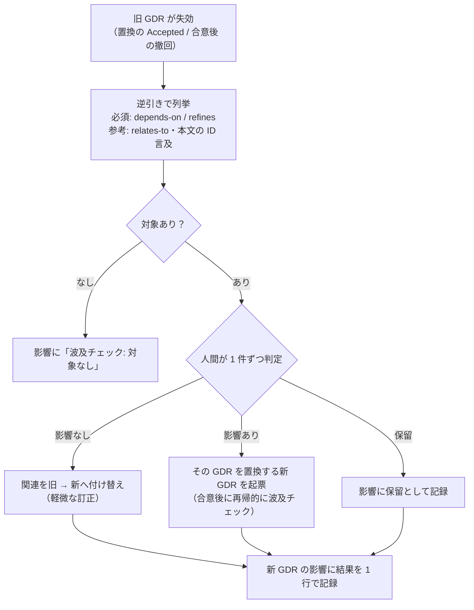

# 013. GDR 置換時の波及チェック提案

## 目次

**GDR 一覧:**

| GDR ID | 決定の要約 | status |
|---|---|---|
| GDR-META-038 | GDR が失効したとき（置換の `Accepted` / 合意後の撤回）、失効した GDR を `depends-on` / `refines` で前提にしている GDR を逆引きで列挙し、人間が 1 件ずつ判定する「波及チェック」を置換手順に加える。結果は新 GDR の「影響」に記録する | Proposed |

---

## 1. GDR（General Decision Record）

**GDR-META-038: GDR が失効したとき（置換の `Accepted` / 合意後の撤回）、失効した GDR を `depends-on` / `refines` で前提にしている GDR を逆引きで列挙し、人間が 1 件ずつ判定する「波及チェック」を置換手順に加える。結果は新 GDR の「影響」に記録する**

- **status:** Proposed
- **scope:** meta, pol
- **決定:**
  - **契機:** 有効だった GDR が失効した時点 — (a) 置換する新 GDR が合意されて `Accepted` になり、旧が `Superseded` になったとき、(b) `Accepted` / `Implemented` だった GDR が `Rejected`（合意後の撤回）になったとき。`Proposed → Rejected` は有効な GDR の前提になりえないため対象外
  - **列挙（逆引き）:** 失効した GDR（以下「旧」）を対象とする辺を逆にたどり、次を列挙する
    - **必須:** 任意フィールド「関連」で旧を `depends-on` / `refines` している GDR（status が `Proposed` / `Accepted` / `Implemented` のもの）
    - **参考:** `relates-to` で旧を指す GDR、および「関連」には書かれていないが本文（決定・理由・影響）で旧の ID に言及している GDR。後者は「関連」の記入漏れの候補として示す
    - `derived-from`（由来）は前提ではないため列挙しない。scope の一致は依存を意味しないため、列挙の基準にしない
  - **判定（人間）:** 列挙した各 GDR について、AI が「旧のどの前提に依存していたか」と「新（撤回なら撤回理由）の下でその前提が成り立つか」を示し、人間が次のいずれかに判定する
    - **影響なし** — 判断はそのまま成り立つ。「関連」の参照先を旧から新へ付け替える（`depends-on GDR-OLD` → `depends-on GDR-NEW`。軽微な訂正として直接編集してよい）。撤回の場合は付け替え先がないため参照を外し、判定を注記する
    - **影響あり** — 判断の本質が変わる。その GDR を置換する新 GDR を起票する（通常のサイクル。合意されればその GDR についても波及チェックを再帰的に行う）
    - **保留** — すぐに判定できない。再検討の対象として新 GDR の「影響」に残し、次の改善提案で扱う
  - **記録:** 判定結果は、失効を引き起こした GDR（置換なら新 GDR、撤回なら撤回された GDR）の「影響」に「波及チェック: GDR-A（影響なし・関連を付け替え）/ GDR-B（影響あり → GDR-C を起票）/ GDR-D（保留）」の形で 1 行に記録する。新しいフィールドは作らない
  - **AI がしないこと:** 列挙した GDR を AI が一括で書き換え・再生成しない。判定は人間が行い、置換は 1 件ずつ通常のサイクル（起票 → レビュー → 合意）を通す
  - **入れ先:**
    - 01 §3「置換と失効」の規則に、失効時の波及チェックを 1 項目追加
    - 02 §5.2「判断更新時の運用ルール」に手順を 1 項目追加、§6「参照の規律」の行に逆向きの確認を 1 文追加
    - 04 に `波及チェック` プロンプトを追加（§4.3）
    - 06 §5 に「波及チェックには GDR-ID 指定の近傍ビューを使える」旨を 1 行追加
    - user-level config: `~/.claude/commands/gdr-flow.md` フェーズ 4（合意）に手順を追加、`~/.claude/CLAUDE.md` §4 に 1 文追加
- **理由:** 現行の参照の規律（02 §6、GDR-META-028〜030）は、失効した GDR に当たったら後継を**前向きに**たどる方向だけを定めている。逆向き — 旧を前提にしていた後続の GDR を見直す手順 — はない（§2-1）。そのため旧が置換されても、旧を `depends-on` していた GDR は `Implemented` のまま残り、すでに成り立たない前提の上に有効な判断が立っている状態を検出できない。これは 02 §3.2 が ◎ とする「矛盾生成」の抑止の死角になる（§2-2）。逆引きに必要な情報（「関連」の型付きリンク、06 の関係ビュー、`/gdr-map` の近傍指定）はすでに揃っており、足りないのは「いつ・何を列挙し・誰が判定するか」の手順だけである（§2-3）。列挙の基準を scope ではなく依存の辺にするのは、同じ scope でも無関係な GDR を巻き込み、scope の違う依存先を取りこぼすため。判定を人間に残すのは、AI の一括再生成は合意を経ない GDR を大量に生み、理由の出所がすべて `ai` になるため（02 §6 出所の明示）
  - **代替案 A:** 旧と同じ scope を持つ後続の GDR を、AI が一括で再計算・再生成する（外部の対話で提案された案）→ scope は依存を表さず、巻き込みと取りこぼしが両方起きる。合意を経ない GDR を量産し、理由の出所の規則とも合わない。却下
  - **代替案 B:** 置換の起票時（新 GDR が `Proposed` の段階）に波及チェックを行う → 新が `Proposed` の間は旧が有効なままで（02 §5.2 失効の切替時点）、新が却下されれば波及チェックは無駄になる。ただし影響が大きいと見込まれるときに起票時に列挙だけ行い、合意の判断材料にするのは妨げない。主たる契機は失効時点とする。部分採用
  - **代替案 C:** 新しい任意フィールド（例: `被参照` や `branch_from`）を追加し、逆向きのリンクを各 GDR に書く → 逆向きのリンクは順向きの「関連」から機械的に導けるため、二重管理になり不整合の元になる。却下
  - **代替案 D:** 判定結果を記録する専用フィールド（例: `波及チェック`）を新設する → 結果は失効を引き起こした判断の「影響」そのものであり、既存の「影響」に書けば足りる。書式の追加は MAJOR / MINOR の判断も重くする。却下
  - **代替案 E:** 何もせず、`整合性チェック` プロンプト（04 §6）に任せる → 整合性チェックはリンク・採番・パスの機械的な整合を見るもので、判断の前提が成り立つかは見ない。契機も決まっていない。却下
- **影響:**
  - 01 §3 に 1 項目、02 §5.2 に 1 項目、02 §6 の 1 行に 1 文、04 に 1 プロンプト、06 §5 に 1 行を追加する。書式（6 フィールド・任意フィールド・status）は変更しない
  - user-level config（`gdr-flow.md` フェーズ 4、`CLAUDE.md` §4）を更新する（リポジトリ外配備）
  - 「関連」が書かれていない GDR は必須の列挙から漏れる。本文での ID 言及を参考として示すことで漏れを補い、記入漏れの是正を促す（任意フィールドを必須にはしない）
  - 置換の合意 1 回あたり、列挙と判定の手間が増える。依存が 0 件なら「波及チェック: 対象なし」の 1 行で済む
  - 版: 既存の GDR の書式・解釈は変わらず、手順と AI の振る舞いの追加のみ。**MINOR（v2.3）**。導入先の移行項目は必須なし。推奨: 導入済みの `Superseded` / 撤回済み GDR について、一度だけ遡って波及チェックを行う
- **再検討条件:**
  - 導入先 1 件で、置換 5 件連続して必須の列挙が 0 件かつ参考の列挙からも見直しが出ない → 「関連」の記入率が低いか、依存の少ない運用である。手順を合意時の任意確認に格下げするか、「関連」の記入を促す側を強化する
  - 判定の「保留」が解消されないまま 3 件以上たまる → 保留の扱い（期限や INDEX への掲示）を追加する
  - 再帰的な波及が 3 段以上続く事例が出る → 置換の粒度（GDR の分け方）か、依存の張り方を見直す
  - 「関連」の型の語彙が改廃される（GDR-META 経由）→ 列挙対象の型（必須 / 参考 / 対象外）の割り当てを見直す
- **日時:** 2026-11-12T13:45:47+09:00
- **関連:** derived-from §2-1, derived-from §2-2, refines GDR-META-029
- **理由の出所:** ai（起点はユーザーによるレビュー依頼「これを解釈してレビューして」と起票指示「改善提案：GDR 置換時の波及チェック」。外部の対話の提案「再検討条件に抵触したら遡って Superseded にし、後続を一括で再計算・再生成」をレビューする過程で、AI が逆向きの手順の欠落を指摘し、本手順を設計した）

---

## 2. 現状

1. **参照の規律は前向きだけ** — 02 §6 と `/gdr-flow` の「GDR 参照の規律」は、`Superseded by X` に当たったら X を末端の有効 GDR までたどるよう定める。逆に、失効した GDR を前提にしている後続の GDR を見直す手順は 01・02・04・06 のどこにもない（repo 内で「被参照」「逆向き」「波及」の規定は 0 件）
2. **成り立たない前提の上に有効な判断が残る** — 例: `GDR-UI-007`（`refines GDR-ARCH-002`）は、`GDR-ARCH-002` が `GDR-ARCH-009` に置換された後も `Implemented` のまま残る。AI は UI-007 を有効な根拠として参照してよく（参照の規律上は UI-007 自体は失効していない）、旧前提と新前提が混ざった判断が積み上がる。02 §3.2 の「矛盾生成」◎ の死角
3. **道具は揃っている** — 「関連」の型付きリンク（01 §3.1、GDR-META-025）、関係ビュー（06 §4）、`/gdr-map GDR-XXX-NNN` の近傍ビュー（06 §5）で逆向きの辺は取り出せる。欠けているのは契機・対象・判定者を定めた手順のみ

> 経緯: 外部の AI との対話（スリットスキャン / 「4 次元編集室」の比喩で GDR を拡張する案）をレビューした結果、提案のうち新規性があったのはこの 1 点だった。他の提案（`branch_from` / `cut_options` / scope スライス）は既存の「関連」・代替案の正式記法・`/gdr-map` と重複していた。

---

## 3. 改善案

置換・撤回で GDR が失効した時点に、逆引き → 人間の判定 → 「影響」への記録、の 3 段の波及チェックを加える。



| 入れ先 | 追加内容 |
|---|---|
| 01 §3（置換と失効の規則） | 失効時の波及チェックの義務（1 項目） |
| 02 §5.2 判断更新時の運用ルール | 手順（契機・列挙・判定・記録） |
| 02 §6 参照の規律 | 逆向きの確認を 1 文 |
| 04 | `波及チェック` プロンプト |
| 06 §5 | 近傍ビューを波及チェックに使える旨 |
| `~/.claude/commands/gdr-flow.md` フェーズ 4 | 合意時の手順 |
| `~/.claude/CLAUDE.md` §4 | 1 文 |

---

## 4. 詳細セクション

### 4.1. 01 §3 への追記の文案

置換と失効の規則（「撤回時の復帰」の直後）に追加:

```markdown
- **波及チェック:** 有効だった GDR が失効したとき（置換する新が `Accepted` になった時点、または `Accepted` / `Implemented` からの撤回時点）、失効した GDR を「関連」の `depends-on` / `refines` で前提にしている GDR を列挙し、それぞれの判断が成り立つかを確認する。手順は [02 §5.2](/01_GDR/02_AI_DRIVEN_GDR_BUILDUP.md#52-判断は積み上がるincremental-crystallization)
```

### 4.2. 02 への追記の文案

§5.2「判断更新時の運用ルール」（「却下の記録」の直後）に追加:

```markdown
- **波及チェック:** 旧が失効した時点（新の `Accepted`、または合意後の撤回）で、旧を前提にしている GDR を見直す
  - **列挙:** 「関連」で旧を `depends-on` / `refines` している GDR は必ず挙げる。`relates-to` と、本文で旧の ID に触れている GDR は参考として挙げる（後者は「関連」の記入漏れの候補）。scope の一致は基準にしない
  - **判定:** 人間が 1 件ずつ、影響なし（「関連」を旧から新へ付け替える。軽微な訂正）/ 影響あり（その GDR を置換する新 GDR を起票。合意後にその GDR についても同じ手順）/ 保留 のいずれかに判定する。AI は依存していた前提と、それが新の下で成り立つかを示すが、一括で書き換えない
  - **記録:** 結果を、失効を引き起こした GDR の「影響」に 1 行で残す（例: `波及チェック: GDR-UI-007（影響なし・関連を付け替え）/ GDR-ARCH-004（影響あり → GDR-ARCH-010 を起票）`。対象がなければ `波及チェック: 対象なし`）
```

§6「参照の規律」の行の末尾に追加:

```markdown
逆向きにも確認する: GDR が失効したら、それを前提にしている GDR を §5.2 の波及チェックで見直す
```

### 4.3. 04 への追記の文案

§6（定型操作のプロンプト。`整合性チェック` の直後）に追加:

```markdown
| `波及チェック [GDR-ID]` | 失効した GDR を `depends-on` / `refines` で前提にしている GDR を列挙させ、それぞれが依存していた前提と、後継の下で成り立つかを示させる（判定は人間。[02 §5.2](/01_GDR/02_AI_DRIVEN_GDR_BUILDUP.md#52-判断は積み上がるincremental-crystallization)） |
```

### 4.4. 06 §5 への追記の文案

生成手順の表の直後に追加:

```markdown
> 波及チェック（[02 §5.2](/01_GDR/02_AI_DRIVEN_GDR_BUILDUP.md#52-判断は積み上がるincremental-crystallization)）では、失効した GDR の ID を指定した近傍ビューで、それを指す `depends-on` / `refines` の辺を確認できる。
```

### 4.5. user-level config への追記の文案

`~/.claude/commands/gdr-flow.md` フェーズ 4（合意）の説明に追加:

```markdown
置換対象の旧を `Superseded` にした直後（または合意後の撤回の直後）に**波及チェック**を行う: 旧を「関連」の `depends-on` / `refines` で参照している GDR を列挙し（`relates-to` と本文の ID 言及は参考）、各 GDR が依存していた前提と成り立つかを示して AskUserQuestion で判定を求める（影響なし → 関連を付け替え / 影響あり → 新 GDR を起票 / 保留）。結果は新 GDR の「影響」に 1 行で記録。一括で書き換えない
```

`~/.claude/CLAUDE.md` §4「運用上の不可侵ルール」の置換の項目の末尾に追加:

```markdown
旧が失効したら、旧を `depends-on` / `refines` で前提にしている GDR を列挙して人間が判定する（波及チェック。上流 02 §5.2）
```

### 4.6. 例

`GDR-ARCH-002`（セッションをメモリ保持）を `GDR-ARCH-009`（Redis 保持）が置換し、ARCH-009 が `Accepted` になった場合:

| 列挙された GDR | 区分 | 依存していた前提 | 判定 |
|---|---|---|---|
| GDR-ARCH-004 キャッシュ戦略 | 必須（`depends-on`） | セッションと同じプロセス内メモリを共有 | 影響あり → GDR-ARCH-010 を起票 |
| GDR-UI-007 ログイン画面 | 必須（`refines`） | セッション切れ時の再ログイン導線 | 影響なし → 関連を `refines GDR-ARCH-009` へ付け替え |
| GDR-OPS-003 再起動手順 | 参考（本文で ARCH-002 に言及） | 再起動でセッションが消える前提 | 保留（関連の記入漏れでもある） |
| GDR-UI-005 一覧画面 | — | （scope は同じだが依存なし） | 列挙しない |

ARCH-009 の「影響」に記録する行:

```markdown
- 波及チェック: GDR-ARCH-004（影響あり → GDR-ARCH-010 を起票）/ GDR-UI-007（影響なし・関連を付け替え）/ GDR-OPS-003（保留・関連の記入漏れ）
```

---

## 5. 検討課題

1. **参考の列挙（本文の ID 言及）を含めるか**
   - 含めると漏れは減るが、単なる言及（経緯の記述など）も拾うため判定の手間が増える
   - 解決策（案）: 含める。ただし「参考」として区別し、判定は「関連の記入漏れか否か」だけでもよいとする
2. **保留の置き場所**
   - 新 GDR の「影響」に書くだけでは、後から見つけにくい
   - 解決策（案）: 今回は「影響」のみ。再検討条件 2 項目目（保留が 3 件以上たまる）で INDEX への掲示を検討する
3. **既存の導入先での遡り適用**
   - 導入済みの `Superseded` について過去に遡って波及チェックをするか
   - 解決策（案）: 必須の移行項目にはせず、CHANGELOG の推奨項目とする（版は MINOR のまま）
4. **本提案の対象外（同じレビューから出た別の候補）**
   - 06 に時間軸ビュー（`日時` で scope 別に並べる）を追加する案、04 に「取り返しのつかない判断で複数案の影響を先読みさせる」レシピを追加する案は、本提案に含めない。需要が出たら別の改善提案とする

---

## 6. 実行計画

### 6.1. タスク一覧

| # | タスク | 根拠 GDR | 依存 | ステータス |
|---|---|---|---|---|
| 0.1 | 本提案のレビュー → 反映 → 合意 | GDR-META-038 | — | 未着手 |
| 1.1 | 01 §3 への追記（§4.1） | GDR-META-038 | 0.1 | 未着手 |
| 1.2 | 02 §5.2 / §6 への追記（§4.2） | GDR-META-038 | 1.1 | 未着手 |
| 1.3 | 04 / 06 への追記（§4.3 / §4.4） | GDR-META-038 | 1.2 | 未着手 |
| 1.4 | user-level config の更新（§4.5）— リポジトリ外配備 | GDR-META-038 | 1.2 | 未着手 |
| 2.1 | 版の判定と CHANGELOG（MINOR v2.3） | GDR-META-038 | 1.1〜1.4 | 未着手 |

### 6.2. フェーズ詳細

#### フェーズ 0: 合意・準備

**目的:** 文書 → レビュー → 合意の順序を守る。

- [ ] 0.1 本提案のレビューと合意

#### フェーズ 1: 手順の組み込み

**目的:** 置換・撤回の合意時に、前提にしていた GDR の見直しが手順として行われる。

- [ ] 1.1 01 GDR 仕様
- [ ] 1.2 02 AI-Driven GDR ビルドアップ
- [ ] 1.3 04 プロンプトガイド / 06 可視化ガイド
- [ ] 1.4 user-level config

#### フェーズ 2: 発行

- [ ] 2.1 版の判定と CHANGELOG（v2.3 / MINOR）

### 6.3. 進捗サマリー

| フェーズ | タスク数 | 完了 | 残 | コミット |
|---|---|---|---|---|
| 0 | 1 | 0 | 1 | — |
| 1 | 4 | 0 | 4 | — |
| 2 | 1 | 0 | 1 | — |
