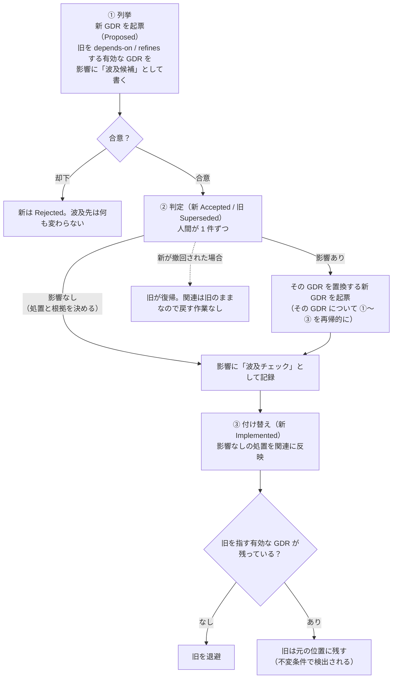

# 013. GDR 置換時の波及チェック提案

## 目次

**GDR 一覧:**

| GDR ID | 決定の要約 | status |
|---|---|---|
| GDR-META-038 | GDR を置換・撤回するとき、失効する GDR を `depends-on` / `refines` で前提にしている GDR を「起票時に列挙 → 合意時に判定 → 実装完了時に付け替え」の 3 段で見直す（波及チェック）。有効な GDR が退避済みの失効 GDR を指したままにならないことを不変条件とし、未解決の依存はこの条件で検出する | Proposed |

---

## 1. GDR（General Decision Record）

**GDR-META-038: GDR を置換・撤回するとき、失効する GDR を `depends-on` / `refines` で前提にしている GDR を「起票時に列挙 → 合意時に判定 → 実装完了時に付け替え」の 3 段で見直す（波及チェック）。有効な GDR が退避済みの失効 GDR を指したままにならないことを不変条件とし、未解決の依存はこの条件で検出する**

- **status:** Proposed
- **scope:** meta, pol
- **決定:**
  - **対象:** 有効な GDR を失効させる 2 つの操作 — (a) 新 GDR による置換（旧が `Superseded` になる）、(b) 合意後の撤回（`Accepted → Rejected`）。`Implemented` の判断をやめる場合は否定形の決定を持つ新 GDR で置換するので (a) に含まれる（01 §3。レビュー A-2）。`Proposed → Rejected` は有効な判断を失効させないため対象外
  - **波及先:** 失効する GDR（以下「旧」）を、任意フィールド「関連」で `depends-on` / `refines` している有効な GDR（`Proposed` / `Accepted` / `Implemented`）。「関連」には書かれていないが、GDR レコード（6 フィールドのブロック）の本文で旧の ID に言及している GDR は、「関連」の記入漏れの候補として示す。`relates-to`（依存しないと宣言した関連）・`derived-from`（由来）・scope の一致は基準にしない（レビュー D-1 / B-2）
  - **3 段の手順**（既存のライフサイクル — 失効は新の `Accepted`、退避は新の `Implemented` — に合わせる。レビュー A-1）:

    | 段階 | 時点 | 行うこと |
    |---|---|---|
    | ① 列挙 | 置換する新 GDR の起票〜レビュー時（`Proposed`）。撤回は撤回を諮る時点 | 波及先を列挙し、各 GDR が旧のどの前提に依存しているかを添えて、新 GDR の「影響」に「波及候補」として書く。合意の判断材料にする |
    | ② 判定 | 合意時（新が `Accepted`、旧が `Superseded`）。撤回は `Rejected` の確定時 | 人間が 1 件ずつ判定する。**影響なし** — 処置（付け替える / 外す / `relates-to` に弱める）と根拠を一言決める（レビュー A-4）。**影響あり** — その GDR を置換する新 GDR を起票する（以後その GDR について同じ 3 段を行う）。結果を「影響」に「波及チェック」として記録する |
    | ③ 付け替え | 新が `Implemented` になった時点（旧を退避する前）。撤回は旧の退避前 | 「影響なし」の処置を「関連」に反映する。付け替えはリンクの訂正であり、軽微な訂正として直接編集してよい。理由は変わらないので「理由の出所」は変えない（レビュー B-3） |

  - **不変条件:** 有効な GDR の「関連」は、退避済みの失効 GDR を `depends-on` / `refines` で指さない。言い換えると、**旧を `depends-on` / `refines` で指す有効な GDR が残っている間は、旧を退避しない**。判定の済まない GDR や、置換の新 GDR がまだ合意されていない「影響あり」の GDR は「関連」が旧を指したまま残るので、未解決の依存は「失効 GDR を指す有効 GDR」として機械的に検出できる。「保留」という判定や置き場所は設けない（レビュー A-3 / D-2）
  - **撤回との整合:** 置換する新が合意後に撤回されて旧が復帰した場合（01 §3 撤回時の復帰）、付け替えは ③ まで行われていないので、波及先の「関連」は旧を指したままで戻す作業は要らない。②で「影響あり」として起票済みの置換 GDR は、前提が戻ったことを示して見直す
  - **AI がしないこと:** 波及先を AI が一括で書き換え・再生成しない。判定は人間が行い、置換は 1 件ずつ通常のサイクル（起票 → レビュー → 合意）を通す
  - **補足:** 旧が複数の新に分割して置換される場合、付け替え先は人間が選ぶ（レビュー B-1）。記録が長くなる場合は「影響」配下のサブ箇条書きにしてよい（レビュー B-4）。波及先が 0 件でも「波及チェック: 対象なし」と書く（確認したことと、忘れたことを区別する）
  - **版:** 既存の GDR の書式・解釈を変えないため、v2.1 の環境依存パスの規則と同様に**解釈版によらず適用**する。v1.x（`Accepted` がない）では、②を「新 GDR の発行時（旧を `Superseded` にする時点）」と読み替える（レビュー A-6）
  - **入れ先:** 01 §3 / 02 §5.2・§6 / 04 §5 / 05 / user-level config（`gdr-flow.md` / `gdr-docs.md` / `CLAUDE.md`）。文案は §4
- **理由:** 現行の参照の規律（02 §6、GDR-META-029）は、失効した GDR に当たったら後継を**前向きに**たどる方向だけを定めている。逆向き — 旧を前提にしていた後続の GDR を見直す手順 — はない（§2-1）。そのため旧が置換されても、旧を `depends-on` していた GDR は `Implemented` のまま残り、すでに成り立たない前提の上に有効な判断が立っている状態を検出できない。これは 02 §3.2 が ◎ とする「矛盾生成」の抑止の死角になる（§2-2）。逆引きに必要な情報（「関連」の型付きリンク、06 の関係ビュー、`/gdr-map` の近傍指定）はすでに揃っており、足りないのは「いつ・何を列挙し・誰が判定するか」の手順だけである（§2-3）。手順を 3 段に分けるのは、既存の置換が「失効（新の `Accepted`）」と「退避（新の `Implemented`）」の 2 時点を持ち、その間は実装がまだ旧に従い、撤回で旧が復帰しうるため — 列挙を起票時に置けば合意が影響の件数を知ったうえで行われ、付け替えを `Implemented` 時に置けば撤回時に戻す作業が生じない。未解決を不変条件で表すのは、専用の状態や置き場所を作らずに、手順を通らなかった置換（status の手書き変更など）や導入済みの古い置換も後から同じ方法で検出できるため。列挙の基準を scope ではなく依存の辺にするのは、同じ scope でも無関係な GDR を巻き込み、scope の違う依存先を取りこぼすため。判定を人間に残すのは、AI の一括再生成は合意を経ない GDR を大量に生み、理由の出所がすべて `ai` になるため（02 §6 出所の明示）
  - **代替案 A:** 旧と同じ scope を持つ後続の GDR を、AI が一括で再計算・再生成する（外部の対話で提案された案）→ scope は依存を表さず、巻き込みと取りこぼしが両方起きる。合意を経ない GDR を量産し、理由の出所の規則とも合わない。却下
  - **代替案 B:** 合意時（新の `Accepted`）に列挙・判定・付け替え・記録をまとめて行う（起票時の案）→ 合意の時点で人間は波及の件数を知らない。実装がまだ旧に従っている間に後続の参照先を新へ移してしまい、新が撤回されると付け替えを戻す手順が要る。レビュー（A-1）で 3 段に分割。却下
  - **代替案 C:** 新しい任意フィールド（例: `被参照` や `branch_from`）を追加し、逆向きのリンクを各 GDR に書く → 逆向きのリンクは順向きの「関連」から機械的に導けるため、二重管理になり不整合の元になる。却下
  - **代替案 D:** 判定結果を記録する専用フィールド（例: `波及チェック`）を新設する → 結果は失効を引き起こした判断の「影響」そのものであり、既存の「影響」に書けば足りる。却下
  - **代替案 E:** 判定に「保留」を設け、新 GDR の「影響」に記録する（起票時の案）→ 撤回の場合は記録先が確定時点で退避されて読まれなくなり、置換の場合も「影響」の 1 行に埋もれて拾う経路がない。「関連」が旧を指したままであることを未解決の印にすれば、状態を増やさずに検出できる。レビュー（A-3）で不変条件に置き換え。却下
  - **代替案 F:** 何もせず、`整合性チェック` プロンプト（04 §5）に任せる → 整合性チェックはリンク・採番・パスの機械的な整合を見るもので、判断の前提が成り立つかは見ない。契機も決まっていない。却下（ただし不変条件の違反は整合性チェックでも検出できる）
- **影響:**
  - 01 §3 に 1 項目、02 §5.2 に 1 項目、02 §6 の 1 行に 1 文、04 §5 に 1 プロンプトを追加する。05 の user-level config の記述を同期する。書式（6 フィールド・任意フィールド・status 値・遷移）は変更しない
  - user-level config（`gdr-flow.md` フェーズ 1・4・7、`gdr-docs.md`、`CLAUDE.md` §4）を更新する（リポジトリ外配備）
  - 旧の退避が、波及先の解決を待つ分だけ遅れることがある。旧は元の位置に `Superseded` のまま残り、参照の規律で後継へたどられるので、判断の誤用にはならない
  - 「関連」が書かれていない GDR は列挙から漏れる。GDR レコード内の ID 言及を候補として示すことで漏れを補い、記入漏れの是正を促す（任意フィールドを必須にはしない）
  - 置換 1 回あたり、列挙と判定の手間が増える。依存が 0 件なら「波及チェック: 対象なし」の 1 行で済む
  - 版: MINOR（v2.3）。導入先の移行項目は必須なし。推奨: 導入済みの GDR について、不変条件の違反（退避済みの失効 GDR を `depends-on` / `refines` で指す有効な GDR）を一度確認する
- **再検討条件:**
  - 導入先 1 件で、置換 5 件連続して波及先が 0 件 → 「関連」の記入率が低いか、依存の少ない運用である。GDR レコード内の ID 言及を候補から必須に上げるか、「関連」の記入を促す側を強化する（レビュー C-2）
  - 不変条件のために退避を待つ旧 GDR が、3 件以上・1 か月以上残る → 判定の滞留を INDEX に掲示するなどの対処を加える
  - 再帰的な波及が 3 段以上続く事例が出る → 置換の粒度（GDR の分け方）か、依存の張り方を見直す
  - 「関連」の型の語彙が改廃される（GDR-META 経由）→ 波及先の型（`depends-on` / `refines`）の割り当てを見直す
- **日時:** 2026-11-12T13:45:47+09:00
- **関連:** derived-from §2-1, derived-from §2-2, depends-on GDR-META-025, depends-on GDR-META-028, relates-to GDR-META-029
- **理由の出所:** ai（起点はユーザーによるレビュー依頼「これを解釈してレビューして」と起票指示「改善提案：GDR 置換時の波及チェック」。外部の対話の提案「再検討条件に抵触したら遡って Superseded にし、後続を一括で再計算・再生成」をレビューする過程で、AI が逆向きの手順の欠落を指摘し、本手順を設計した。セルフレビュー（Fable）の指摘 A-1〜A-7 を反映済み。合意時に `ai-reviewed` へ更新する）

---

## 2. 現状

1. **参照の規律は前向きだけ** — 02 §6 と `/gdr-flow` の「GDR 参照の規律」は、`Superseded by X` に当たったら X を末端の有効 GDR までたどるよう定める。逆に、失効した GDR を前提にしている後続の GDR を見直す手順は 01・02・04・06 のどこにもない（repo 内で「被参照」「逆向き」「波及」の規定は 0 件）
2. **成り立たない前提の上に有効な判断が残る** — 例: `GDR-ARCH-004`（`depends-on GDR-ARCH-002`）は、`GDR-ARCH-002` が `GDR-ARCH-009` に置換された後も `Implemented` のまま残る。AI は ARCH-004 を有効な根拠として参照してよく（参照の規律上は ARCH-004 自体は失効していない）、旧前提と新前提が混ざった判断が積み上がる。02 §3.2 の「矛盾生成」◎ の死角
3. **道具は揃っている** — 「関連」の型付きリンク（01 §3.1、GDR-META-025）、関係ビュー（06 §4）、`/gdr-map GDR-XXX-NNN` の近傍ビュー（06 §5）で逆向きの辺は取り出せる。欠けているのは契機・対象・判定者を定めた手順のみ
4. **置換は 2 時点で進む** — 旧の失効は新の `Accepted` 時点、旧の退避は新の `Implemented` 時点で、その間は実装がまだ旧に従い、新が撤回されれば旧が復帰する（01 §3 / 02 §5.2）。波及の見直しも、この 2 時点に合わせる必要がある

> 経緯: 外部の AI との対話（スリットスキャン / 「4 次元編集室」の比喩で GDR を拡張する案）をレビューした結果、提案のうち新規性があったのはこの 1 点だった。他の提案（`branch_from` / `cut_options` / scope スライス）は既存の「関連」・代替案の正式記法・`/gdr-map` と重複していた。

---

## 3. 改善案

置換・撤回の既存の段階に合わせて、列挙 → 判定 → 付け替え の 3 段を加え、未解決は不変条件で検出する。



| 入れ先 | 追加内容 |
|---|---|
| 01 §3「置換（supersede）の記法と切替時点」 | 波及チェックと不変条件（1 項目） |
| 02 §5.2 判断更新時の運用ルール | 3 段の手順 |
| 02 §6 参照の規律 | 逆向きの確認を 1 文 |
| 04 §5 ふりかえり・検証 | `波及チェック` プロンプト |
| 05 Claude Code セットアップ | user-level config の記述の同期（`gdr-flow.md` / `gdr-docs.md` / 不可侵ルール） |
| `~/.claude/commands/gdr-flow.md` | フェーズ 1（列挙）・4（判定）・7（付け替え・退避の条件） |
| `~/.claude/commands/gdr-docs.md` | 完了処理での付け替え・退避の条件 |
| `~/.claude/CLAUDE.md` | §4 に 1 文、§6 の現行版を v2.3 に |

---

## 4. 詳細セクション

### 4.1. 01 §3 への追記の文案

「置換（supersede）の記法と切替時点」の箇条書き（「撤回時の復帰」の直後）に追加:

```markdown
- **波及チェック:** 置換・合意後の撤回で失効する GDR を「関連」の `depends-on` / `refines` で前提にしている有効な GDR は、置換の起票時に列挙し、合意時に人間が判定し、新が `Implemented` になった時点で「関連」を付け替える。旧を `depends-on` / `refines` で指す有効な GDR が残っている間は、旧を退避しない。手順は [02 §5.2](/01_GDR/02_AI_DRIVEN_GDR_BUILDUP.md#52-判断は積み上がるincremental-crystallization)
```

### 4.2. 02 への追記の文案

§5.2「判断更新時の運用ルール」（「却下の記録」の直後）に追加:

```markdown
- **波及チェック:** 置換（または合意後の撤回）で失効する GDR（旧）を、「関連」の `depends-on` / `refines` で前提にしている有効な GDR（波及先）を見直す。scope の一致・`relates-to`・`derived-from` は基準にしない
  - **① 列挙（新の起票〜レビュー時）:** 波及先と、それぞれが旧のどの前提に依存しているかを、新 GDR の「影響」に「波及候補」として書く。「関連」に書かれていないが GDR レコード内で旧の ID に触れている GDR は、記入漏れの候補として添える
  - **② 判定（合意時）:** 人間が 1 件ずつ判定する。影響なし — 処置（付け替える / 外す / `relates-to` に弱める）と根拠を決める。影響あり — その GDR を置換する新 GDR を起票する（その GDR についても同じ手順）。結果を「影響」に記録する（例: `波及チェック: GDR-ARCH-004（影響あり → GDR-ARCH-010 を起票）/ GDR-UI-007（影響なし・再ログイン導線は保持方式によらない → 関連を外す）`。0 件なら `波及チェック: 対象なし`）
  - **③ 付け替え（新の `Implemented` 時、旧の退避前）:** 影響なしの処置を「関連」に反映する（軽微な訂正。理由の出所は変えない）
  - **不変条件:** 旧を `depends-on` / `refines` で指す有効な GDR が残っている間は、旧を退避しない。未解決の依存は「失効 GDR を指す有効な GDR」として検出できる
  - 新が撤回されて旧が復帰した場合、「関連」は旧を指したままなので戻す作業は要らない。②で起票した置換 GDR は前提が戻ったことを示して見直す
```

§6「参照の規律」の行の末尾に追加:

```markdown
逆向きにも確認する: 置換・撤回するときは、失効する GDR を前提にしている GDR を §5.2 の波及チェックで見直す
```

### 4.3. 04 §5 への追記の文案

「ふりかえり・検証」の表（`整合性チェック` の直後）に追加:

```markdown
| `波及チェック [GDR-ID]` | 置換・撤回する GDR を `depends-on` / `refines` で前提にしている有効な GDR を列挙させ、それぞれが依存していた前提と、後継の下で成り立つかを示させる（判定は人間。[02 §5.2](/01_GDR/02_AI_DRIVEN_GDR_BUILDUP.md#52-判断は積み上がるincremental-crystallization)）。引数なしなら、失効 GDR を指したままの有効な GDR を列挙させる |
```

### 4.4. 05 への同期の文案

§（不可侵ルールの一覧、line 33 相当）の置換の項目に「旧を前提にする GDR の波及チェック（起票時に列挙・合意時に判定・`Implemented` 時に付け替え、指す有効 GDR が残る間は旧を退避しない）」を追記する。`gdr-flow.md` の表の行に「フェーズ 1 で波及候補を列挙、4 で判定、7 で付け替え・退避の条件」を、`gdr-docs.md` の行に「付け替えと退避の条件」を追記する。

### 4.5. user-level config への追記の文案

`~/.claude/commands/gdr-flow.md`:

- フェーズ 1（起票）: 置換する GDR を起票するときは、旧を `depends-on` / `refines` で指す有効な GDR を列挙し、「影響」に「波及候補」として書く
- フェーズ 4（合意）: 旧を `Superseded` にした直後（または撤回の確定時）に、波及候補を 1 件ずつ AskUserQuestion で判定してもらう（影響なし → 処置と根拠 / 影響あり → 置換 GDR を起票）。結果を新 GDR の「影響」に記録する。一括で書き換えない
- フェーズ 7（完了処理）: 旧を退避する前に、影響なしの処置を「関連」に反映する。旧を `depends-on` / `refines` で指す有効な GDR が残っていれば、旧は退避せず報告する

`~/.claude/commands/gdr-docs.md`: フェーズ 7 と同じ付け替え・退避の条件を追加する。

`~/.claude/CLAUDE.md` §4「運用上の不可侵ルール」の置換の項目の末尾に追加:

```markdown
旧を `depends-on` / `refines` で前提にしている有効な GDR は、起票時に列挙・合意時に判定・新の `Implemented` 時に付け替え、指す有効 GDR が残る間は旧を退避しない（波及チェック。上流 02 §5.2）
```

あわせて §6 の「GDR 仕様の現行版」を v2.3 にする。

### 4.6. 例

`GDR-ARCH-002`（セッションをメモリ保持）を `GDR-ARCH-009`（Redis 保持）で置換する場合:

**① 起票時（ARCH-009 が `Proposed`）— 影響に書く行:**

```markdown
- 波及候補: GDR-ARCH-004（キャッシュをセッションと同じプロセス内メモリで共有する前提）/ GDR-UI-007（セッション切れ時に再ログインへ誘導する前提）/ GDR-OPS-003（関連なし・本文で ARCH-002 に言及 — 記入漏れの候補）
```

**② 合意時（ARCH-009 が `Accepted`、ARCH-002 が `Superseded`）— 判定:**

| 波及先 | 依存していた前提 | 判定 | 処置と根拠 |
|---|---|---|---|
| GDR-ARCH-004 キャッシュ戦略 | セッションと同じプロセス内メモリを共有 | 影響あり | GDR-ARCH-010 を起票（キャッシュも Redis へ） |
| GDR-UI-007 ログイン画面 | セッション切れ時の再ログイン導線 | 影響なし | 関連を外す — 導線は保持方式によらない |
| GDR-OPS-003 再起動手順 | 再起動でセッションが消える | 影響あり | GDR-OPS-004 を起票（記入漏れも是正） |

影響に書く行:

```markdown
- 波及チェック: GDR-ARCH-004（影響あり → GDR-ARCH-010 を起票）/ GDR-UI-007（影響なし・再ログイン導線は保持方式によらない → 関連を外す）/ GDR-OPS-003（影響あり → GDR-OPS-004 を起票。関連の記入漏れを是正）
```

**③ ARCH-009 が `Implemented` になった時点:** UI-007 の「関連」から `refines GDR-ARCH-002` を外す。ARCH-004 は ARCH-010 が `Accepted` になるまで ARCH-002 を指したままなので、それまで ARCH-002 は退避しない。

---

## 5. 検討課題

1. **本文の ID 言及を候補に含めるか**
   - → **確定:** 含める。ただし GDR レコード（6 フィールドのブロック）の中に限る。仕様書・ガイドは経緯として GDR ID を多数引いており、文書全体を探すと雑音が多い（レビュー B-2）
2. **保留の置き場所**
   - → **確定:** 「保留」は設けない。未判定・未解決は「関連」が旧を指したままであることで表し、不変条件で検出する（レビュー A-3 / D-2）
3. **既存の導入先での遡り適用**
   - → **確定:** 必須にしない。CHANGELOG の推奨項目として、不変条件の違反を一度確認する（`波及チェック` を引数なしで実行）
4. **T2 テンプレートの「影響」に記入例を足すか**
   - → **確定:** 足さない。手順は 02 §5.2 に例を載せれば足り、テンプレートの変更は導入先の取り直しを増やす（レビュー B-6）
5. **06 可視化ガイドへの追記**
   - → **確定:** 追記しない。`/gdr-map GDR-ID` の近傍ビューはすでに逆向きの辺を含む（レビュー D-3）
6. **本提案の対象外（同じレビューから出た別の候補）**
   - 06 に時間軸ビュー（`日時` で scope 別に並べる）を追加する案、04 に「取り返しのつかない判断で複数案の影響を先読みさせる」レシピを追加する案は、本提案に含めない。需要が出たら別の改善提案とする

---

## 6. 実行計画

### 6.1. タスク一覧

| # | タスク | 根拠 GDR | 依存 | ステータス |
|---|---|---|---|---|
| 0.1 | 本提案のレビュー → 反映 → 合意 | GDR-META-038 | — | 反映済み・合意待ち |
| 1.1 | 01 §3 への追記（§4.1） | GDR-META-038 | 0.1 | 未着手 |
| 1.2 | 02 §5.2 / §6 への追記（§4.2） | GDR-META-038 | 1.1 | 未着手 |
| 1.3 | 04 §5 への追記（§4.3） | GDR-META-038 | 1.2 | 未着手 |
| 1.4 | 05 の同期（§4.4） | GDR-META-038 | 1.5 | 未着手 |
| 1.5 | user-level config の更新（§4.5）— リポジトリ外配備 | GDR-META-038 | 1.2 | 未着手 |
| 2.1 | 導入先 1 件で実際の置換に適用して確認（列挙の件数・判定の往復を記録） | GDR-META-038 | 1.1〜1.5 | 未着手 |
| 2.2 | 版の判定と CHANGELOG（MINOR v2.3） | GDR-META-038 | 2.1 | 未着手 |

### 6.2. フェーズ詳細

#### フェーズ 0: 合意・準備

**目的:** 文書 → レビュー → 合意の順序を守る。

- [x] 0.1a セルフレビュー（Fable）→ 反映（A-1〜A-7、D-1〜D-3、B、C-2）
- [ ] 0.1b 合意

#### フェーズ 1: 手順の組み込み

**目的:** 置換・撤回の各段階で、前提にしていた GDR の見直しが手順として行われる。

- [ ] 1.1 01 GDR 仕様
- [ ] 1.2 02 AI-Driven GDR ビルドアップ
- [ ] 1.3 04 プロンプトガイド
- [ ] 1.4 05 Claude Code セットアップ
- [ ] 1.5 user-level config

#### フェーズ 2: 試行と発行

**目的:** 上流には実際の置換の履歴がない（kaizen 配下 43 レコード中、`Superseded` は説明用サンプルの 1 件、「関連」の記入は 16 件）ため、発行前に導入先で手順を確かめる（レビュー C-1）。

- [ ] 2.1 導入先での試行（置換 1 件あたりの列挙数・判定の往復を記録し、02 §3.3 の過剰な形式化になっていないかを見る — レビュー C-3）
- [ ] 2.2 版の判定と CHANGELOG（v2.3 / MINOR）

### 6.3. 進捗サマリー

| フェーズ | タスク数 | 完了 | 残 | コミット |
|---|---|---|---|---|
| 0 | 1 | 0 | 1 | d63829a / 1659d73 / 本コミット |
| 1 | 5 | 0 | 5 | — |
| 2 | 2 | 0 | 2 | — |
