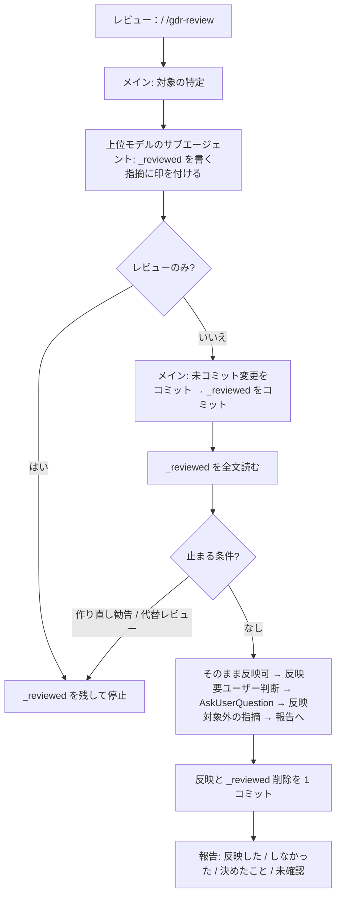

# 014. レビューの上位モデル委任と反映のワンセット化提案

## 目次

**GDR 一覧:**

| GDR ID | 決定の要約 | status |
|---|---|---|
| GDR-META-039 | `レビュー：` / `/gdr-review` は、レビュー本体を上位モデルのレビュー用サブエージェントに委ね、続けて確認を挟まずレビュー反映まで行う（ワンセット）。人が `_reviewed` を読んでから反映を指示する確認を外す代わりに、反映の記録と取り消し（コミットの分割）・止まる条件・指摘の印（そのまま反映可 / 要ユーザー判断）を反映の規則に加える | Proposed |

---

## 1. GDR（General Decision Record）

**GDR-META-039: `レビュー：` / `/gdr-review` は、レビュー本体を上位モデルのレビュー用サブエージェントに委ね、続けて確認を挟まずレビュー反映まで行う（ワンセット）。人が `_reviewed` を読んでから反映を指示する確認を外す代わりに、反映の記録と取り消し（コミットの分割）・止まる条件・指摘の印（そのまま反映可 / 要ユーザー判断）を反映の規則に加える**

- **status:** Proposed
- **scope:** meta, pol
- **決定:**
  - **委任:** `レビュー：` / `/gdr-review` では、対象の特定（引数あり / なしの 2 モード）はメインセッションが行い、レビュー本体（`_reviewed` の執筆）は**上位モデルのレビュー用サブエージェント**に委ねる。メインセッションのモデルが何であっても委ね、自分ではレビューを書かない（書いた本人の文脈から独立した目で見るため）。サブエージェントが使えないときは、その旨を伝えて自分でレビューし、反映には進まず止める
    - **モデルの指定は 1 か所:** レビュアーのモデルと推論の強さはサブエージェント定義（Claude Code では `~/.claude/agents/gdr-reviewer.md` の frontmatter `model:` / `effort:`）だけで決める。コマンドや `CLAUDE.md` にモデル名を書かない。プロジェクトで変えるときは、そのプロジェクトの `.claude/agents/` に同名の定義を置く
    - 上流の文書には特定の製品名・モデル名を書かず、「上位モデル」「レビュアーのモデル」と書く
  - **ワンセット:** レビューが戻ったら、確認を挟まずにレビュー反映（`レビュー反映：` / `/gdr-apply-review` と同じ規則）へ進む。`レビュー：` の実行を反映の明示指示とみなす。止めたいときは「レビューのみ」と指定する（`/gdr-review <ファイル> レビューのみ`）。`レビュー反映：` 単体は、止めた分・別セッションのレビュー・中断した反映のために残す
  - **反映の規則（正本は `gdr-apply-review` の「共通の振る舞い」。ワンセットでも単体でも同じ）:**

    | 項目 | 内容 |
    |---|---|
    | 記録と取り消し | git 管理下: ① 本体の未コミット変更を先にコミット → ② `_reviewed` をコミット → ③ 反映と `_reviewed` の削除を 1 コミット。レビューの全文が履歴に残り、反映だけを `git revert` で戻せる。git 管理外: 反映前に本体の写しを取り、反映が終わったら `_reviewed`・写しとも消す |
    | 読み直し | 反映前に `_reviewed` を全文読む。サブエージェントの返答（要点）だけで反映しない。`_reviewed` が書き出されていなければ止める |
    | 止まる条件 | 全体評価が作り直し・取り下げを勧める / 代替で自分がレビューした → 反映せず止める。確定済み GDR（`Accepted` 以降）の本文・`_reference/`・`_archive/`・委任時に渡していないファイル・コードへの指摘 → その指摘だけ反映せず報告（確定済み GDR は置換 GDR の起票候補として） |
    | 指摘の印 | レビュアーは A・D・E の各指摘に【そのまま反映可】／【要ユーザー判断】（選択肢と推奨つき）を付ける。前者は確認なしで反映（事実誤認と判断したものは反映せず理由を報告）、後者は AskUserQuestion で聞いてから反映。決定事項・節をまるごと削る提案は後者 |
    | 合意との境界 | 反映時の質問への回答は本文を確定するためのもので、GDR の合意ではない。status と理由の出所は変えない。`一気通貫：` のフェーズ 4（合意）は回答済みの分岐を聞き直さず、合意を聞く前に「レビューで何が変わったか」を示す |
    | 報告 | 反映したもの / 反映しなかったもの（理由つき）/ 回答で決めたこと / 未確認の点 / コミット hash |

  - **`一気通貫：` のフェーズ判定:** フェーズ 2（レビュー）と 3（反映）は通常まとめて完了する。反映済みは「`_reviewed` を削除したコミットがある」、`_reviewed` が残っていれば「レビューのみで止めた／中断した」（フェーズ 3 から）で判定する
  - **プロジェクト側の定義との関係:** プロジェクトの `CLAUDE.md` にある `レビュー：` の定義（03 の初回プロンプト由来）は出力先と書式を定めるもので、委任とワンセットは user-level の定義に従う
  - **入れ先:** 02 §5.2 / 04 §6 / 05（配置ファイル・コマンド表・ロールバック）/ 00 / 03 の短縮キーワードの説明 / user-level config。文案は §4
- **理由:** これまでの `レビュー：` は、レビューを書いたのと同じセッション・同じモデルが自分の文書を見直し（§2-1）、人が `_reviewed` を読んでから `レビュー反映：` を指示する 2 段だった（§2-2）。上流の提案 09〜13 では、実際には毎回「別モデルでレビュー → ほぼ全件を反映」が繰り返され、人が反映前に判断したのは選択肢のある数件だけだった（§2-3）。レビューを独立した上位モデルに書かせれば、書いた本人の見落としを拾う力が上がり、レビューと反映の間の人の往復はその数件に絞れる。ただし外す確認は、(1) レビュアーの誤りを止める、(2) 判断が要る指摘を人に回す、(3) レビューの記録を残す、(4) フェーズの現在地を示す、の 4 つを兼ねていた（試行時のレビューの指摘）。そのため、確認を外すのと同時に、(1) は読み直し・止まる条件・事実誤認の除外、(2) は指摘の印、(3) と (4) はコミットの分割で代わりを用意する。モデルの指定を 1 か所に絞るのは、モデルの世代や価格が変わるたびに複数の文書を直さずに済ませ、プロジェクトごとの上書きを可能にするため
  - **代替案 A:** コマンドの frontmatter でそのターンだけ上位モデルに切り替える（従来の `/gdr-review` の形）→ 自然文の `レビュー：` はセッションのモデルのまま動き、経路で挙動が分かれる。レビューも書いた本人の文脈の中で行われ、独立しない。却下
  - **代替案 B:** 委任だけ行い、反映は従来どおり人の指示を待つ → 独立したレビューは得られるが、提案 09〜13 の実績では待ちの大半が「全件反映」の確認で、人の往復が減らない。判断の要る指摘は印と AskUserQuestion で拾えるので、待ちを全件にかける必要はない。却下（「レビューのみ」の指定で選べる形で残す）
  - **代替案 C:** 確認を外し、`_reviewed` もコミットせずに反映後すぐ消す（試行の初版）→ レビューの全文と反映の取り消し手段が失われ、`一気通貫：` が未レビューと反映済みを区別できない。試行時のレビューで指摘。却下
  - **代替案 D:** メインセッションがレビュアーと同じモデルなら委ねずに自分で書く → 費用は減るが、書いた本人の文脈から独立するという委任の目的を失い、挙動がモデルで分かれる。却下
- **影響:**
  - 02 §5.2 の流れ（改善提案 → レビュー → レビュー反映 → 再レビュー → 実装）に、レビューと反映が通常ワンセットで行われる旨と、人の確認が「印の付いた分岐」と「合意」に移る旨を足す。サイクルの段階・GDR の書式・status 値・遷移・理由の出所の規則は変えない
  - 04 §6・00・03 の `レビュー：` / `レビュー反映：` の説明を更新する。03 の初回プロンプトの例はそのままでよい（出力先と書式の定義として有効。委任とワンセットは user-level が担う）
  - 05: 配置ファイルに `~/.claude/agents/gdr-reviewer.md` を追加（10 ファイル + 任意 1）。`gdr-review.md` / `gdr-apply-review.md` の説明、コマンド表、「モード B の誤特定時のロールバック」（`/gdr-apply-review` は 1 コミットではなく最大 3 コミット。反映だけの取り消しは最後のコミットの `git revert`）を更新
  - user-level config: `CLAUDE.md`、`commands/gdr-review.md`、`commands/gdr-apply-review.md`、`commands/gdr-flow.md`、新規 `agents/gdr-reviewer.md`（手元では 2026-11-26 に先行して配備・試行済み。§4.4）
  - 費用: レビューのたびに上位モデルが 1 回走る。`一気通貫：` を回すたびに 1 回増える
  - Claude Code 以外のツールでは、サブエージェントやモデルの指定の仕組みが違う。仕様としては「レビューは独立した文脈・レビュアーのモデルで書く」「確認を外すなら記録・止まる条件・印をそろえる」を原則とし、Claude Code の具体は 05 に置く
  - 版: MINOR（v2.5）。必須の移行なし。推奨: user-level config の更新
- **再検討条件:**
  - 導入先で、自動反映した指摘を人が後から戻す（`git revert` や手直し）ことが 5 回のレビューのうち 2 回以上起きる → 【そのまま反映可】の基準を狭めるか、既定を「レビューのみ」に戻す
  - 【要ユーザー判断】が 1 回のレビューで平均 4 件を超える → 印の付け方が慎重すぎるか、起票の段階で詰めが足りない。レビュアーの基準か起票の手順を見直す
  - サブエージェントの仕組み（定義ファイル・frontmatter・プロジェクト定義の優先）が Claude Code 側で変わる → 05 と user-level config を見直す
  - レビュアーのモデルとメインのモデルの差が小さくなり、委任の費用に見合う指摘の差が出なくなる → 委任の既定を見直す
- **日時:** 2026-11-26T12:04:53+09:00
- **関連:** depends-on GDR-META-030, relates-to GDR-META-038
- **理由の出所:** ai（起点はユーザーの指示「レビューには上位モデルのサブエージェントに依頼をかけるように修正」「汎用性を高めたい」「依頼はレビューの反映までをワンセットにして」「使い終わったファイルは消すように」。メインが上位モデルでも委ねる・Fable のメインでも反映する・コミットを分ける、はユーザーが選択肢から選んだ。決定の構成と理由は AI が起案し、手元の試行で別モデルのレビュー 2 回を受けて直したもの。合意前）

---

## 2. 現状

1. **レビューは書いた本人が行う** — 04 §6 と 05 の `レビュー：` / `/gdr-review` は「対象をレビューし `_reviewed` を生成」とだけ定め、誰が書くかを決めていない。自然文の `レビュー：` はセッションのモデルで、起票した文脈のまま動く。手元の設定では `/gdr-review` だけが frontmatter で上位モデルに切り替わっていたが、自然文の経路とは挙動が分かれていた
2. **反映は人の指示を待つ 2 段** — 00・03・04・05 はいずれも `レビュー：` を「生成まで」、`レビュー反映：` を別の指示として定める。05「モード B の誤特定時のロールバック」は、`/gdr-apply-review` が `_reviewed.md` 削除を含めて 1 コミットで完結する前提で書かれている
3. **実績では待ちの大半が全件反映の確認だった** — 提案 09〜13 の各フェーズ 0 は「セルフレビュー（別モデル）→ 反映」で、人の関与は選択肢のある指摘への回答と合意に集中していた。`_reviewed.md` を 1 コミット → 反映と削除を 1 コミット、という分割は慣行としてあったが（例: 提案 13 の `1659d73` → `d90a264`）、仕様には書かれていない
4. **反映の規則が薄い** — `/gdr-apply-review` は「A / D / E は必ず反映」とし、確定済み GDR・`_reference/`・コードへの指摘や、判断の要る指摘の扱いを定めていない。人が `_reviewed.md` を読む前提で、この確認が実質の歯止めだった

> 経緯: 2026-11-26、user-level config（手元の `~/.claude/`）で先に委任とワンセットを実装し、別モデルのレビューを 2 回受けて直した（§4.4）。本提案はその結果を上流の仕様・ガイドに入れるためのもの。

---

## 3. 改善案

人の確認は「`_reviewed` 全体を読んで反映を指示する」から、「印の付いた分岐に答える」と「合意（`Proposed → Accepted`）」に移る。外した確認の役割は、コミットの分割（記録・取り消し・現在地）と止まる条件・印（誤りの歯止め・判断の振り分け）で代える。

---

## 4. 詳細セクション

### 4.1. 02 §5.2 への追記の文案

「改善提案 → レビュー → レビュー反映 → 再レビュー → 実装」の直後に:

> - **レビューと反映（推奨）:** レビューは、起票した文脈から独立した文脈で、レビュアーのモデル（上位モデル）に書かせる。ツールが対応していれば、レビューと反映を続けて行ってよい（ワンセット）。その場合、人の確認は「判断が要ると印の付いた指摘への回答」と「合意」に移る。代わりに、(1) `_reviewed` をコミットしてから反映し、反映を別コミットにする（記録と取り消し）、(2) 確定済み GDR・編集禁止の領域・コードへの指摘は反映せず報告に回す、(3) 反映時の回答は合意とみなさず、status と理由の出所を変えない（経緯: [014 提案](/91_demo_buildup_documents.md/kaizen/14_レビューの上位モデル委任と反映のワンセット化提案.md) GDR-META-039）

### 4.2. 04 §6・00・03 の説明の文案

- 04 §6 の表 `レビュー`: 「…同位置に `{ファイル名}_reviewed` としてレビュー文書を生成」の後に「レビューは独立した文脈・レビュアーのモデルで書く。対応するツールでは続けて反映まで行う（『レビューのみ』で止める）」
- 04 §6 の表 `レビュー反映`: 「…`_reviewed` を削除する」の後に「反映前に `_reviewed` をコミットし、反映と削除を別コミットにする。【要ユーザー判断】の指摘は聞いてから反映する」。04 L59 の簡易表も同旨に
- 00 L161〜162: 同旨を 1 句ずつ
- 03: 初回プロンプトの例は変えない（§1 影響）

### 4.3. 05 への同期の文案

- **配置するファイル:** 「10 ファイル + 任意 1 ファイル」とし、`~/.claude/agents/gdr-reviewer.md`（レビュー用サブエージェントの定義。レビュアーのモデル・推論の強さ・観点・出力構造・指摘の印をここだけで決める）を追加
- **`CLAUDE.md` の仕様:** モデルの役割分担に「レビューは `gdr-reviewer` に委ね、モデルは定義の frontmatter の 1 か所で決める」、短縮キーワードの `レビュー：` に「続けて反映まで行う（『レビューのみ』で止める）」を追加
- **コマンド表:** `gdr-review.md` を「対象を特定し、レビュー用サブエージェントでレビューし、続けてレビュー反映まで行う」、引数に `[レビューのみ]`。`gdr-apply-review.md` を「反映の規則の正本（ワンセットでも単体でも同じ）。反映前のコミット、止まる条件、指摘の印による振り分け、合意との境界」、引数に「本体と `_reviewed.md` の両方のパス」
- **モード B の誤特定時のロールバック:** 「`/gdr-apply-review` は、未コミット変更・`_reviewed.md`・反映の最大 3 コミットに分ける。反映だけを戻すときは最後のコミットを `git revert` する」に書き換え
- **`gdr-reviewer.md` 内容例:** frontmatter（`name` / `description` / `model` / `effort` / `tools`）と本文の骨子。`model:` の値は例として示し、特定のモデル名を推奨しない

### 4.4. user-level config（手元で先行配備・試行済み）

2026-11-26 に次の形で配備し、別モデルのレビューを 2 回受けて直した。

| ファイル | 内容 |
|---|---|
| `agents/gdr-reviewer.md`（新規） | レビュアーのモデル・effort（frontmatter）、対象を編集もコミットもしない、`_reviewed.md` の書き出しが成果物、GDR 文書でない対象では書式の観点を飛ばす、解釈版と【要ユーザー判断】の件数を返す、A・D・E に印、日本語で書く |
| `commands/gdr-review.md` | モデル名を持たない。委任のプロンプトの項目（絶対パス・出力先・前提）、`model` を指定しない、代替時は反映せず止める、`~/.claude/` 等が対象のときの出力先、既存 `_reviewed.md` の確認、引数末尾の `レビューのみ`、ワンセット |
| `commands/gdr-apply-review.md` | 反映の規則の正本（§1 の表）、両方のパスを渡す形、`~/.claude/review/` も探す |
| `commands/gdr-flow.md` | フェーズ 2〜3 の判定材料を削除コミットに、フェーズ 4 で回答済みの分岐を聞き直さない、進行ルールの「主体的に判断」より印を優先 |
| `CLAUDE.md` | モデル表を版なしに、委任・モデルの 1 か所指定・代替、Fable のメインでも反映は明示指示に含む、`レビュー：` の行に委任とワンセットとプロジェクト定義との関係 |

試行で分かったこと:

- 1 回目のレビュー（委任のみの版）: モデル表の版がエイリアスの解決先と食い違う、代替経路の中間段が成り立たない、観点の写しがずれる、の 5 件
- 2 回目のレビュー（ワンセット化の版）: 外した確認が 4 つの役割を兼ねていた、止まる条件・印・合意との境界・フェーズ判定が無い、の A 9 件。うち選択肢のある 2 件（Fable のメインでの反映、記録と取り消しの残し方）だけを聞き、残りは確認なしで反映した — ワンセットの流れそのものを試した形になった

### 4.5. 例

`/gdr-review notes/20_kaizen/2026-12-01_cache.md` を実行した場合:

1. メイン: 対象と出力先（同じ場所の `..._reviewed.md`）を決め、レビュー用サブエージェントを呼ぶ
2. サブエージェント: `_reviewed.md` を書く（A 4 件 — うち【要ユーザー判断】1 件）
3. メイン: 未コミットだった起票の修正をコミット → `_reviewed.md` をコミット（`docs(kaizen): add review of cache proposal`）
4. メイン: 全文を読む。A-3 は確定済みの GDR-ARCH-002 の本文への指摘 → 反映せず「置換 GDR の起票候補」として報告へ。A-2 は【要ユーザー判断】→ AskUserQuestion
5. メイン: 残りを反映し、`_reviewed.md` 削除と 1 コミット（`docs(kaizen): apply review of cache proposal`）
6. 報告: 反映 2 件・回答で決めた 1 件・反映しなかった 1 件（理由）・コミット hash。GDR は `Proposed` のまま（合意は別）

---

## 5. 検討課題

1. **人が `_reviewed` を読まなくなることの是非** — 02 §5.1「人間は判断の方向性と受容可否に集中する」とは整合する（受容可否は印と合意で残る）。一方、レビュー全文を読むことで人が得ていた気づきは減る。報告に「反映しなかったもの」を必ず含めることで補う。再検討条件 1 で観察する
2. **ツール依存の書き分け** — 仕様（02）には原則だけを書き、サブエージェント・frontmatter・`model` の指定は 05 に置く。Cursor / Copilot など委任の仕組みが無いツールでは、別セッション・別モデルでレビューする運用を推奨とする
3. **「セルフレビュー」という語** — 別モデル・別文脈のレビューになり、名前と中身がずれた（04 §6 の一気通貫のフェーズ名、`gdr-flow.md`）。語を変えると既存の導入先の `CLAUDE.md` との対応が崩れるため、本提案では変えない。変えるなら別の提案で
4. **git 管理外の対象** — 手元の `~/.claude/` のように git 管理外の対象では、反映が終わると戻す手段がない（写しは反映後に消す）。上流の導入先はリポジトリの中なので通常は当たらない。05 に注記のみ
5. **費用** — レビューごとに上位モデルが 1 回走る。小さな文書でも委ねる（判断の質を優先）。再検討条件 4 で見直す
6. **未確認の点** — frontmatter の `effort:` が効いているか、プロジェクトの `.claude/agents/` の定義がユーザー定義より優先されるかは、手元の試行で実地に確かめていない。05 に書く前に確かめる（§6 タスク 1.1）

---

## 6. 実行計画

### 6.1. タスク一覧

| # | タスク | 対象 GDR | 依存 | 状態 |
|---|---|---|---|---|
| 0.1 | レビュー（別モデル）→ 反映 | GDR-META-039 | — | 未着手 |
| 0.2 | 合意 | GDR-META-039 | 0.1 | 未着手 |
| 1.1 | 未確認の点（`effort:`・プロジェクト定義の優先）を新しいセッションで確かめる | GDR-META-039 | 0.2 | 未着手 |
| 1.2 | 02 §5.2 | GDR-META-039 | 0.2 | 未着手 |
| 1.3 | 04 §6・00 の説明 | GDR-META-039 | 0.2 | 未着手 |
| 1.4 | 05（配置ファイル・`CLAUDE.md` の仕様・コマンド表・ロールバック・`gdr-reviewer.md` 内容例） | GDR-META-039 | 1.1 | 未着手 |
| 1.5 | user-level config（先行配備済み。合意内容との差分があれば直す）— リポジトリ外配備 | GDR-META-039 | 0.2 | 先行配備済み |
| 2.1 | 版の判定と CHANGELOG（MINOR v2.5）、`CLAUDE.md` §6 の現行版、タグ | GDR-META-039 | 1.2〜1.5 | 未着手 |
| 3.1 | 導入先での観察（自動反映の取り消し回数、【要ユーザー判断】の件数） | GDR-META-039 | 2.1 | 未着手 |

### 6.2. フェーズ詳細

#### フェーズ 0: 合意・準備

**目的:** 文書 → レビュー → 合意の順序を守る。

- [ ] 0.1 レビュー（別モデル）→ 反映
- [ ] 0.2 合意

#### フェーズ 1: 仕様・ガイドへの組み込み

**目的:** 委任とワンセット、反映の規則が、上流の文書と user-level config で一致する。

- [ ] 1.1 未確認の点の確認
- [ ] 1.2 02 AI-Driven GDR ビルドアップ
- [ ] 1.3 04 プロンプトガイド・00 Getting Started
- [ ] 1.4 05 Claude Code セットアップ
- [x] 1.5 user-level config（先行配備）

#### フェーズ 2: 発行

- [ ] 2.1 版の判定と CHANGELOG（v2.5 / MINOR）、`CLAUDE.md` §6、タグ

#### フェーズ 3: 発行後の観察

- [ ] 3.1 再検討条件 1・2 の観察

### 6.3. 進捗サマリー

| フェーズ | タスク数 | 完了 | 残 | コミット |
|---|---|---|---|---|
| 0 | 2 | 0 | 2 | — |
| 1 | 5 | 1 | 4 | —（1.5 は `~/.claude/` 配下への配備のためリポジトリ外） |
| 2 | 1 | 0 | 1 | — |
| 3 | 1 | 0 | 1 | — |

---

## 7. ふりかえり

> 完了時に記入する。

### 7.1. 観察された傾向

### 7.2. 次回への申し送り
