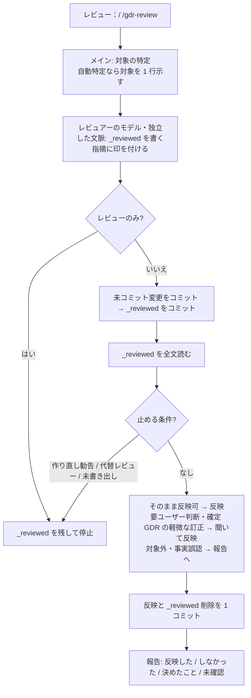

# 014. レビューの上位モデル委任と反映のワンセット化提案

## 目次

**GDR 一覧:**

| GDR ID | 決定の要約 | status |
|---|---|---|
| GDR-META-039 | レビューは起票した文脈から独立した文脈で、レビュアーのモデル（上位モデル）に書かせる。ツールが対応していれば、レビューに続けて確認を挟まずレビュー反映まで行う（ワンセット）。人が `_reviewed` を読んでから反映を指示する確認を外す代わりに、記録と取り消し・止める条件・対象の絞り込み・指摘の印・合意との境界を反映の規則としてそろえる | Implemented |

---

## 1. GDR（General Decision Record）

**GDR-META-039: レビューは起票した文脈から独立した文脈で、レビュアーのモデル（上位モデル）に書かせる。ツールが対応していれば、レビューに続けて確認を挟まずレビュー反映まで行う（ワンセット）。人が `_reviewed` を読んでから反映を指示する確認を外す代わりに、記録と取り消し・止める条件・対象の絞り込み・指摘の印・合意との境界を反映の規則としてそろえる**

- **status:** Implemented
- **scope:** meta, pol
- **決定:**
  - **原則（ツールに依存しない。02 §5.2 に置く）:**
    - レビューは、起票した文脈から独立した文脈で、レビュアーのモデルに書かせる。メインのモデルがレビュアーと同じでも、独立した文脈で書かせる（GDR-META-043 で改めた: `main` と明示したときはメインセッションが書き、反映せず止める）
    - ツールが対応していれば、レビューと反映を続けて行ってよい（ワンセット）。その場合、人の確認は「判断が要ると印の付いた指摘への回答」と「合意」に移る
    - 確認を外す代わりに、下の「反映の規則」をそろえる。そろえられない環境（記録できない・独立した文脈で書けない）では続けて反映しない
  - **反映の規則（上流の正本は 05 の節「レビュー反映の規則」。配備先では `gdr-apply-review` の「共通の振る舞い」。ワンセットでも単体の `レビュー反映：` でも同じ）:**

    | 項目 | 内容 |
    |---|---|
    | 記録と取り消し | git 管理下: ① 本体の未コミット変更を先にコミット → ② `_reviewed` をコミット → ③ 反映と `_reviewed` の削除を 1 コミット。レビューの全文が履歴に残り、反映だけを `git revert` で戻せる。コミットの可否はプロジェクトの運用ルール（00 Step 5）に従い、確認が要るプロジェクトでは聞いてからコミットする。コミットできないときは反映に進まず `_reviewed` を残して止める。git 管理外: 反映前に本体の写しを取り、反映が終わったら `_reviewed`・写しとも消す |
    | 止める | 反映の前に `_reviewed` を全文読む（要点の返答だけで反映しない）。`_reviewed` が書き出されていない、全体評価が作り直し・取り下げを勧めている、ワンセットの経路で独立した文脈で書けなかった（代替で自分が書いた）→ 反映せず止める。事実誤認と判断した指摘は反映せず理由を報告する |
    | 対象の絞り込み | `Proposed` 以外（`Accepted` / `Implemented` / `Superseded` / `Rejected`）の GDR 本文への指摘: 軽微な訂正と判断したものは【要ユーザー判断】として聞いてから反映し、それ以外は置換 GDR の起票候補として報告する。`_reference/`・`_archive/`・レビュー対象として渡していないファイル・コードへの指摘は反映せず報告する |
    | 指摘の印 | レビュアーは A・D・E の各指摘に【そのまま反映可】（直し方が 1 通り）／【要ユーザー判断】（選択肢と推奨つき）を付ける。前者は確認なしで反映し、後者は聞いてから反映する。決定事項・節をまるごと削る提案は後者 |
    | 合意との境界 | 反映時の回答は本文を確定するためのもので、GDR の合意ではない。status と理由の出所は変えない。合意を聞く前に、レビューで何が変わったか（反映したもの・しなかったもの）を示し、反映時に回答済みの分岐は聞き直さない |
    | 報告 | 反映したもの / 反映しなかったもの（理由つき）/ 回答で決めたこと / 未確認の点 / コミット hash |

  - **Claude Code での実装（05 に置く）:**
    - `レビュー：` / `/gdr-review` では、対象の特定（引数あり / なしの 2 モード）はメインセッションが行い、レビュー本体はレビュー用サブエージェント（`~/.claude/agents/gdr-reviewer.md`）に委ねる（GDR-META-043 で改めた: `main` と明示したときを除く）。引数なしで自動特定したときは、委任の前に対象を 1 行示す（確認は待たない）
    - レビュアーのモデルと推論の強さの**指定**は、サブエージェント定義の frontmatter（`model:` / `effort:`）だけに書く。ほかの文書は役割名（レビュアーのモデル）で言及する。プロジェクトで変えるときは、そのプロジェクトの `.claude/agents/` に同名の定義を置く。プロジェクトの定義がユーザー定義より優先されること、`model:` が効くこと、`effort:` を指定できることは確かめた（§5-6）。メインと別のモデルのサブエージェントにはセッションの推論の強さが適用されないので `effort:` は必ず書き、呼び出し時の指定は frontmatter より優先されるので `gdr-reviewer` を呼ぶときは `model` も `effort` も指定しない（GDR-META-043 で改めた: 既定では指定せず、引数で明示したときだけその回に限って指定する。frontmatter の指定は「既定の指定」と読む）
    - サブエージェントが使えないときは、その旨を伝えて自分でレビューし、ワンセットの経路では反映に進まず止める（`_reviewed` の冒頭に代替で書いた旨を書く）。単体の `レビュー反映：` は人の指示なので、代替で書いた `_reviewed` も反映してよい
    - `レビュー：` の実行を反映の明示指示とみなす。止めたいときは「レビューのみ」と指定する（`/gdr-review <ファイル> レビューのみ`）。`レビュー反映：` 単体は、止めた分・別セッションのレビュー・中断した反映のために残す
    - `一気通貫：` のフェーズ判定: フェーズ 2（レビュー）と 3（反映）は通常まとめて完了する。まず `_reviewed` が残っていれば、削除コミットの有無によらず「フェーズ 3 から」。残っていなければ、`_reviewed` を削除したコミットがあれば反映済み、なければ未レビュー
    - プロジェクトの `CLAUDE.md` にある `レビュー：` の定義（03 の初回プロンプト由来）は出力先と書式を定めるもので、委任とワンセットは user-level の定義に従う（プロジェクト側が「レビューのみ」と明記している場合を除く）
    - 上流の文書には特定の製品名・モデル名を書かず、「上位モデル」「レビュアーのモデル」と書く
  - **版:** 解釈版によらず適用する。v1.x の導入先（`Accepted` が無く、`Proposed` に合意済みのものが含まれうる）では、反映の対象に `Proposed` の GDR があるとき、反映の前に合意済みかどうかを 1 回確かめ、合意済みなら「`Proposed` 以外」と同じ扱いにする。合意との境界の「status と理由の出所は変えない」は、v1.x では理由の出所を求めないので status だけに当たる
  - **入れ先:** 02 §5.2 / 04 §3・§6 / 00（Step 2.0 の配置プロンプト・L42・L161〜162）/ 05（配置ファイル・`CLAUDE.md` の仕様・コマンド表・2 モード表・新設の「レビュー反映の規則」・ロールバック・再起動・`gdr-reviewer.md` 内容例）/ CHANGELOG / user-level config。文案は §4
- **理由:** これまでの `レビュー：` は、05 がセルフレビュー（書いた本人）と定め、人が `_reviewed` を読んでから `レビュー反映：` を指示する 2 段だった（§2-1・2-2）。履歴では提案 09〜13 でレビューが 7 回あり、7 回とも「`_reviewed` を 1 コミット → 反映と削除を 1 コミット」で進み、本文に残るユーザーの判断は回ごとに数件の選択に限られていた（§2-3）。レビューを独立した文脈・レビュアーのモデルに書かせれば、書いた本人の見落としを拾う力が上がる。これは 04 §2.1 `外部の審判は？`（AI 自身の自己評価ではなく別のレビュアーなど、GDR-META-037）の適用にあたる。人の往復は判断の要る数件に絞れる。ただし外す確認は、(1) レビュアーの誤りを止める、(2) 判断が要る指摘を人に回す、(3) レビューの記録を残す、(4) フェーズの現在地を示す、の 4 つを兼ねていた（手元の試行時のレビューの指摘。§4.4）。そのため確認を外すのと同時に、(1) は全文の読み直し・止める条件・事実誤認の除外・対象の絞り込み、(2) は指摘の印、(3) と (4) はコミットの分割で代わりを用意する。合意の前に「レビューで何が変わったか」を示すのは、人が `_reviewed` を読まなくなった後も、01 §3.1 の `ai-reviewed`（人間がレビュー・合意で確認）の意味を保つため。原則を 02、Claude Code の具体を 05 に分けるのは、ツールの仕組みが変わっても原則が残るようにするため。モデルの指定を 1 か所に絞るのは、モデルの世代や価格が変わるたびに複数の文書を直さずに済ませ、プロジェクトごとの上書きを可能にするため
  - **代替案 A:** コマンドの frontmatter でそのターンだけ上位モデルに切り替える（従来の手元の `/gdr-review` の形）→ 自然文の `レビュー：` はセッションのモデルのまま動き、経路で挙動が分かれる。レビューも書いた本人の文脈の中で行われ、独立しない。却下
  - **代替案 B:** 委任だけ行い、反映は従来どおり人の指示を待つ → 独立したレビューは得られるが、判断の要る指摘は印と質問で拾えるので、待ちを全件にかける必要はない。却下（「レビューのみ」の指定で選べる形で残す）
  - **代替案 C:** 確認を外し、`_reviewed` もコミットせずに反映後すぐ消す（手元の試行の初版）→ レビューの全文と反映の取り消し手段が失われ、`一気通貫：` が未レビューと反映済みを区別できない。試行時のレビューで指摘。却下
  - **代替案 D:** メインセッションがレビュアーと同じモデルなら委ねずに自分で書く → 費用は減るが、独立した文脈という委任の目的を失い、挙動がモデルで分かれる。却下
  - **代替案 E:** `Proposed` 以外の GDR への指摘は、軽微な訂正も含めて一律に反映しない → 02 §5.2「軽微な追記・誤りの修正は元の GDR を直接編集してよい」と、提案 13 の発行前の再レビューを `Accepted` の GDR に補足として反映した実績に合わない。一方で軽微かどうかの線引きを AI の単独判断に任せると、確認を外した後の歯止めが弱まる。聞いてから反映する形を採る。却下
  - **代替案 F:** v1.x の導入先ではワンセットを既定にせず「レビューのみ」にする → 挙動が版で分かれ、互換モードの表に行が増える。v1.x で質問が 1 つ増えるだけで同じ安全性が得られる。却下
  - **代替案 G:** 引数なしで自動特定したときは、候補が 1 件でも確認してから委任する → 往復を減らす目的に反する。誤特定は 3 つのコミットで戻せる。誤特定が起きたら切り替える（再検討条件 3）。却下
- **影響:**
  - 02 §5.2 に原則の項を 1 つ足す。サイクルの段階・図・GDR の書式・status 値・遷移・理由の出所の規則は変えない（`gdr-cycle-pdca.svg` は 2 と 3 の間に人の確認を描いていない）
  - 04 §6 の `レビュー` / `レビュー反映` / `一気通貫` の行、04 §3 の簡易表（半句）、00 の配置プロンプトと短縮キーワードの表を更新する。03 は変えない
  - 05: 配置ファイルに `~/.claude/agents/gdr-reviewer.md` を追加（10 ファイル + 任意 1）。節「レビュー反映の規則」を新設。`CLAUDE.md` の仕様に「レビューの委任」の項目を新設。コマンド表・2 モード表・ロールバック（`/gdr-review` と `/gdr-apply-review` は最大 3 コミット）・再起動の節を更新
  - user-level config: `CLAUDE.md`、`commands/gdr-review.md`、`commands/gdr-apply-review.md`、`commands/gdr-flow.md`、新規 `agents/gdr-reviewer.md`（手元では 2026-11-26 に先行して配備。§4.4。本提案に合わせた修正はタスク 1.5）
  - 導入先が config を更新するときは、`gdr-review.md` と `gdr-apply-review.md` を必ず同時に更新する（`gdr-review.md` だけ新しくすると、止める条件も印も無い旧い反映の規則のまま確認なしで反映が走る）
  - `レビュー：` が確認なしに本体を編集・コミットするようになる。CHANGELOG の互換性欄の先頭に書く
  - 費用: レビューのたびにレビュアーのモデルが 1 回走る。`一気通貫：` を回すたびに 1 回増える
  - 版: MINOR（v2.5）。必須の移行なし。推奨: user-level config の更新（上の同時更新を含む）
- **再検討条件:**
  - 導入先で、自動反映した指摘を人が後から戻す（`git revert` や手直し）ことが 5 回のレビューのうち 2 回以上起きる → 【そのまま反映可】の基準を狭めるか、既定を「レビューのみ」に戻す
  - 【要ユーザー判断】が 1 回のレビューで平均 4 件を超える → 印の付け方が慎重すぎるか、起票の段階で詰めが足りない。レビュアーの基準か起票の手順を見直す
  - 引数なしの自動特定による誤特定で取り消しが起きる → 自動特定のときは確認してから委任する（代替案 G）に切り替える
  - v1.x の導入先で「合意済みか」の確認が煩わしいと分かる → v1.x の既定を「レビューのみ」にする（代替案 F）に切り替える
  - サブエージェントの仕組み（定義ファイル・frontmatter・プロジェクト定義の優先）が Claude Code 側で変わる → 05 と user-level config を見直す
  - レビュアーのモデルとメインのモデルの差が小さくなり、委任の費用に見合う指摘の差が出なくなる → 委任の既定を見直す
- **日時:** 2026-11-26T12:04:53+09:00
- **関連:** depends-on GDR-META-028, depends-on GDR-META-030, relates-to GDR-META-034, relates-to GDR-META-037
- **理由の出所:** ai-reviewed（起点はユーザーの指示「レビューには上位モデルのサブエージェントに依頼をかけるように修正」「汎用性を高めたい」「依頼はレビューの反映までをワンセットにして」「使い終わったファイルは消すように」。メインがレビュアーと同じモデルでも委ねる・そのメインでも反映する・コミットを分ける・確定済み GDR の軽微な訂正は聞いて反映・v1.x は 1 回確かめる・自動特定は対象を示して進む、はユーザーが選択肢から選んだ。決定の構成と理由は AI が起案し、手元の試行のレビュー 2 回と本提案のレビュー 1 回を受けて直したもの。合意: ユーザー「合意」（2026-11-26）。未確認の 2 点は確かめずに合意したため、決定に「未確認」と添えた）

---

## 2. 現状

1. **レビューは書いた本人が行う** — 04 §6 は `レビュー：` を「同位置に `{ファイル名}_reviewed` としてレビュー文書を生成」とし、誰が書くかを定めていない。05 は `gdr-review.md` を「対象ファイルを**セルフレビュー**し」（L59）、「指定ファイルをセルフレビュー」（L85）とし、書いた本人が行うと定めている。手元の設定では `/gdr-review` だけが frontmatter で上位モデルに切り替わっていたが、自然文の経路とは挙動が分かれていた
2. **反映は人の指示を待つ 2 段** — 00（L161〜162）・03（初回プロンプトの例）・04（L58〜59・L98〜99）・05（L59〜60）はいずれも `レビュー：` を「生成まで」、`レビュー反映：` を別の指示として定める。05「モード B の誤特定時のロールバック」（L113）は、各コマンドが 1 コミットで完結する前提で書かれている
3. **実績** — 提案 09〜13 のレビューは 7 回（09 が 2 回、10・11・12 が各 1 回、13 が 2 回）、A 区分は計 31 件。7 回とも「`_reviewed.md` を 1 コミット → 反映と削除を 1 コミット」で進んだ（`bada7fa`→`044c276`、`b98e150`→`2a2c317`、`3494268`→`94bc886`、`441d79b`→`fc8ac6d`、`399446c`→`9f142f4`、`1659d73`→`d90a264`、`051f1a1`→`0d78823`）。本文に残るユーザーの判断は、09（`Accepted` の追加）、10（MAJOR の基準・暫定対処）、11（D の採否）、12（検討課題の委任）など回ごとに数件。レビュアーが別モデルだったと記録にあるのは 12・13 の 3 回（09〜11 は記録なし）。人が反映の前に `_reviewed` を全文読んだかどうかは記録に無い。2 コミットの分割は慣行で、仕様には書かれていない
4. **反映の規則が薄い** — 05 の `gdr-apply-review.md` は「A / D / E は必ず反映」とし、確定済み GDR・`_reference/`・コードへの指摘や、判断の要る指摘の扱いを定めていない。人が `_reviewed.md` を読む前提で、この確認が実質の歯止めだった

> 経緯: 2026-11-26、user-level config（手元の `~/.claude/`）で先に委任とワンセットを実装し、別のモデルのレビューを 2 回受けて直した（§4.4）。本提案はその結果を上流の仕様・ガイドに入れるためのもの。

---

## 3. 改善案

人の確認は「`_reviewed` 全体を読んで反映を指示する」から、「印の付いた分岐に答える」と「合意（`Proposed → Accepted`）」に移る。外した確認の役割は、コミットの分割（記録・取り消し・現在地）と止める条件・対象の絞り込み・印（誤りの歯止め・判断の振り分け）で代える。

---

## 4. 詳細セクション

### 4.1. 02 §5.2 への追記の文案

L114「改善提案 → レビュー → レビュー反映 → 再レビュー → 実装」の子項目として:

> - **レビューと反映（推奨）:** レビューは、起票した文脈から独立した文脈で、レビュアーのモデルに書かせる（委任の仕組みが無いツールでは、別のセッションでレビューする）。ツールが対応していれば、レビューと反映を続けて行ってよい（ワンセット）。その場合、人の確認は「判断が要ると印の付いた指摘への回答」と「合意」に移る。確認を外す代わりに次をそろえる。(1) 記録と取り消し — `_reviewed` をバージョン管理に記録してから反映し、反映は別の単位で記録する。記録できない環境では続けて反映しない。(2) 止める — 反映の前にレビューの全文を読む。レビューが作り直し・取り下げを勧めるとき、独立した文脈で書けなかったときは反映しない。事実誤認と判断した指摘は反映せず報告する。(3) 対象を絞る — `Proposed` 以外の GDR への指摘は、軽微な訂正なら人に聞いてから反映し、それ以外は置換 GDR の起票候補として報告する。編集禁止の領域・コードへの指摘は反映せず報告に回す。(4) 合意と分ける — 反映時の回答は合意とみなさず、status と理由の出所を変えない。合意を聞く前に、レビューで何が変わったかを示す。v1.x の導入先では、`Proposed` の GDR が合意済みかどうかを反映の前に 1 回確かめる（経緯: [014 提案](/91_demo_buildup_documents.md/kaizen/14_レビューの上位モデル委任と反映のワンセット化提案.md) GDR-META-039）

### 4.2. 04・00 の説明の文案

- 04 §6 の表 `レビュー`（L98）: 「…同位置に `{ファイル名}_reviewed` としてレビュー文書を生成」の後に「レビューは独立した文脈・レビュアーのモデルで書く。対応するツールでは続けて反映まで行う（『レビューのみ』で止める。規則は [05 レビュー反映の規則](/01_GDR/guide/05_CLAUDE_CODE_SETUP.md)）」
- 04 §6 の表 `レビュー反映`（L99）: 「…`_reviewed` を削除する」の後に「反映前に `_reviewed` を記録し、反映は別の単位で記録する。判断が要ると印の付いた指摘は聞いてから反映する」
- 04 §6 の表 `一気通貫`（L101）: 「セルフレビューとレビュー反映は通常まとめて完了する」を 1 句
- 04 §3 の簡易表（L58〜59）: `レビュー` の行に「続けて反映まで行う（§6）」の半句のみ
- 00 L161〜162: 同旨を 1 句ずつ
- 00 Step 2.0（L42・L56〜65）: 配置プロンプトの配置対象に `~/.claude/agents/gdr-reviewer.md` を足し、L42 の個数を実数に直す（これが無いと、新規の導入先は定義を持たず、`/gdr-review` が毎回代替経路で止まる）
- 03: 変えない（初回プロンプトの例は出力先と書式の定義として有効。委任とワンセットは user-level が担う）

### 4.3. 05 への同期の文案

- **配置するファイル:** 「10 ファイル + 任意 1 ファイル」とし、`~/.claude/agents/gdr-reviewer.md`（レビュー用サブエージェントの定義）を追加
- **`~/.claude/CLAUDE.md` の仕様:** 含める節に「レビューの委任」を新設する（05 の仕様に「モデルの役割分担」の節は無いため）。内容: レビューは `gdr-reviewer` に委ねる、モデルの指定は定義の frontmatter の 1 か所、使えないときの代替、プロジェクト側の `レビュー：` の定義との関係（「レビューのみ」と明記している場合を除く）。短縮キーワードの `レビュー：` に「続けて反映まで行う（『レビューのみ』で止める）」を追加
- **節「レビュー反映の規則」（新設）:** §1 決定の表（記録と取り消し / 止める / 対象の絞り込み / 指摘の印 / 合意との境界 / 報告）と版の項をそのまま置く。コマンド表の `gdr-review.md` / `gdr-apply-review.md` / `gdr-flow.md` の行はこの節を指す
- **コマンド表:**
  - `gdr-review.md`: 「対象を特定し（自動特定なら対象を 1 行示す）、レビュー用サブエージェントでレビューし、続けてレビュー反映まで行う」。引数に `[レビューのみ]`
  - `gdr-apply-review.md`: 「レビュー反映の規則に従って統合する（ワンセットでも単体でも同じ）」。引数に「本体と `_reviewed.md` の両方のパス」
  - `gdr-flow.md`（L62）: フェーズ 2〜3 はまとめて完了。判定は `_reviewed` の残りを先に見て、次に削除コミット。フェーズ 4 は回答済みの分岐を聞き直さず、レビューで変わった点を示す。印は進行ルールの「主体的に判断」より優先
- **2 モード表（L85〜86）:** `/gdr-review` を「指定ファイルをレビュー用サブエージェントでレビューし、続けて反映」、`/gdr-apply-review` を「本体と `_reviewed.md` を統合（別ディレクトリなら両方のパス）」
- **モード B の誤特定時のロールバック（L113）:** 「`/gdr-review`（ワンセット）と `/gdr-apply-review` は最大 3 コミットに分かれる。反映だけを戻すときは最後のコミットを `git revert` する。対象の誤特定を戻すときは、反映のコミット → `_reviewed.md` のコミットの順に `git revert` する（未コミット変更のコミットは、対象ファイルの元の変更なので残す）」
- **配置後の再起動（L212）:** 起動時に読み込まれるものに `agents/*.md` を足す。セッション開始後に `CLAUDE.md` を直しても、そのセッションから呼ぶサブエージェントには開始時の版が渡る旨を添える
- **`gdr-reviewer.md` 内容例:** frontmatter（`name` / `description` / `model` / `effort` / `tools`）と本文の骨子。最低限含めるもの: 対象を編集もコミットもしない / `_reviewed.md` の書き出しが成果物 / A〜G の出力構造 / A・D・E への印とその定義 / 作り直し・取り下げを勧めるときは G に明記 / 代替ではないこと。`model:` の値は例として示し、特定のモデルを推奨しない。`tools:` に書き出し用の Write があり、「対象を編集しない」は本文の指示で守る旨を注記

### 4.4. user-level config（手元で先行配備）

2026-11-26 に次の形で配備し、別のモデルのレビューを 2 回受けて直した（試行の `_reviewed` と写しは git 管理外のため残っていない。件数は試行時の報告による）。

| ファイル | 内容 |
|---|---|
| `agents/gdr-reviewer.md`（新規） | レビュアーのモデル・effort（frontmatter）、対象を編集もコミットもしない、`_reviewed.md` の書き出しが成果物、GDR 文書でない対象では書式の観点を飛ばす、解釈版と【要ユーザー判断】の件数を返す、A・D・E に印、日本語で書く |
| `commands/gdr-review.md` | 委任のプロンプトの項目（絶対パス・出力先・前提）、`model` を指定しない、代替時は反映せず止める、`~/.claude/` 等が対象のときの出力先、既存 `_reviewed.md` の確認、引数末尾の `レビューのみ`、ワンセット |
| `commands/gdr-apply-review.md` | 反映の規則（§1 の表の元）、両方のパスを渡す形、`~/.claude/review/` も探す |
| `commands/gdr-flow.md` | フェーズ 2〜3 の判定材料を削除コミットに、フェーズ 4 で回答済みの分岐を聞き直さない、進行ルールの「主体的に判断」より印を優先 |
| `CLAUDE.md` | モデル表を版なしに、委任・モデルの 1 か所指定・代替、レビュアーと同じモデルのメインでも反映は明示指示に含む、`レビュー：` の行に委任とワンセットとプロジェクト定義との関係 |

試行で分かったこと:

- 1 回目のレビュー（委任のみの版）: モデル表の版がエイリアスの解決先と食い違う、代替経路の中間段が成り立たない、観点の写しがずれる、など A 5 件
- 2 回目のレビュー（ワンセット化の版）: 外した確認が 4 つの役割を兼ねていた、止める条件・印・合意との境界・フェーズ判定が無い、など A 9 件。うち選択肢のある 2 件だけを聞き、残りは確認なしで反映した
- 本提案のレビュー（3 回目。git 管理下で初めてワンセットを回した回）: A 8 件・【要ユーザー判断】3 件（A-4〜A-6）。§7 に記録する

本提案に合わせて直す点（タスク 1.5）:

- `gdr-review.md` の特定のモデル名への言及 2 か所を役割名に直す
- `gdr-apply-review.md`: 版の条件（v1.x の確認）、コミットの可否（プロジェクトの運用ルール）、`Proposed` 以外の GDR の軽微な訂正は聞いて反映、代替で止めるのはワンセットの経路だけ
- `gdr-review.md`: 自動特定のときに対象を 1 行示す、代替で書いた旨を `_reviewed` の冒頭に書く
- `gdr-flow.md`: 判定の順序（`_reviewed` の残りを先に見る）

### 4.5. 例

`/gdr-review notes/20_kaizen/2026-12-01_cache.md` を実行した場合:

1. メイン: 対象と出力先（同じ場所の `..._reviewed.md`）を決め、レビュー用サブエージェントを呼ぶ
2. サブエージェント: `_reviewed.md` を書く（A 4 件 — うち【要ユーザー判断】1 件）
3. メイン: 未コミットだった起票の修正をコミット → `_reviewed.md` をコミット（`docs(kaizen): add review of cache proposal`）
4. メイン: 全文を読む。A-3 は `Implemented` の GDR-ARCH-002 の判断に関わる指摘 → 反映せず「置換 GDR の起票候補」として報告へ。A-2 は【要ユーザー判断】→ 質問
5. メイン: 残りを反映し、`_reviewed.md` 削除と 1 コミット（`docs(kaizen): apply review of cache proposal`）
6. 報告: 反映 2 件・回答で決めた 1 件・反映しなかった 1 件（理由）・コミット hash。GDR は `Proposed` のまま（合意は別）

---

## 5. 検討課題

1. **人が `_reviewed` を読まなくなることの是非** — 02 §5.1「人間は判断の方向性と受容可否に集中する」とは整合する（受容可否は印と合意で残る）。一方、レビュー全文を読むことで人が得ていた気づきは減る。報告に「反映しなかったもの」を必ず含め、合意の前に「レビューで何が変わったか」を示すことで補う。再検討条件 1 で観察する
2. **ツール依存の書き分け** — 原則は 02、サブエージェント・frontmatter・`model` の指定は 05 に置く。委任の仕組みが無いツールでは、別のセッション・別のモデルでレビューする運用を推奨とする
3. **「セルフレビュー」という語** — 独立した文脈のレビューになり、名前と中身がずれた（04 §6 の一気通貫のフェーズ名、`gdr-flow.md`）。語を変えると既存の導入先の `CLAUDE.md` との対応が崩れるため、本提案では変えない。変えるなら別の提案で
4. **git 管理外の対象** — 手元の `~/.claude/` のように git 管理外の対象では、反映が終わると戻す手段がなく、レビューの記録も残らない（本提案 §4.4 の試行の件数を確かめられないのはこのため）。上流の導入先はリポジトリの中なので通常は当たらない。05 に注記のみとするが、記録が理由の根拠になる場合は git 管理下で試すのが望ましい
5. **費用** — レビューごとにレビュアーのモデルが 1 回走る。小さな文書でも委ねる（判断の質を優先）。再検討条件 6 で見直す
6. **未確認の点の確認（タスク 0.1。2026-11-26、設定を読み直した新しいセッションで実施）**
   - **プロジェクトの定義の優先: 確認済み。** 検証用リポジトリの `.claude/agents/gdr-reviewer.md` に目印（返答の 1 行目に `PROJECT-DEF`）と `model: haiku` を書き、そのリポジトリで起動したセッション（`claude -p`）から `model` を指定せずに呼んだ。目印と Haiku 系のモデル ID が返り、説明文もプロジェクト側のものだった
   - **`model:` が効くこと: 確認済み。** 上の確認で、メインが別のモデルのときに定義どおりのモデルで動いた（継承ではない）。ユーザー側の定義（`model:` にレビュアーのモデルのエイリアス）から呼んだときも、その系統のモデル ID が返った
   - **`effort:` を指定できること: 公式の説明で確認済み。** 公式のサブエージェントのページ（https://code.claude.com/docs/en/sub-agents）の frontmatter の表に `effort`（low / medium / high / xhigh / max。使える段階はモデルによる）がある。指定しないとき、メインと同じモデルのサブエージェントはセッションの段階を使うが、別のモデルではセッションの段階が適用されない。優先順は環境変数 `CLAUDE_CODE_EFFORT_LEVEL` ＞ 呼び出し時の `effort` パラメータ ＞ frontmatter。サブエージェントの内側からは effort が見えないため、効いたことの観察はしていない
   - **端から端までの動作: 確認済み。** 検証用リポジトリで `/gdr-review sample.md` を実行し、`_reviewed.md` の追加と、反映・削除の 2 コミットに分かれた。【要ユーザー判断】3 件を質問 1 回で聞き、【そのまま反映可】1 件は確認なしで反映した。前提定義書の無いリポジトリでは解釈版 v1.0 と読み、GDR の書式の観点は「GDR として起票するときに何が足りなくなるか」の範囲で見た
   - 前回の観察（セッション開始後に直した user-level `CLAUDE.md` はサブエージェントに届かず、開始時の版が渡る）は、新しいセッションでは解消した

---

## 6. 実行計画

### 6.1. タスク一覧

| # | タスク | 対象 GDR | 依存 | 状態 |
|---|---|---|---|---|
| 0.1 | 未確認の点（`effort:`・プロジェクト定義の優先）を新しいセッションで確かめ、§5-6 に結果を書く | GDR-META-039 | — | 完了 |
| 0.2 | レビュー（別モデル）→ 反映 | GDR-META-039 | — | 完了 |
| 0.3 | 合意 | GDR-META-039 | 0.2 | 完了（2026-11-26） |
| 1.1 | 02 §5.2 | GDR-META-039 | 0.3 | 完了 |
| 1.2 | 04 §3・§6、00（Step 2.0 の配置プロンプト・L42・L161〜162） | GDR-META-039 | 0.3 | 完了（00 Step 2.0 は 1.3 と同時） |
| 1.3 | 05（配置ファイル・`CLAUDE.md` の仕様・レビュー反映の規則・コマンド表・2 モード表・ロールバック・再起動・`gdr-reviewer.md` 内容例） | GDR-META-039 | 0.1・0.3 | 完了 |
| 1.4 | user-level config（先行配備済み。§4.4 の「直す点」）— リポジトリ外配備 | GDR-META-039 | 0.3 | 完了（リポジトリ外配備） |
| 2.1 | 版の判定と CHANGELOG（MINOR v2.5。互換性欄の先頭に `レビュー：` の挙動の変更と版の適用範囲、移行項目に `agents/gdr-reviewer.md` の配置と `gdr-review.md` / `gdr-apply-review.md` の同時更新）、user-level の `~/.claude/CLAUDE.md` §6 の現行版、タグ | GDR-META-039 | 1.1〜1.4 | 完了（v2.5） |
| 3.1 | 導入先での観察（自動反映の取り消し回数、【要ユーザー判断】の件数、誤特定、v1.x での確認の手間）。数える欄はふりかえりに置く | GDR-META-039 | 2.1 | 未着手 |

### 6.2. フェーズ詳細

#### フェーズ 0: 合意・準備

**目的:** 文書 → レビュー → 合意の順序を守る。未確認の前提を合意の前に確かめる。

- [x] 0.1 未確認の点の確認
- [x] 0.2 レビュー（別モデル）→ 反映（A-1〜A-8、D-1、E-1〜E-11、B-1・B-5・B-6・B-8・B-9 の一部）
- [x] 0.3 合意（2026-11-26。0.1 は未了のまま合意し、決定に「未確認」と添えた）

#### フェーズ 1: 仕様・ガイドへの組み込み

**目的:** 原則・反映の規則・Claude Code での実装が、上流の文書と user-level config で一致する。

- [x] 1.1 02 AI-Driven GDR ビルドアップ
- [x] 1.2 04 プロンプトガイド・00 Getting Started
- [x] 1.3 05 Claude Code セットアップ
- [x] 1.4 user-level config

#### フェーズ 2: 発行

- [x] 2.1 版の判定と CHANGELOG（v2.5 / MINOR）、`~/.claude/CLAUDE.md` §6、タグ

#### フェーズ 3: 発行後の観察

- [ ] 3.1 再検討条件 1〜4 の観察

### 6.3. 進捗サマリー

| フェーズ | タスク数 | 完了 | 残 | コミット |
|---|---|---|---|---|
| 0 | 3 | 2 | 1 | 8dfaa15 / 4af4281 / fa840e6 / 本コミット |
| 1 | 4 | 4 | 0 | cb58f8d / 本コミット（1.4 は `~/.claude/` 配下への配備のためリポジトリ外） |
| 2 | 1 | 1 | 0 | 本コミット（+ タグ v2.5。`~/.claude/CLAUDE.md` §6 はリポジトリ外） |
| 3 | 1 | 0 | 1 | — |

---

## 7. ふりかえり

> 起票・レビュー・合意・実装・発行時点（2026-11-26）の記録。

### 7.1. 観察された傾向

1. **手元で先に動かしてから提案にした** — user-level config で委任とワンセットを実装し、別のモデルのレビューを 2 回受けてから起票した。理由の中心（外す確認が 4 つの役割を兼ねていた）は試行のレビューから出た。ただし試行は git 管理外で行い、記録が残らなかった（§5-4）。理由の根拠になる試行は git 管理下で行う
2. **ワンセットを自分自身の提案で回した** — 本提案のレビュー（A 8 件・D 1 件・E 11 件）は、git 管理下で初めてワンセットを回した回になった。【要ユーザー判断】3 件（A-4〜A-6）を質問 1 回で聞き、すべて推奨どおりの回答。残りは確認なしで反映した。事実誤認として反映しなかった指摘はなく、対象外として報告に回したのは user-level config への申し送りだけ。反映後に手で戻した箇所もなかった
3. **決めたことが上流に届いていなかった** — レビューの A の中心は「規則は手元の config では完成しているが、上流の文書（05・02・00）に運ぶ文案が要約に留まる」だった（A-1〜A-3）。とくに 00 の配置プロンプトに `gdr-reviewer.md` が無ければ、新規の導入先は毎回代替経路に落ちる。手元で先行した変更を上流に入れるときは、導入先が受け取るのは上流の文書だけ、という前提で文案を書く
4. **未確認の前提を合意の後に確かめた** — レビュー（A-7）は確認を合意の前に置くよう求めたが、ユーザーは先に合意し、決定に「未確認」と添えた。実装（05）の前に、別のリポジトリで起動したセッション（`claude -p`）と公式の説明で 3 点とも確かめた。とくに `effort:` は「メインと別のモデルではセッションの段階が適用されない」ことが分かり、書き忘れると上位モデルが低い段階で動くという、試行では見えなかった落とし穴を拾えた
5. **セッションの途中で直した設定はサブエージェントに届かない** — 試行中、user-level `CLAUDE.md` を直しても、そのセッションから呼んだサブエージェントには開始時の版が渡っていた。05 の再起動の節に書いた

### 7.2. 次回への申し送り

- GDR-META-039 は 2026-11-26 に `Implemented`。タグ `v2.5` はローカルのみ（公開には push が必要）
- フェーズ 3（導入先での観察）は未着手。自動反映を後から戻した回数（再検討条件 1）、【要ユーザー判断】の件数（同 2）、自動特定の誤特定（同 3）、v1.x での確認の手間（同 4）を、反映の報告から数える
- 「セルフレビュー」という語は残した（§5-3）。変えるなら別の提案で
