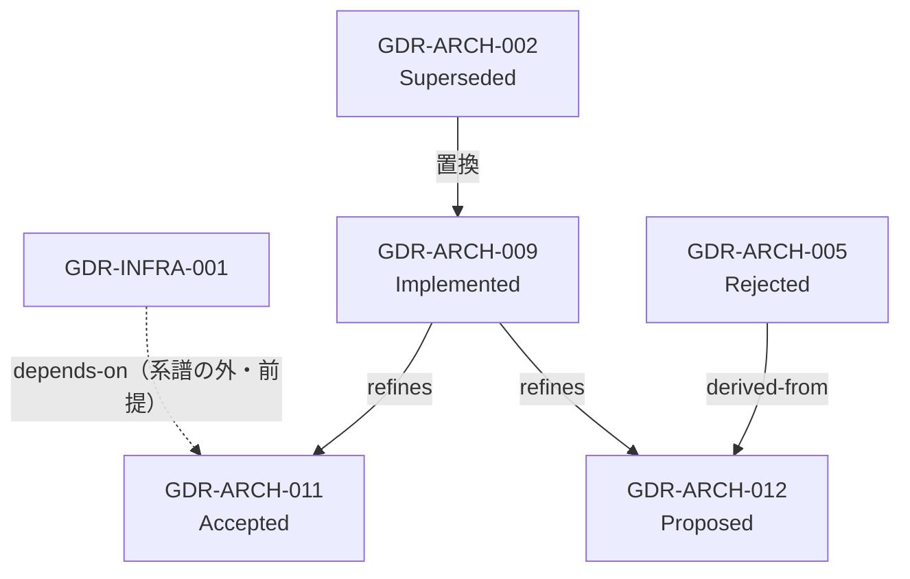

# 015. GDR の系譜の明確化と UUID v7 の検討提案

## 目次

**GDR 一覧:**

| GDR ID | 決定の要約 | status |
|---|---|---|
| GDR-META-040 | GDR の先祖・子孫（系譜）を、ID ではなく既存のリンクで明確にする。系譜をつくるリンクを「置換（supersedes）・`refines`・GDR を指す `derived-from`」と定め、「先祖は子孫より古い（日時）」を不変条件にし、祖先と子孫をたどるプロンプトと可視化を加える。UUID v7 は GDR ID に採らない | Proposed |

---

## 1. GDR（General Decision Record）

**GDR-META-040: GDR の先祖・子孫（系譜）を、ID ではなく既存のリンクで明確にする。系譜をつくるリンクを「置換（supersedes）・`refines`・GDR を指す `derived-from`」と定め、「先祖は子孫より古い（日時）」を不変条件にし、祖先と子孫をたどるプロンプトと可視化を加える。UUID v7 は GDR ID に採らない**

- **status:** Proposed
- **scope:** meta, spec
- **決定:**
  - **系譜の定義（01 §3.1 に置く）:** GDR の「親 → 子」は次の 3 種のリンクだけで表す。先祖は親を、子孫は子を、それぞれ推移的にたどった集合

    | リンク | 書く場所 | 親 | 子 | 意味 |
    |---|---|---|---|---|
    | 置換 | status 行（`Superseded by` / `Accepted (supersedes ...)`） | 旧 GDR | 新 GDR | 同じ判断の更新 |
    | `refines` | 子の「関連」 | 親決定 | 細分化した決定 | 判断の分解 |
    | `derived-from GDR-…` | 子の「関連」 | 元の GDR | 派生した GDR | 却下案の再提案、別の判断からの派生 |

    - `depends-on`（前提）と `relates-to`（弱い関連）は系譜に含めない。前提は「この判断が成り立つための他の判断」で、親子ではない（系譜とは別に表示する）
    - `derived-from §N-M`（課題への由来）は系譜の外。課題は GDR ではないため
    - 親を持たない GDR を「起点」、子を持たない有効な GDR を「末端」と呼ぶ。置換の末端が、参照の規律（02 §6）でたどり着く「末端の有効 GDR」にあたる
  - **不変条件（01 §3.1・整合性チェック）:**
    - **系譜は閉路を持たない（DAG）**
    - **先祖は子孫より古い:** 系譜のリンクの両端に「日時」があるとき、親の日時 ≤ 子の日時。日時の無い GDR はこの確認から外す（日時は任意フィールドのまま）
    - 違反は書式違反ではなく、整合性チェック（04 §5）の警告として出す
  - **たどる手段:**
    - 04 §5 にプロンプト `系譜 [GDR-ID]` を加える。指定 GDR の先祖を起点まで、子孫を末端まで、status と日時つきで列挙させる。前提（`depends-on`）は別の欄に出す。引数なしなら、起点ごとの系譜の一覧と、不変条件の違反を出す
    - 06 の関係ビューに「系譜ビュー」を加える（系譜の 3 種のエッジだけを描き、親を上・子を下に置く）。`/gdr-map 系譜 GDR-ID` で近傍を描く
  - **起票時に親を書く（推奨）:** 新しい GDR を起票するとき、既存の GDR を細分化・派生・置換したものなら、その親を必ず書く（置換は従来どおり status 行、細分化は `refines`、派生は `derived-from GDR-…`）。AI が起票するときは、親の候補を挙げて確認する
  - **UUID v7 の扱い:** GDR ID（`GDR-{PREFIX}-{番号}`）を UUID v7 に置き換えない。補助の識別子としても今は足さない（§5-1・再検討条件）
  - **版:** MINOR（書式・status 値・既存の値の意味は変えない。不変条件の違反は警告のみ）。解釈版によらず適用
  - **入れ先:** 01 §3.1 / 02 §6（参照の規律に一文）/ 04 §5 / 06 / 05（`gdr-map.md` の行）/ user-level config。文案は §4
- **理由:** 先祖・子孫を明確にしたいという目的に対し、UUID v7 が与えるのは (1) 生成時刻による並び順と (2) 調整なしの大域的な一意性で、どちらも「誰が誰の親か」を表さない（§2-3）。時刻の順は既存の任意フィールド「日時」で得られ、大域的な一意性は横断検索で `(project, gdr_id)` の複合キーを決めている（GDR-META-020）。一方、系譜を表す材料は「関連」の型付きリンクと置換の相互リンクとしてすでにあるが、どの型が親子かが決まっておらず、実際の記録でも GDR を指す親子のリンクがほとんど書かれていない（§2-1・2-2）。足りないのは ID の形式ではなく、親子の定義・書く習慣・たどる手段なので、そこを補う。UUID v7 の時刻の性質は「先祖は子孫より古い」という不変条件として取り込み、閉路や書き間違いの検出に使う
  - **代替案 A:** GDR ID を UUID v7 にする（例: `GDR-META-0193c9a2-…`）→ 時刻順に並び、並行する起票でも衝突しないが、親子は表さない。36 文字の ID は会話・見出し・リンクで読めず、AI の文脈も 1 回の参照ごとに大きくなる。既存の 400 か所超の参照と、`GDR-{PREFIX}-{番号}` を前提にしたパーサ・lint・可視化を壊す（MAJOR）。却下
  - **代替案 B:** 人が読む ID はそのままにし、任意フィールド `uid`（UUID v7）を足す → 置換・採番しなおしでも変わらない識別子と、プロジェクトをまたぐ参照が得られる。ただし今は、プロジェクトをまたいで親子をつなぐ必要も、採番の衝突も起きていない（§2-4）。親子は表さないので目的に直接は効かない。保留（再検討条件 1・2）
  - **代替案 C:** ID に系譜を埋め込む（例: `GDR-META-039.1` を 039 の子にする）→ 親が複数ある派生（`derived-from` を 2 つ持つ GDR）や、置換で親が変わる場合を表せない。ID が判断の内容に依存し、親の付け替えで ID が変わる。却下
  - **代替案 D:** 逆向きのリンク（「子」フィールド）を各 GDR に書く → 子は親へのリンクから機械的に求まるので二重管理になる（提案 13 の代替案 C と同じ理由）。却下
  - **代替案 E:** `depends-on` も系譜に含める → 前提は親子ではない。含めると「キャッシュの方針」が「DB の選定」の子孫になるような、判断の分解とは無関係な系譜ができ、系譜ビューが依存グラフと同じになる。前提は別欄に出す。却下
- **影響:**
  - 01 §3.1 の「関連」の説明に系譜の定義と不変条件を足す。フィールド・型の語彙・status 値は変えない
  - 02 §6 の参照の規律に「末端の有効 GDR = 置換の系譜の末端」の一文を足す。04 §5 にプロンプト 1 つ、06 に系譜ビュー、05 の `gdr-map.md` の行に `系譜` 引数を足す
  - 整合性チェックの対象が増える（閉路・日時の順）。違反は警告のみ
  - user-level config: `CLAUDE.md`（GDR 方法論に系譜の一行）、`commands/gdr-kaizen.md`・`commands/gdr-flow.md`（起票時に親の候補を挙げて確認）、`commands/gdr-map.md`（系譜ビュー）
  - 起票のたびに親の確認が 1 つ増える。親が無ければ「起点」と答えるだけでよい
  - 既存の GDR には遡って親を書くことを求めない（推奨: 置換の相互リンクは既に書かれているので、系譜ビューは置換の系譜から使える）
  - 版: MINOR（v2.6）
- **再検討条件:**
  - プロジェクトをまたいで親子をつなぐ記録（他プロジェクトの GDR から派生した GDR）が導入先で 3 件以上出る → 代替案 B（`uid`）か、論理名つきの参照（`{リポジトリ名}:GDR-…`）を検討する
  - 並行するブランチ・複数の書き手による採番の衝突が、1 つの導入先で 2 回以上起きる → 代替案 B か、採番の手順（マージ時に後の日時の方を採番しなおす）を検討する
  - 新しく起票した GDR のうち、親を持つものの割合が 3 か月たっても上がらない（親の候補の確認が働いていない）→ 起票時の確認を必須に上げるか、AI が親を推定して提示する手段を足す
  - 系譜の 3 種に当てはまらない親子関係が繰り返し出る → 型の語彙の追加を GDR-META で検討する
- **日時:** 2026-11-26T12:48:57+09:00
- **関連:** refines GDR-META-025, depends-on GDR-META-020, relates-to GDR-META-038
- **理由の出所:** ai（起点はユーザーの指示「uuid v7を検討してほしい」と、検討中の補足「要は先祖、子孫を明確にしたい」。GDR レコードの ID が対象で、改善提案として起票することはユーザーが選択した。UUID v7 を ID に採らず、既存のリンクで系譜を定義するという構成と理由は AI の起案。合意前）

---

## 2. 現状

1. **系譜の材料はあるが、親子が定義されていない** — 01 §3.1 の任意フィールド「関連」は `depends-on` / `refines` / `relates-to` / `derived-from` の閉集合で、置換は status 行の相互リンクで表す（GDR-META-025）。しかし、どの型が「親 → 子」を表すかは決まっていない。参照の規律（02 §6）は置換を前向きにたどることだけを定め、波及チェック（GDR-META-038）は `depends-on` / `refines` を逆向きに見る。系譜としてまとめた定義はない
2. **実際の記録に親子のリンクがほとんど無い** — このリポジトリの改善提案 01〜14 の GDR レコード 44 件のうち、「関連」があるのは 17 件。型別では `derived-from` 23（**すべて課題 `§N-M` 向きで、GDR 向きは 0**）、`depends-on` 14、`relates-to` 6、`refines` 1。置換は 1 件。GDR 同士の親子として読めるのは `refines` 1 件と置換 1 件だけで、残りは前提（`depends-on`）か課題への由来
3. **ID は系譜を表さない** — `GDR-{PREFIX}-{番号}` の番号は PREFIX 内の採番順で、親子とは無関係（GDR-META-039 の親が 038 とは限らない）。UUID v7 にしても、得られるのは生成時刻の順（48 ビットのミリ秒）と大域的な一意性で、親子は表さない
4. **UUID v7 の利点が要る場面は今は起きていない** — 時刻の順は任意フィールド「日時」（44 件中 18 件に記入）で得られる。ID はプロジェクト内でしか一意でないが、横断検索は `(project, gdr_id)` の複合キーで扱う設計（GDR-META-020。全プロジェクトに `GDR-META-001` がある実測から）。並行ブランチでの採番の衝突は、このリポジトリの履歴では起きていない
5. **たどる手段が無い** — 06 の関係ビューと `/gdr-map GDR-ID`（近傍）は全種のエッジを描くので、先祖・子孫だけを取り出す見方がない。04 にも系譜を問うプロンプトがない

> 経緯: ユーザーが「uuid v7を検討してほしい」（対象は GDR レコードの ID）と依頼し、検討中に「要は先祖、子孫を明確にしたい」と目的を補足した。目的に照らして、ID の形式ではなく親子の定義と手段の不足が本題と判断した。

---

## 3. 改善案



- 系譜は親（上）→ 子（下）の DAG。ARCH-012 の先祖は ARCH-009・ARCH-005・ARCH-002、ARCH-002 の子孫は ARCH-009・011・012
- `depends-on`（点線）は前提として別に示し、系譜には数えない
- 各リンクで「親の日時 ≤ 子の日時」を確かめる

---

## 4. 詳細セクション

### 4.1. 01 §3.1 への追記の文案

「関連」の表の後、型の語彙の注記の近くに:

> **系譜（先祖・子孫）:** GDR の親 → 子は、置換（旧 → 新。status 行）、`refines`（親決定 → 細分化した決定）、GDR を指す `derived-from`（元 → 派生）の 3 種のリンクで表す。先祖・子孫はこれを推移的にたどった集合。`depends-on` と `relates-to`、課題（`§N-M`）への `derived-from` は系譜に含めない。系譜は閉路を持たず、両端に日時があるときは親の日時 ≤ 子の日時とする（違反は整合性チェックの警告。書式違反ではない）。既存の GDR を細分化・派生・置換して起票するときは、親を書く（経緯: [015 提案](/91_demo_buildup_documents.md/kaizen/15_GDRの系譜の明確化とUUIDv7の検討提案.md) GDR-META-040）

### 4.2. 02 §6 への追記の文案

参照の規律の「`Superseded by X` に当たったら X を末端の有効 GDR までたどる」の後に: 「末端の有効 GDR は、置換の系譜の末端にあたる（01 §3.1 系譜）」

### 4.3. 04 §5 への追記の文案

| プロンプト | 効果 |
|---|---|
| `系譜 [GDR-ID]` | 指定 GDR の先祖を起点まで、子孫を末端まで、リンクの種類・status・日時つきで列挙させる。前提（`depends-on`）は別欄。引数なしなら、起点ごとの系譜の一覧と、不変条件の違反（閉路・日時の逆転）を出させる |

`整合性チェック` の説明に「系譜の閉路・日時の逆転」を足す。

### 4.4. 06・05 への追記の文案

- 06 §4 の関係ビューの下に「系譜ビュー」: 系譜の 3 種のエッジだけを描き、`flowchart TB` で親を上に置く。`depends-on` は既定で描かない（`前提` 指定で点線として足す）。ノードラベル・status の表現は関係ビューと同じ
- 05 の `gdr-map.md` の行: argument-hint に `[系譜]` を足し、「`系譜` 指定で系譜ビュー（指定 GDR の先祖と子孫）」

### 4.5. user-level config への追記の文案

- `CLAUDE.md` GDR 方法論 §4（不可侵ルール）: 「系譜（先祖・子孫）は置換・`refines`・GDR を指す `derived-from` で表す。起票時、既存の GDR を細分化・派生・置換したものなら親を書く」
- `commands/gdr-kaizen.md` / `commands/gdr-flow.md`（フェーズ 1）: 起票する GDR ごとに、親の候補（同じ PREFIX・scope の有効な GDR、会話で触れた GDR）を挙げて確認する。無ければ「起点」
- `commands/gdr-map.md`: `系譜` 引数

### 4.6. 例

`系譜 GDR-ARCH-012` の出力（§3 の図の場合）:

```
GDR-ARCH-012（Proposed, 2026-12-10）
先祖:
  GDR-ARCH-009（Implemented, 2026-11-02）— refines
    GDR-ARCH-002（Superseded, 2026-08-15）— 置換
  GDR-ARCH-005（Rejected, 2026-09-01）— derived-from
子孫: なし（末端）
前提（系譜の外）: なし
不変条件: OK
```

---

## 5. 検討課題

1. **UUID v7 を補助の識別子として足すか（代替案 B）** — 置換や採番しなおしでも変わらない識別子は、横断検索や外部ツールとの連携で便利になりうる。ただし系譜には効かず、今は使う場面がない。再検討条件 1・2 のどちらかで見直す。足す場合も人が読む ID は残す
2. **既存の GDR への遡及** — 44 件のうち親子として書かれているのは 2 件。遡って親を書くかは導入先の任意とする。上流のこのリポジトリで試すなら、提案 09〜14 の GDR-META（025→028→030→038→039 のような、前の判断を前提・細分化した流れ）で親が `depends-on` なのか `refines` なのかを見直すことになる
3. **`refines` と `depends-on` の境目** — 「前の判断を前提にした新しい判断」はどちらか迷いやすい。目安: 前の判断を分解・具体化したものなら `refines`（子）、前の判断が成り立つことを条件に別の判断をしたなら `depends-on`（前提）。04 か 01 に目安を 1 行置くかはレビューで決める
4. **日時の無い GDR** — 不変条件の日時の確認は日時がある両端だけ。日時は任意フィールドのままとし、必須に上げない（GDR-META-025 の方針）

---

## 6. 実行計画

### 6.1. タスク一覧

| # | タスク | 対象 GDR | 依存 | 状態 |
|---|---|---|---|---|
| 0.1 | レビュー（別モデル）→ 反映 | GDR-META-040 | — | 未着手 |
| 0.2 | 合意 | GDR-META-040 | 0.1 | 未着手 |
| 1.1 | 01 §3.1・02 §6 | GDR-META-040 | 0.2 | 未着手 |
| 1.2 | 04 §5・06・05 | GDR-META-040 | 0.2 | 未着手 |
| 1.3 | user-level config — リポジトリ外配備 | GDR-META-040 | 0.2 | 未着手 |
| 2.1 | 版の判定と CHANGELOG（MINOR v2.6）、`~/.claude/CLAUDE.md` §6 の現行版、タグ | GDR-META-040 | 1.1〜1.3 | 未着手 |
| 3.1 | 導入先での観察（親を持つ GDR の割合、不変条件の違反、再検討条件 1・2） | GDR-META-040 | 2.1 | 未着手 |

### 6.2. フェーズ詳細

#### フェーズ 0: 合意・準備

- [ ] 0.1 レビュー → 反映
- [ ] 0.2 合意

#### フェーズ 1: 仕様・ガイドへの組み込み

- [ ] 1.1 01 GDR 仕様・02
- [ ] 1.2 04 プロンプトガイド・06 可視化ガイド・05
- [ ] 1.3 user-level config

#### フェーズ 2: 発行

- [ ] 2.1 版の判定と CHANGELOG（v2.6 / MINOR）、タグ

#### フェーズ 3: 発行後の観察

- [ ] 3.1 再検討条件の観察

### 6.3. 進捗サマリー

| フェーズ | タスク数 | 完了 | 残 | コミット |
|---|---|---|---|---|
| 0 | 2 | 0 | 2 | — |
| 1 | 3 | 0 | 3 | — |
| 2 | 1 | 0 | 1 | — |
| 3 | 1 | 0 | 1 | — |

---

## 7. ふりかえり

> 完了時に記入する。

### 7.1. 観察された傾向

### 7.2. 次回への申し送り
