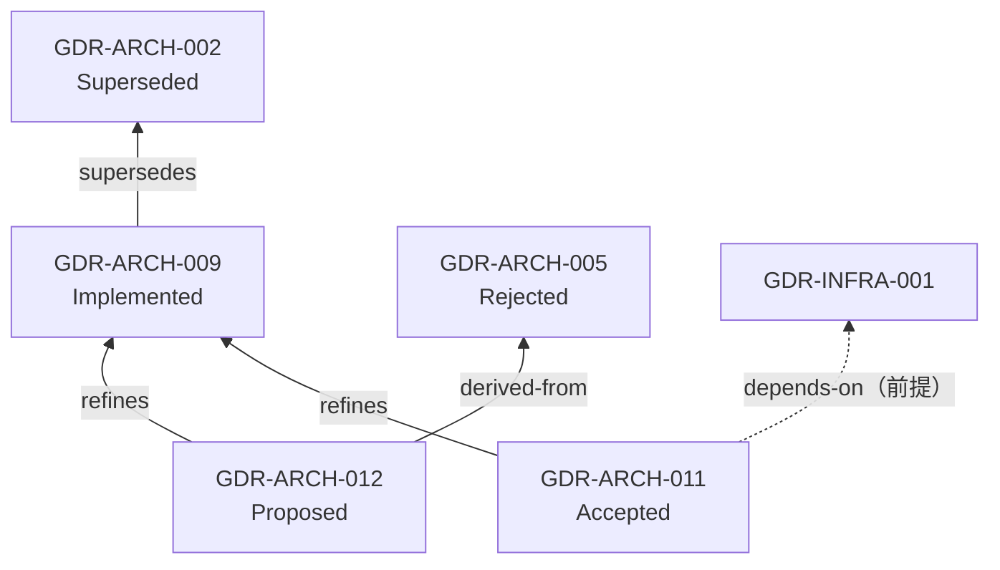

# 015. GDR の系譜の明確化と UUID v7 の検討提案

## 目次

**GDR 一覧:**

| GDR ID | 決定の要約 | status |
|---|---|---|
| GDR-META-040 | GDR の先祖・子孫（系譜）を、ID ではなく既存のリンクで明確にする。親子をつくるリンクを「置換・`refines`・GDR を指す `derived-from`」と定め、前提（`depends-on`）の連鎖と並べてたどれるようにする。系譜は閉路を持たず、置換と派生では親が子より古いことを不変条件にする。UUID v7 は GDR ID には採らず、変わらない補助の識別子（任意フィールド `uid`）として持たせる | Accepted |

---

## 1. GDR（General Decision Record）

**GDR-META-040: GDR の先祖・子孫（系譜）を、ID ではなく既存のリンクで明確にする。親子をつくるリンクを「置換・`refines`・GDR を指す `derived-from`」と定め、前提（`depends-on`）の連鎖と並べてたどれるようにする。系譜は閉路を持たず、置換と派生では親が子より古いことを不変条件にする。UUID v7 は GDR ID には採らず、変わらない補助の識別子（任意フィールド `uid`）として持たせる**

- **status:** Accepted
- **scope:** meta, spec
- **決定:**
  - **系譜の定義（01 §3.1 に置く）:** GDR の「親 → 子」は次の 3 種のリンクだけで表す。先祖は親を、子孫は子を、それぞれ推移的にたどった集合

    | リンク | 書く場所 | 親 | 子 | 性質 |
    |---|---|---|---|---|
    | 置換 | status 行（`Superseded by` / `Accepted (supersedes ...)`） | 旧 GDR | 新 GDR | 因果（同じ判断の更新） |
    | `refines` | 子の「関連」 | 親決定 | 細分化した決定 | 構造（全体と部分） |
    | `derived-from GDR-…` | 子の「関連」 | 元の GDR | 派生した GDR | 因果（元の案や検討から生まれた） |

    - `depends-on`（前提）と `relates-to`（弱い関連）、課題（`§N-M`）への `derived-from` は親子に含めない。前提は「この判断が成り立つための別の判断」で、親子ではない
    - **前提も同じ重みでたどる:** 系譜をたどる手段（下記）は、親子の連鎖（先祖・子孫）と、前提の連鎖（`depends-on` と `refines` を推移的にたどった前提・被前提。波及チェックと同じ範囲）を並べて出す。定義は混ぜず、見え方で「積み上がった判断」を追えるようにする
    - **型の選び分けの目安:**
      - `refines` — この GDR の決定が、親の決定の**範囲の内側**にある（親を分けた・具体的にした）。親子
      - `depends-on` — 親とは**別の対象**についての判断で、親が成り立つことを条件にしている。前提
      - `derived-from GDR-…` — 親の案や検討から生まれたが、**親が成り立つことを条件にしない**（却下・保留された案の再提案、再検討条件の成立を受けた起票など）。親子
      - 同じ相手には 1 つだけ書く。`refines` は前提であることを含むので、`depends-on` と重ねない（`refines` の親は、先祖の段と前提の段の両方に種類つきで出る）
    - 親を持たない GDR を「起点」、子を持たない GDR を「末端」と呼ぶ
    - **系譜は参照の規律を変えない:** 失効した GDR から後継をたどるとき（02 §6）にたどるのは**置換リンクだけ**である。`refines` / `derived-from` の子は後継ではない（細分化した子や、却下案から派生した再提案は、親の代わりにならない）
    - 系譜は現在の「関連」と status 行から導く。波及チェックで付け替え・削除されたリンクの過去の姿は、版管理の履歴にある
  - **不変条件（違反は書式違反ではなく、`系譜`（引数なし）の警告として出す）:**
    - **系譜は閉路を持たない（DAG）。** 3 種とも
    - **置換と GDR 向き `derived-from` では、親は子より古い:** 両端に日時があるとき、親の日時 ≤ 子の日時。オフセットを考慮した時刻で比べ、どちらかが日付のみのときは日付で比べて、同日は違反としない。`refines` には日時の順を課さない（波及チェックの付け替えや、後から親を起票する通常の流れで、親が子より新しくなるため）
  - **たどる手段:**
    - 04 §5 にプロンプト `系譜 [GDR-ID]` を加える。指定 GDR の先祖を起点まで、子孫を末端まで、リンクの種類・status・日時つきで列挙し、別の段に前提・被前提の連鎖を出す。引数なしなら、親子のある系譜の一覧（親も子も無い GDR は件数だけ）と、不変条件の違反、異なる GDR ID に同じ `uid` が付いているもの（警告）を出す
    - 退避済みの GDR は INDEX の 1 行サマリでたどれるところまで出し、「退避済み（本文未読）」と示して止める。日時が読めない端では日時を比べない（`notes/_archive/` は明示指定時のみ読む規則に従う）
    - 図は 06 §4 の関係ビューの絞り込みとして加える。`/gdr-map GDR-ID 系譜` でエッジを親子の 3 種に絞り、`flowchart BT` で描く（矢印とラベルは関係ビューと同じく子 → 親・新 → 旧で、親が上に並ぶ）。`前提` を添えると `depends-on` を点線で足す
    - **3D の系譜ビューア（任意の補助ツール）:** 上流は `docs/ja/01_GDR/tools/gdr_lineage_3d.py` を配る。GDR の Markdown を読み、親子・前提・不変条件の違反と `uid` の警告を 3D で俯瞰する単一の HTML を生成する（縦は日時、GDR の本文と元の文書もその場で読める）。既定の可視化（AI が都度 Mermaid を生成し、生成物を永続化しない。GDR-META-026）は変えない
      - **版の扱い:** `tools/` は任意の補助ツールで、GDR 仕様の版の対象外とする（CHANGELOG の対象の説明に明記し、追加・削除と、読む書式・系譜の定義に関わる変更だけを各版の要約に書く）。ツールは対応する GDR 仕様の版と更新日を持ち、生成物と画面に出す。導入時の取得リストには入れない。要る導入先がタグを指定して取得し、リポジトリの外（または `.gitignore` した場所）で実行する。`_reference/` には入れない
      - **生成物:** 導入先では生成した HTML をコミットしない。上流は見本（架空の GDR だけ。`--demo` で生成し、「生成物・手編集禁止」のヘッダ付き）を 1 つ置く。元の文書を持たないので古くならない。これは GDR-META-026 の「永続化しない」の例外として扱う
      - 読み方・描き方は §4.9
  - **起票時に親を書く（推奨。欠落は書式違反にしない）:** 新しい GDR が既存の GDR を細分化・派生・置換したものなら、親を書く（置換は status 行、細分化は `refines`、派生は `derived-from GDR-…`）。AI が起票するときは、親と型を判断して「関連」に書き、親が無ければ本文の注記か報告で「起点」と明示する。親の候補が複数あって決められないときだけ聞く。親の候補には、同じ PREFIX・scope の有効な GDR、会話で触れた GDR、INDEX の `Rejected` の行（再提案の元）を含める。記入漏れと型の選び方は、レビュー（GDR-META-039 のレビュー用サブエージェントの観点「GDR の書式・規律」）と合意で確かめる
  - **AI が起票するときは日時を書く（推奨。欠落は書式違反にしない）:** 決定の日時は「日時」で残す（`uid` の時刻は起票の時刻で、決定の日時とは限らない）。日時は任意フィールドのまま
  - **UUID v7 の扱い — 補助の識別子 `uid`（01 §3.1 の任意フィールドに追加）:**
    - GDR ID（`GDR-{PREFIX}-{番号}`）は人が読む ID としてそのまま使い、UUID v7 に置き換えない。リンク（「関連」・status 行の置換）の対象も GDR ID のまま
    - 任意フィールド `uid` を足す。形式は UUID v7 の正規表記（小文字の 8-4-4-4-12、例: `- **uid:** 01a2160a-ab52-7343-bb37-84748947ff68`）。GDR を起票したときに 1 回だけ付け、**以後変えない**（status の遷移・採番しなおし・退避・ファイルの移動でも同じ値を保つ）
    - **`uid` は GDR レコード 1 件の識別子である。** 置換・再提案で起票する新しい GDR には新しい `uid` を生成する（旧の値を引き継がない）。同じ GDR の写し（改善提案の文書と `notes/91_gdr/gdr/` の記録）は同じ値を持つ（`一気通貫：` のフェーズ 5 では改善提案の値をそのまま写し、生成しなおさない）。既存の GDR や仕様の例から値を写さない
    - **生成はツールで行う。** AI が値を手で書かない（もっともらしい値を作ってしまい、時刻も一意性も保証されない）。生成には次の 1 行のコマンドを使う（Python 3.7 以上で動く。標準ライブラリだけ）。使えなければ `uid` を書かずに報告する（macOS の `uuidgen` は v4 なので使わない）:

      ```bash
      python3 -c "import os,time,uuid;b=bytearray((time.time_ns()//10**6).to_bytes(6,'big')+os.urandom(10));b[6]=b[6]&15|112;b[8]=b[8]&63|128;print(uuid.UUID(bytes=bytes(b)))"
      ```

    - **生成の手段はファイルで配らない。** コマンドを 01 §3.1 と user-level config に載せる。Python 3.14 以上の `uuid.uuid7()` が無い環境（macOS 標準の Python 3.9 など）でも動き、取得リストや `_reference/` の版に依存しないので、config を更新した時点で全プロジェクトに届き、Claude Code 以外の利用者も 01 から写せる
    - AI が起票するときは `uid` を付ける（推奨。欠落は書式違反にしない）。既存の GDR に遡って付けることは任意（判断の内容を変えないので軽微な追記として扱う。遡って付けた `uid` の時刻は付けた時点のもので、起票の時刻ではない）
    - **使いみち:**
      - **同一性:** 採番しなおしても `uid` は変えないので、同じ GDR だと分かる。番号が重なったときにどちらを採番しなおすかは、実例が出てから決める（再検討条件「採番の衝突」）
      - **プロジェクトをまたぐ参照:** 他プロジェクトの GDR を指すときは、本文に論理名（`{リポジトリ名} リポジトリの GDR-…`）と `uid` を併記する（「関連」の対象には書かない）。相手の採番が変わっても `uid` で特定できる
    - `uid` の時刻は日時の順の確認に使わない（日時の順は「日時」だけで確かめる）。`uid` の先後は文字列の辞書順で比べられる（先頭 48 ビットが時刻のため）
  - **版:** MINOR（任意フィールド `uid` の追加と、推奨・警告だけ。書式・status 値・型の語彙・既存の値の意味は変えない）。解釈版によらず適用（v1.x には `Rejected` が無く却下案からの派生が生じないだけで、読み替えは要らない）
  - **入れ先:** 01 §3（採番ルール）・§3.1 / CHANGELOG（対象の説明に「`tools/` は版の対象外」）/ 02 §6 / 04 §4（`採番しなおして`）・§5 / 06 §4・§5 / T2（GDR の記入欄に `uid`）/ 00（任意フィールドの列挙）/ 新規 `docs/ja/01_GDR/tools/gdr_lineage_3d.py`（任意。取得リスト外。合意までは提案の添付 `15_attachments/` に置く）/ 05（`CLAUDE.md` の不可侵ルールの記載項目、`gdr-kaizen.md`・`gdr-flow.md`・`gdr-map.md` の行、`gdr-reviewer.md` の仕様の観点）/ user-level config。03・T0・T1 は変更なし。生成の手段はファイルで配らない。文案は §4
- **理由:** 先祖・子孫を明確にしたいという目的に対し、UUID v7 が与えるのは (1) 生成時刻による並び順と (2) 調整なしの大域的な一意性で、どちらも「誰が誰の親か」を表さない（§2-3）。系譜を表す材料は「関連」の型付きリンクと置換の相互リンクとしてすでにあるが、どの型が親子かが決まっておらず、実際の記録にも GDR 同士の親子のリンクがほとんど無い（§2-1・2-2）。足りないのは ID の形式ではなく、親子の定義・書く習慣・たどる手段なので、そこを補う。ただし実際の記録では「積み上がった判断」の多くが `depends-on` で書かれているので、前提の連鎖も同じ重みで並べて出さないと、ほとんどの GDR が「先祖なし」になって目的を満たさない（§2-2）。親子と前提を定義で分けるのは、前提を親子に含めると、判断の分解と無関係な連鎖（「キャッシュの方針」が「DB の選定」の子孫になるような）が系譜に入るため。日時の順を置換と派生だけに課すのは、この 2 つが因果の関係で（無かったものを置換・派生はできない）必ず成り立つのに対し、`refines` は構造の関係で、波及チェックの付け替え（GDR-META-038）や後から親を起票する流れで正当に破れるため。UUID v7 は親子を表さないので系譜の手段にはならないが、変わらない識別子として持たせる価値はある。GDR ID は PREFIX 内の採番で、衝突すれば採番しなおし、プロジェクトの外では一意でない。人が読む ID を残したまま `uid` を足せば、採番しなおしても同じ GDR だと分かり、プロジェクトをまたいで指すときも特定できる。採番の衝突もプロジェクトをまたぐ参照もいまは起きていないが、起きてから付けると、それまでの GDR には遡れない。ID を置き換えないので、読みやすさ・既存の参照・リンクの書き方は変わらない（ユーザーの判断「補助的にuuid v7を持たせる」）。3D の系譜ビューアは、GDR-META-026 の代替案 D（インタラクティブ HTML。個人運用・小規模には過剰として却下、再検討条件は「数百件超」）に当たり、その条件は成立していない（このリポジトリで 39 件）。それでも置くのは、ユーザーの指示（「このスクリプトとHTMLもGDRに同梱してほしい」）による。既定の可視化と永続化しない定めは変えず、任意のツールとして置く。生成の手段をファイルではなく 1 行のコマンドで配るのは、`_reference/` が各プロジェクトで取り直すまで届かず、取得リストも実際には Claude Code の config にしか無いため（再レビュー A-4）
  - **代替案 A:** GDR ID を UUID v7 にする（例: `GDR-META-0193c9a2-…`）→ 時刻順に並び、並行する起票でも衝突せず、時刻が必ず付いて後から書き換えられない。しかし親子は表さない。36 文字の ID は会話・見出し・リンクで読めず、AI の文脈も 1 回の参照ごとに大きくなる。UUID v7 の時刻は生成時刻で、決定の日時とは限らず、16 進数で人には読めない。既存の 487 か所の参照と、ID の形を前提にした書式・採番ルール・`/gdr-map` の抽出規則・INDEX の記法を変える（MAJOR）。却下
  - **代替案 B:** 補助の識別子を持たせない（レビュー反映時の案。必要が起きるまで保留）→ 採番の衝突やプロジェクトをまたぐ参照が起きてから付けると、それまでの GDR には付いておらず、起票の時刻も後から作れない（UUID v7 の時刻は生成時点のもの）。GDR 1 件あたりは 1 行と 1 回のコマンドの実行で済む（配る費用は影響のとおり）ので、先に持たせる。却下（ユーザーが「補助的にuuid v7を持たせる」を選んだ）
  - **代替案 I:** `uid` を「関連」や status 行のリンクの対象にする → リンクが読めなくなり、代替案 A と同じ損が出る。リンクは GDR ID のまま、`uid` は同一性の確認とプロジェクトをまたぐ参照の併記だけに使う。却下
  - **代替案 J:** `uid` を必須にする → 任意フィールドの欠落は書式違反にしない方針（GDR-META-025）を変え、既存の GDR がすべて違反になる（MAJOR）。AI 起票時の推奨にとどめる。却下
  - **代替案 K:** UUID v4（`uuidgen` の既定）を使う → macOS・Linux の `uuidgen` で作れ、生成の手段を配る必要が無い。時刻は日時でも残せる。それでも v7 にするのは、ユーザーの判断（「補助的にuuid v7を持たせる」）と、`uid` 自身が起票の順に並ぶため（日時が無い GDR でも並べられる）。却下
  - **代替案 L:** 生成を環境の Python 3.14 以上だけに頼り、スクリプトを配らない → 配るものは無いが、macOS 標準の `/usr/bin/python3` は 3.9 で `uuid.uuid7()` が無い（2026-11-26 に確認）。多くの導入先で `uid` が付かず、推奨が形だけになる。却下（Python 3.7 以上で動く 1 行のコマンドを載せる）
  - **代替案 M:** 生成スクリプトを user-level config（`~/.claude/`）と一緒に配る → プロジェクトのファイルは増えないが、Claude Code の利用者にしか届かない。GDR はツールに依存しない方法論なので、01 にもコマンドを載せる。却下
  - **代替案 N:** 生成スクリプト `uuid7.py` を上流に置き、導入時の取得リストで `_reference/tools/` に取り込む（再レビュー前の案）→ `_reference/` は各プロジェクトで `/gdr-upgrade` するまで届かず、config（全プロジェクト共通）だけが先に `uid` を書こうとして生成に失敗する。取得リストの実体は Claude Code の config にしか無く、`_reference/` に初めて実行物が入る。中身は 1 行に収まる。却下（ユーザーが再レビュー後に「1 行のコマンドを文書に載せる」を選んだ）
  - **代替案 C:** ID に系譜を埋め込む（例: `GDR-META-039.1` を 039 の子にする）→ 親が複数ある派生や、置換で親が変わる場合を表せない。ID が判断の内容に依存し、親の付け替えで ID が変わる。却下
  - **代替案 D:** 逆向きのリンク（「子」フィールド）を各 GDR に書く → 子は親へのリンクから機械的に求まるので二重管理になる（提案 13 の代替案 C と同じ理由）。却下
  - **代替案 E:** `depends-on` も親子に含める → 定義は単純になるが、判断の分解と無関係な連鎖が系譜に入り、親子と前提の区別がなくなる。前提の連鎖は並べて出すことで追える。却下（ユーザーが合意前の確認で「定義は分け、前提も並べて出す」を選んだ）
  - **代替案 F:** 日時の順を 3 種すべてに課す → `refines` で正当に破れ（波及チェックの付け替え・後から親を起票）、警告が常態化して本当の書き間違いが埋もれる。却下
  - **代替案 G:** 起票時に GDR ごとに親を問い合わせる → 改善提案 1 本で GDR が 4〜5 件起票されることがあり、`一気通貫：` の流れを止める。起票後のレビューと合意で確かめられる。却下（決められないときだけ聞く）
  - **代替案 H:** 系譜を 06 の独立したビューにする → 定義は「関係ビューのエッジを 3 種に絞り、向きを `BT` にする」だけで、ビューの種類を増やすほどの中身がない。却下（関係ビューの絞り込みにする）
- **影響:**
  - 01 §3.1 の任意フィールドの表に `uid` を 1 行足し、「関連」の説明に系譜の定義・型の選び分けの目安・不変条件・起票時の推奨（親・日時・`uid`）を足す。型の語彙・status 値は変えない
  - 01 の採番ルール（`{番号}` は PREFIX 内の連番）に「採番しなおしても `uid` は変えない」を 1 文足す。04 §4 の `採番しなおして` にも同じ一文。T2 の GDR の記入欄と 00 の任意フィールドの列挙に `uid` を足す
  - 02 §6 の参照の規律に「たどるのは置換リンクだけ」の一文を足す
  - 04 §5 にプロンプト `系譜` を 1 つ、06 §4 に関係ビューの絞り込み（`系譜` / `前提`）、06 §5 の既定ビューの表に 1 語を足す
  - 05: `CLAUDE.md` の不可侵ルールの記載項目、各コマンドの仕様表の `gdr-kaizen.md`・`gdr-flow.md`・`gdr-map.md` の行、`gdr-reviewer.md` の仕様の観点
  - user-level config: `CLAUDE.md`（GDR 方法論の不可侵ルールに系譜と `uid` の一行）、`commands/gdr-kaizen.md`・`commands/gdr-flow.md`（起票時に親・日時・`uid` を書く。`uid` はツールで生成）、`commands/gdr-map.md`（`系譜` / `前提`）、`agents/gdr-reviewer.md`（観点に「親の記入漏れ・型の選び方」と `uid` の確認）
  - 起票時の問い合わせは増えない（決められないときだけ）。レビューの観点が 1 つ増える。GDR 1 件あたり `uid` の 1 行が増える（約 50 字）
  - config を更新すると、AI は起票のたびに `python3` を 1 回実行する（実行の許可を求められることがある）。Python 3.7 以上があれば `uid` を生成できる。無い環境では付かないが、付かなくても書式違反ではない
  - 上流の `tools/` に任意のツールが 1 つ増える（`gdr_lineage_3d.py`。Python 3.7 以上の標準ライブラリだけで生成する。表示には CDN のライブラリを版の固定と SRI 付きで使うので、開くときにネット接続が要る）。版の対象外で、取得リストも増えない
  - 既存の GDR には遡って親を書くことを求めない。前提の連鎖は既存の `depends-on` からすぐたどれる。置換を記録している導入先では、置換の系譜もすぐたどれる（このリポジトリには実在の置換が無い）
  - 版: MINOR（v2.6）
- **再検討条件:**
  - **プロジェクトをまたぐ親子:** 他プロジェクトの GDR から派生した GDR が導入先で 3 件以上出る（本文に論理名と `uid` を併記して数える）→ 「関連」の対象にプロジェクトをまたぐ参照の記法を足すかを GDR-META で検討する
  - **採番の衝突:** 並行するブランチ・複数の書き手による採番の衝突が起きる（1 回目で、どちらを採番しなおすかの基準を決める。候補は「まだ共有されていない側」。2 回以上起きたら採番そのもの（PREFIX 内の連番）を見直す）
  - **`uid` の記入:** AI 起票時の `uid` の記入率が低い（Python 3 が無い環境・実行の許可が下りない環境が多い）→ 別の手段を足すか、推奨を見直す
  - **`uid` の使われ方:** 発行後 6 か月、`uid` が同一性の確認・プロジェクトをまたぐ参照のどちらにも使われない → 推奨を外すかを見直す
  - **`uid` の誤り:** レビューや `系譜` で、重複した `uid` や形式を満たさない `uid` が 2 件以上見つかる → 生成を仕組みで強制する手段を検討する
  - **3D の系譜ビューア:** 発行後 6 か月、上流・導入先で使われない、または CDN のライブラリの更新・提供終了で動かなくなる → `tools/` から外すかを見直す（外すときは GDR-META-026 の既定に戻るだけで、仕様は変わらない）
  - **親の記入漏れ:** レビューや `系譜` の確認で、親の記入漏れが 3 件以上見つかる → 起票時の確認を強める（親の欄を必須に近づける、T2 の記入欄に注記を足す）
  - **型の選び分けの迷い:** 目安で判定できない例が繰り返し出る、または 3 種に当てはまらない親子関係が繰り返し出る → 目安の見直しか、型の語彙の追加を GDR-META で検討する
  - **日時の記入:** AI 起票時の日時の記入率が高止まりする（GDR-META-025 の再検討条件）→ AI 起票時の日時の必須化を、GDR-META-025 を置換する別の提案で検討する
- **日時:** 2026-11-26T12:48:57+09:00
- **関連:** refines GDR-META-025, depends-on GDR-META-028, relates-to GDR-META-020, relates-to GDR-META-026, relates-to GDR-META-038
- **理由の出所:** ai-reviewed（起点はユーザーの指示「uuid v7を検討してほしい」と、検討中の補足「要は先祖、子孫を明確にしたい」。UUID v7 を補助の識別子として持たせることはユーザーの判断「補助的にuuid v7を持たせる」（レビュー反映後）、生成の手段は、いったん「上流でスクリプトを配る」を選んだのち、再レビューを受けて「1 行のコマンドを文書に載せる」を選んだ。GDR を 1 件のままにする・採番しなおしでは「`uid` は変えない」だけ書く・`uid` の時刻で日時を補う使いみちを削る・前提の段に `refines` も含める、も再レビュー後にユーザーが選んだ。GDR レコードの ID が対象で、改善提案として起票することはユーザーが選択した。「先祖・子孫」を由来・分解・置換の親子と読んだのは起票側の解釈で、レビューの指摘を受けて実例（§4.6）で確かめ、ユーザーが「定義は分け、前提も並べて出す」を選んだ。3D の系譜ビューアを同梱することはユーザーの指示「このスクリプトとHTMLもGDRに同梱してほしい」（合意前の検討で作った試作を受けて）。任意のツールとして取得リストに入れない・生成物をコミットしない・合意まで提案の添付に置く、は AI の起案。ビューアのレビュー後に、合意前に添付を直す・見本は架空の GDR だけ・GDR-META-026 との関係を書き足す・導入先の書き方を寛容に読む・版の対象外とし印を持たせる・全文の埋め込みは GDR のある文書だけ・粒子の表示を削る・git の追加日の推定は残す・色を 06 にそろえる、をユーザーが選んだ。日時の順を置換と派生だけに課す・AI が親を書いてレビューで確かめる・AI 起票時は日時を書く・図は関係ビューの絞り込み、もユーザーが選択肢から選んだ。UUID v7 を ID に採らないという構成と理由、`uid` の細部（変えない・ツールで生成・使いみち）は AI の起案。合意: ユーザー「合意」（2026-11-26）。合意の前にレビュー 3 回（初回・再レビュー・ビューア）を受けて直した）
- **uid:** 01a2165a-7df8-79a8-8621-30e6c7a1c379

---

## 2. 現状

1. **系譜の材料はあるが、親子が定義されていない** — 01 §3.1 の任意フィールド「関連」は `depends-on` / `refines` / `relates-to` / `derived-from` の閉集合で、置換は status 行の相互リンクで表す（GDR-META-025・028）。しかし、どの型が「親 → 子」を表すかは決まっていない。参照の規律（02 §6）は置換を前向きにたどることだけを定め、波及チェック（GDR-META-038）は `depends-on` / `refines` を逆向きに見る。系譜としてまとめた定義はない
2. **実際の記録に親子のリンクがほとんど無い** — このリポジトリの改善提案 01〜14 にある実在の GDR（GDR-META-001〜039、011 は欠番の 38 件。各提案 §4 の記入例 6 件を除く）のうち、「関連」があるのは 16 件。型別では `derived-from` 22（**すべて課題 `§N-M` 向きで、GDR 向きは 0**）、`depends-on` 13、`relates-to` 6、`refines` 1（GDR-META-030 → 025）。実在の置換は 0 件。GDR 同士の親子として読めるのは `refines` 1 本だけで、「積み上がった判断」の連鎖（025 → 028 → 038 など）はすべて `depends-on` で書かれている
3. **ID は系譜を表さない** — `GDR-{PREFIX}-{番号}` の番号は PREFIX 内の採番順で、親子とは無関係。UUID v7 にしても、得られるのは生成時刻の順（48 ビットのミリ秒）と大域的な一意性で、親子は表さない
4. **UUID v7 の利点の現状** — 時刻の順は任意フィールド「日時」で残せるが、任意なので保証はない（実在 38 件のうち GDR-META-001〜023 の 22 件には無く、024 以降の 16 件にはすべてある）。GDR ID はプロジェクト内でしか一意でない（提案 07 の実測: 4 プロジェクトすべてに `GDR-META-001` がある）。プロジェクトをまたいで GDR を指す手段はまだ決まっていない（複合キー `(project, gdr_id)` は GDR-META-020 で提案中・未確定）。採番の衝突はこのリポジトリの履歴では起きていないが、書き手 1 人・並行ブランチなしの履歴なので、複数人の導入先の根拠にはならない
5. **たどる手段が無い** — 06 の関係ビューと `/gdr-map GDR-ID`（近傍）は全種のエッジを描くので、先祖・子孫だけを取り出す見方がない。04 にも系譜を問うプロンプトがない

> 経緯: ユーザーが「uuid v7を検討してほしい」（対象は GDR レコードの ID）と依頼し、検討中に「要は先祖、子孫を明確にしたい」と目的を補足した。目的に照らして、ID の形式ではなく親子の定義と手段の不足が本題と判断した。「先祖・子孫」を由来・分解・置換の親子と読んだのは起票側の解釈で、レビュー（A-1）を受けて実例で確かめた（§4.6）。

---

## 3. 改善案



- 矢印とラベルは 06 §4 の関係ビューと同じ（子 → 親、新 → 旧）。`flowchart BT` なので親が上に並ぶ
- ARCH-012 の先祖は ARCH-009・005・002、ARCH-002 の子孫は ARCH-009・011・012
- ARCH-002 から参照の規律でたどる後継は ARCH-009 だけ（置換リンクだけをたどる。011・012 は後継ではない）
- `depends-on`（点線）は前提の段に出し、親子には数えない
- 日時の順を確かめるのは supersedes（009 ≥ 002）と derived-from（012 ≥ 005）。refines は閉路だけ

---

## 4. 詳細セクション

### 4.1. 01 §3.1 への追記の文案

「関連」の表の後に、「理由の出所の規則:」と同じ形で:

> **系譜（先祖・子孫）の規則:**（経緯: [015 提案](/91_demo_buildup_documents.md/kaizen/15_GDRの系譜の明確化とUUIDv7の検討提案.md) GDR-META-040）
> - GDR の親 → 子は、置換（旧 → 新。status 行）、`refines`（親決定 → 細分化した決定）、GDR を指す `derived-from`（元 → 派生）の 3 種で表す。先祖・子孫はこれを推移的にたどった集合。`depends-on` と `relates-to`、課題（`§N-M`）への `derived-from` は親子に含めない（前提の連鎖は別に並べてたどる）
> - 型の選び分け: `refines` = 親の決定の範囲の内側（分けた・具体的にした）/ `depends-on` = 別の対象の判断で、親が成り立つことを条件にする / `derived-from GDR-…` = 親の案や検討から生まれたが、親が成り立つことを条件にしない。同じ相手には 1 つだけ書く
> - 系譜は閉路を持たない。置換と GDR 向き `derived-from` では、両端に日時があるとき親の日時 ≤ 子の日時（オフセットを考慮して比べ、日付のみのときは日付で比べて同日は違反としない）。`refines` には日時の順を課さない。違反は書式違反ではなく警告
> - 系譜は参照の規律を変えない。後継としてたどるのは置換リンクだけ
> - 既存の GDR を細分化・派生・置換して起票するときは、親を書く（推奨）。AI が起票するときは日時と `uid` も書く（推奨）。いずれも欠落は書式違反にしない

任意フィールドの表に 1 行:

> | `uid` | UUID v7 の正規表記（小文字の 8-4-4-4-12）。ツールで生成し、手で書かない（生成のコマンドは下記） | GDR レコード 1 件の変わらない識別子。起票時に 1 回だけ付け、status の遷移・採番しなおし・退避でも変えない。置換・再提案の新しい GDR は新しい値を持ち、同じ GDR の写しは同じ値を持つ。採番しなおしても同じ GDR だと分かるため、およびプロジェクトをまたぐ参照の併記に使う。リンクの対象・日時の順の確認には使わない |

生成のコマンド（Python 3.7 以上）:

```bash
python3 -c "import os,time,uuid;b=bytearray((time.time_ns()//10**6).to_bytes(6,'big')+os.urandom(10));b[6]=b[6]&15|112;b[8]=b[8]&63|128;print(uuid.UUID(bytes=bytes(b)))"
```

採番ルール（`{番号}` は PREFIX 内の連番）の後に: 「採番しなおしても `uid` は変えない」

### 4.2. 02 §6 への追記の文案

「`Superseded` に当たったら後継を末端の有効 GDR までたどる（断絶・循環は人間に報告）」の後に: 「たどるのは置換リンクだけである。`refines` / `derived-from` の子は後継ではない（01 §3.1 系譜）」

### 4.3. 04 §5 への追記の文案

| プロンプト | 効果 |
|---|---|
| `系譜 [GDR-ID]` | 指定 GDR の先祖を起点まで、子孫を末端まで、リンクの種類・status・日時つきで列挙させる。別の段に、前提（`depends-on` と `refines` を推移的にたどったもの）と被前提を出させる。退避済みの GDR は INDEX の 1 行サマリまでで止め、「退避済み（本文未読）」と示させる。引数なしなら、親子のある系譜の一覧（親も子も無い GDR は件数だけ）と、不変条件の違反（閉路・置換と派生の日時の逆転）と、異なる GDR ID に同じ `uid` が付いているものを出させる |

### 4.4. 06・05 への追記の文案

- 06 §4 の関係ビューの説明の後に: 「**系譜の絞り込み:** `系譜` 指定でエッジを親子の 3 種（`supersedes` / `refines` / GDR 向き `derived-from`）に絞り、`flowchart BT` で描く（矢印とラベルは変えず、親が上に並ぶ）。`前提` を添えると `depends-on` を点線で足す」
- 06 §5 の表の「既定ビュー」の行に「`系譜` 指定で親子に絞る」を足す
- 05:
  - `CLAUDE.md` の仕様の不可侵ルール（L34）: 「系譜（先祖・子孫）は置換・`refines`・GDR 向き `derived-from` で表し、起票時に親・日時・`uid` を書く（推奨。`uid` は 01 §3.1 のコマンドで生成し、手で書かない）」
  - `gdr-kaizen.md` の行: 「GDR ごとに親と型を判断して『関連』に書く（無ければ起点と明示。決められないときだけ聞く）。日時を書く。`uid` をツールで生成して書く」
  - `gdr-flow.md` の行: フェーズ 1 に同じ一文。フェーズ 5 に「`uid` は改善提案の値をそのまま写す」
  - `gdr-map.md` の行: argument-hint に `[系譜] [前提]`、動作に系譜の絞り込み
  - `gdr-reviewer.md` の仕様の観点: 「GDR の書式・規律」に「親の記入漏れ・型の選び方（01 §3.1 の目安）。`uid` があるとき、(1) 小文字の 8-4-4-4-12 か、(2) 3 つ目の区切りの先頭が `7`（version）で 4 つ目の区切りの先頭が `8`・`9`・`a`・`b` のどれか（variant）か、(3) 別の GDR と重複していないか、(4) 仕様の例の値と同じでないか」
- 04 §4 の `採番しなおして` に「`uid` は変えない」
- T2 の GDR の記入欄に `- **uid:** {ツールで生成した UUID v7。手で書かない}（任意 — AI 起票時は推奨。01 §3.1 参照）`、00 の任意フィールドの列挙（日時 / 関連 / 理由の出所）に `uid`

### 4.5. user-level config への追記の文案

- `CLAUDE.md` GDR 方法論 §4（不可侵ルール）: 「系譜（先祖・子孫）は置換・`refines`・GDR を指す `derived-from` で表し、`depends-on` は前提として別にたどる。起票時、既存の GDR を細分化・派生・置換したものなら親を書き、日時と `uid` を書く（推奨。`uid` はコマンドで生成し、手で書かない。以後変えない）。後継としてたどるのは置換リンクだけ」
- `commands/gdr-kaizen.md` / `commands/gdr-flow.md`（フェーズ 1）: 起票する GDR ごとに、親の候補（同じ PREFIX・scope の有効な GDR、会話で触れた GDR、INDEX の `Rejected` の行）から親と型を判断して「関連」に書く。無ければ報告で「起点」と明示。決められないときだけ聞く。日時を書く。`uid` を 01 §3.1 の 1 行のコマンドで生成して書く（手で書かない。生成できなければ書かずに報告）。`gdr-flow.md` フェーズ 5 では改善提案の `uid` をそのまま写す
- `commands/gdr-map.md`: `系譜` / `前提` の指定
- `agents/gdr-reviewer.md`: 観点「GDR の書式・規律」に §4.4 の `gdr-reviewer.md` の観点と同じ文

### 4.6. 例（実在の GDR に当てた結果）

合意の前の確認として、定義をこのリポジトリの GDR-META-024〜039 に当てた（読むだけで書き換えない）。

`系譜 GDR-META-038`:

```
GDR-META-038（Implemented, 2026-11-12）波及チェック
先祖・子孫: なし（起点・末端）
前提:
  GDR-META-025（Implemented, 2026-07-15）関連の型付きリンク
    GDR-META-024（Implemented, 2026-07-15）
  GDR-META-028（Implemented, 2026-09-28）status 5 値
    GDR-META-025（上と同じ）
被前提: なし
不変条件: OK
```

`系譜 GDR-META-039`:

```
GDR-META-039（Implemented, 2026-11-26）レビューの委任とワンセット
先祖・子孫: なし（起点・末端）
前提:
  GDR-META-028 → 025 → 024
  GDR-META-030（Implemented, 2026-09-28）理由の出所
    GDR-META-025（refines。030 の先祖でもある）
不変条件: OK
```

- 親子の段は空でも、前提の段で「積み上がった判断」が追える。ユーザーはこの出し方（定義は分け、前提も並べる）を選んだ
- 目安で見直すと、`depends-on` の 13 本の多くは「別の対象の判断で、前提が成り立つことを条件にする」に当てはまり、`refines` に直すべきものは目立たない（例: 038 波及チェックは、025 の関連の型を前提にした別の手順）。遡って書き換えることは求めない

### 4.7. 例（架空の GDR）

§3 の図と見本（§4.9）の場合の `系譜 GDR-ARCH-012`:

```
GDR-ARCH-012（Proposed, 2026-12-10）
先祖:
  GDR-ARCH-009（Implemented, 2026-11-02）— refines
    GDR-ARCH-002（Superseded, 2026-04-10）— supersedes（退避済みなら「退避済み（本文未読）」）
  GDR-ARCH-005（Rejected, 2026-05-01）— derived-from
    GDR-ARCH-001（Implemented, 2026-03-01）— refines
子孫: なし（末端）
前提:
  GDR-ARCH-009（Implemented, 2026-11-02）— refines
    GDR-INFRA-001（Implemented, 2026-02-15）— depends-on
  GDR-UI-001（Implemented, 2026-03-05）— depends-on
    GDR-ARCH-001（Implemented, 2026-03-01）— depends-on
不変条件: OK（supersedes 009 ≥ 002、derived-from 012 ≥ 005）
```

### 4.8. `uid` の生成コマンドの確認

01 §3.1 に載せる 1 行のコマンド（§4.1）は、2026-11-26 に Python 3.9.6（macOS 標準。`uuid.uuid7()` なし）と 3.15.2 で実行し、どちらも version 7・RFC 9562 の variant・実行時刻の先頭 48 ビットになることを確かめた（再レビューでも 20,000 個を連続生成して重複なし）。

- `time.time_ns()` を使うので Python 3.7 以上が要る
- 同じミリ秒の中での順序（RFC 9562 §6.2 のカウンタ）は保証しない。`uid` は 1 件ずつ起票時に作るので問題にならない。一意性は 74 ビットの乱数で保たれる
- 再レビューの前は、同じ処理を `docs/ja/01_GDR/tools/uuid7.py` として配り、取得リストで `_reference/tools/` に取り込む案だった（代替案 N）

### 4.9. 3D の系譜ビューア（任意の補助ツール）

合意までは提案の添付（`15_attachments/`）に置き、1.2 で `docs/ja/01_GDR/tools/` へ移した（移すだけ。中身はビューアのレビューの反映で決定に合わせた）。以下のパスは移す前の名前で書いている。

- `15_attachments/gdr_lineage_3d.py` — 生成スクリプト。Python 3.7 以上の標準ライブラリだけで動く（表示側の HTML のひな形と、架空の見本の GDR を内蔵した 1 ファイル）。冒頭に対応する GDR 仕様の版（`SPEC_VERSION`）と更新日を持つ
- `15_attachments/lineage_3d_demo.html` — 見本（架空の GDR だけ、約 36 KB）。`--demo` で生成し、先頭に「生成物・手編集禁止」・生成したツールの版・日時のヘッダがある。ブラウザで開くだけで見られる（ネット接続が要る）

使い方:

```bash
python3 gdr_lineage_3d.py                       # notes/91_gdr を読む → lineage_3d.html
python3 gdr_lineage_3d.py 本体=notes/91_gdr --demo -o /tmp/lineage.html
```

- **読むもの:** 指定したディレクトリの下の `*.md`（`_archive` / `_reference` / `review` と `*_reviewed.md` は読まない）。「## 1. GDR」節を持つ文書（改善提案）はその節の GDR だけ、それ以外は文書全体の GDR を読む。コードブロック内の記入例は読まない。GDR の始まりは太字の行（`**GDR-X-NNN: 要約**`）と見出しの行（`## GDR-X-NNN: 要約`）の両方。PREFIX の数字（`A11Y`）、status の注記（`Implemented（…）`）・太字の置換・複数の置換、「関連」の対象の注記・リンクも読む。読めなかったもの（status・日時・型の無い関連・知らない型・GDR らしいのに読めなかった行）は件数を出す。GDR を 1 件以上読めた文書だけを埋め込む。データセットの既定の名前はディレクトリ名（絶対パスを入れない）
- **描くもの:** 親子は §1 の 3 種、前提は `depends-on` と `refines`（`refines` は親子としても描く。`relates-to` は切り替え）。矢印は 06 §4 の関係ビューと同じ向き（子 → 親・新 → 旧・依存側 → 前提）。色は status の 5 値で、色相は 06 §4 にそろえる（status が読めないものは別の色）。縦は日時で上ほど古い（日時 > `uid` の時刻 > ファイルの git 追加日（推定）。どれも位置だけに使う）
- **不変条件と警告:** 閉路と、置換・GDR 向き `derived-from` の日時の逆転（「日時」だけで比べる。日付のみ・オフセットの無い時刻が片方にあれば日付で比べ、同日は違反としない。読めない日時の端は比べない。`refines` は比べない）を一覧にし、赤い線で示す。警告: 異なる GDR ID に同じ `uid` / 形式を満たさない `uid` / 同じ ID が複数の文書にあって `uid` が違う（同じなら写しとして 1 件にまとめる）
- **操作:** GDR をクリックすると先祖・子孫・前提・被前提を強調し、右のパネルに GDR の本文（「GDR 本文」タブ）と `系譜` と同じ形の一覧（「系譜」タブ）を出す。「元の文書を読む」で文書全体を開き、その GDR の位置へ移る。URL の `#{データセットの番号}/{GDR ID}[/doc]` で GDR を指定して開ける
- **安全:** 埋め込むデータは `<` をエスケープする。CDN のライブラリは版を固定し SRI を付ける（3d-force-graph 1.80.1 / marked 12.0.2 / DOMPurify 3.5.0。版を上げたら integrity を CDN と npm のパッケージの両方で計算しなおす）。本文の HTML は DOMPurify で無害化し、`style`・フォーム・`id` などは通さない。ライブラリを読み込めないときはその旨を出す
- **確かめたこと（2026-11-26、ビューアのレビューの反映後）:** Python 3.9.6 と 3.15.2 で同じ出力。見本: GDR 17 件・違反 1 件（UI-006 が派生元 UI-004 より古い）・警告 0 件。`refines` の逆転（ARCH-011 と親 ARCH-009、ARCH-013 と親 ARCH-011）は違反にしない。このリポジトリの改善提案: GDR 39 件・`refines` 2・`depends-on` 14・`relates-to` 8・違反 0 件。読みにくい書き方（見出し形・status の注記・太字の置換・注記つきの関連・`+0900`・読めない日時・`uid` の重複と形式・同じ ID の写しと衝突・本文の `<!--` と `<script>`）を並べた試験用の文書で、それぞれ意図どおりに読み・警告し・ページが壊れないこと。Chrome（ヘッドレス）で SRI つきの読み込み、件数・違反・警告・読めなかったものの表示、`#0/GDR-ARCH-011` の系譜タブ（前提に ARCH-009（refines）→ INFRA-001）を確認
- **直すたびの確認:** `--demo` で「GDR 17 件・違反 1 件・警告 0 件」と出ること、ブラウザで件数の欄が埋まること（スクリプトの冒頭の説明にも書いた）

---

## 5. 検討課題

1. **`uid` をリンクに使うか** — 本提案では「関連」の対象は GDR ID のままとし、`uid` は同一性の確認と本文での併記に使う。プロジェクトをまたぐ親子が増えたら、「関連」の記法を GDR-META で検討する（再検討条件「プロジェクトをまたぐ親子」）。横断検索（提案 07）のキーに `uid` を使うかは、提案 07 の側で決める
2. **既存の GDR への遡及** — 遡って親を書くかは導入先の任意とする。§4.6 の当てはめでは、このリポジトリの `depends-on` の多くは目安どおり前提で、書き換えの必要は目立たない
3. **記録されていない親子（別件）** — レビュー（C-1）の指摘: GDR-META-009（status に `Proposed / Approved / Implemented / Superseded` を導入、`Implemented`）と GDR-META-028（status 5 値化）は内容からは置換か細分化の関係に見えるが、028 の「関連」にも本文にも 009 が出てこない。009 は有効なまま古い status 値を定めている。本提案の範囲外とし、`系譜` の発行後に別件として扱うかを決める
4. **日時の無い GDR** — 日時の順の確認は日時がある両端だけ。日時は任意フィールドのままとし、AI 起票時の記入を推奨する。必須化は GDR-META-025 を置換する別の提案で（再検討条件「日時の記入」）
5. **T2 テンプレートの記入欄** — `uid` の行は足す（入れ先）。「関連」の記入欄の注記に「細分化・派生の親があれば書く」を足すかは、実装中に決める
6. **3D の系譜ビューアのレビュー（済み）** — 再レビューの最中に同梱されたため、別にレビューした（タスク 0.2d）。CDN・見本の公開・GDR-META-026 との関係・版の扱い・導入先の書き方・安全性の指摘を反映した。残り: ほかのブラウザ（Safari・Firefox）での確認、数百件の集合での動き、発行時の DOMPurify の advisories の確認

---

## 6. 実行計画

### 6.1. タスク一覧

| # | タスク | 対象 GDR | 依存 | 状態 |
|---|---|---|---|---|
| 0.1 | レビュー（別モデル）→ 反映 | GDR-META-040 | — | 完了 |
| 0.2 | 実在の GDR への当てはめを示す（§4.6） | GDR-META-040 | 0.1 | 完了 |
| 0.2b | `uid`（補助の UUID v7）を決定に加える（ユーザーの判断）→ 再レビュー → 反映（生成の手段は 1 行のコマンドに変更） | GDR-META-040 | 0.2 | 完了 |
| 0.2c | 3D の系譜ビューア（`gdr_lineage_3d.py`）の同梱を決定に加え、試作を提案の添付 `15_attachments/` に置く（ユーザーの指示） | GDR-META-040 | 0.2 | 完了（決定に追加） |
| 0.2d | 3D の系譜ビューアのレビュー（§5-6）→ 反映（コードと見本、提案本文） | GDR-META-040 | 0.2c | 完了 |
| 0.3 | 合意 | GDR-META-040 | 0.2b・0.2d | 完了（2026-11-26） |
| 1.1 | 01 §3（採番ルール）・§3.1（`uid`・生成のコマンド・系譜）・02 §6 | GDR-META-040 | 0.3 | 完了 |
| 1.2 | 04 §4・§5・06 §4・§5・05・T2・00（任意フィールドの列挙）・`15_attachments/` の 2 ファイルを `tools/` へ移す（06 §4 に任意のツールとして一文。取り方と、生成物はコミットしないこと） | GDR-META-040 | 0.3 | 完了（`scripts/check-links.sh` に Docsify のリンクの title（`':ignore'`）を除く処理を足した。`CLAUDE.md`・`README.md` のディレクトリ構成に `tools/` を足した） |
| 1.3 | user-level config（`CLAUDE.md`・`gdr-kaizen.md`・`gdr-flow.md`・`gdr-map.md`・`gdr-reviewer.md`。`uid` の生成を含む）— リポジトリ外配備 | GDR-META-040 | 0.3 | 完了（リポジトリ外配備。GDR-META-040 自身にも `uid` を付けた — 合意後の付与なので軽微な追記） |
| 2.1 | 版の判定と CHANGELOG（MINOR v2.6。要約に任意フィールド `uid`。互換性に「config を更新すると、起票のたびに `python3` を実行するようになる」。推奨移行に「`系譜`（引数なし）で不変条件の違反を一度確かめる」と config の更新（`CLAUDE.md`・`gdr-kaizen.md`・`gdr-flow.md`・`gdr-map.md`・`agents/gdr-reviewer.md`）、任意に `_reference/` の 01・02・04・06・T2 の取り直し。対象の説明に「`tools/` は版の対象外」、要約に 3D の系譜ビューアの追加）、`~/.claude/CLAUDE.md` §6 の現行版、タグ | GDR-META-040 | 1.1〜1.3 | 未着手 |
| 3.1 | 発行後の観察（再検討条件の各項。導入先の記録を見る手段は横断検索が未実装のため、上流での `系譜` 実行とユーザーの報告による） | GDR-META-040 | 2.1 | 未着手 |

### 6.2. フェーズ詳細

#### フェーズ 0: 合意・準備

- [x] 0.1 レビュー → 反映（A-1〜A-13、D-1・D-2、E、B-1・B-2・B-5・B-8・B-9・B-11 の一部）
- [x] 0.2 実在の GDR への当てはめ（§4.6）
- [x] 0.2b `uid` を決定に加える → 再レビュー → 反映
- [x] 0.2c 3D の系譜ビューアの同梱を決定に加える（§4.9）
- [x] 0.2d 3D の系譜ビューアのレビュー → 反映
- [x] 0.3 合意（2026-11-26）

#### フェーズ 1: 仕様・ガイドへの組み込み

- [x] 1.1 01 GDR 仕様（採番ルール・`uid`・系譜）・02
- [x] 1.2 04 プロンプトガイド・06 可視化ガイド・05・T2・00・ビューアの移動
- [x] 1.3 user-level config

#### フェーズ 2: 発行

- [ ] 2.1 版の判定と CHANGELOG（v2.6 / MINOR）、タグ

#### フェーズ 3: 発行後の観察

- [ ] 3.1 再検討条件の観察

### 6.3. 進捗サマリー

| フェーズ | タスク数 | 完了 | 残 | コミット |
|---|---|---|---|---|
| 0 | 6 | 6 | 0 | 4afa727 / 09b263c / 500294a / 1f7351e / 464cfa2 / e38a4eb / 2fd08e0 / efc4903 / f0b6bdd / db65f28 / 本コミット |
| 1 | 3 | 3 | 0 | f56812f / 本コミット（1.3 は `~/.claude/` 配下への配備のためリポジトリ外） |
| 2 | 1 | 0 | 1 | — |
| 3 | 1 | 0 | 1 | — |

---

## 7. ふりかえり

> 完了時に記入する。途中の記録を残す。

### 7.1. 観察された傾向

- **本提案のレビュー（2026-11-26）:** A 13 件・D 2 件・E 17 項目。【要ユーザー判断】5 件（A-1・A-2・A-11・A-13・D-1）を質問 2 回で聞き、すべて推奨どおりの回答。残りは確認なしで反映した。事実誤認として反映しなかった指摘: なし。対象外として報告に回した指摘: GDR-META-009 と 028 の記録されていない関係（§5-3、別件）
- **目的の読み違いの手前で止まった:** 起票側は「先祖・子孫」を親子だけと読んだが、実データに当てると系譜がほぼ空になることをレビューが示した（A-1）。抽象的な定義ではなく実例（038 の出力）で聞いたことで、ユーザーの意図（前提も含めて積み上がりを追いたい）に合う形を選べた
- **再レビュー（2026-11-26、`uid` と生成スクリプトの追加分）:** A 8 件・D 4 件。【要ユーザー判断】5 件（A-1・A-2・A-3・A-4・A-8）を質問 2 回で聞いた。A-3・A-4・A-8 は推奨どおり、A-1（GDR を分ける）は「1 件のまま」、A-2（採番の衝突の基準）は「`uid` は変えない」だけ書く、を選んだ。事実誤認として反映しなかった指摘: なし。対象外として報告に回した指摘: 再レビュー中に同梱された 3D ビューアの中身（タスク 0.2d）
- **3D の系譜ビューアのレビュー（2026-11-26）:** A 11 件・D 4 件・E 24 項目。【要ユーザー判断】9 件を質問 3 回で聞き、すべて推奨どおりの回答。合意の前に添付のコードを直し（db65f28）、見本を架空の GDR だけで作り直した（582 KB → 36 KB）。事実誤認として反映しなかった指摘: 1 件（「`~/.claude/CLAUDE.md` §6 の現行版は v2.4 のまま」— 実際は v2.5。レビュアーに渡った設定の写しが古かった）。導入先の書き方の実測（手元の 15 プロジェクトのうち 9 が見出し形）は、件数と形だけを使い、プロジェクト名は残していない
- **見本の生成物は 7 分で古くなった:** 改善提案の本文を埋め込んだ見本は、同梱の直後の再レビュー反映で古くなった。GDR-META-026 が永続化を避けた理由そのもので、上流の見本は元の文書を持たない架空のデータにした
- **合意前に決定へ足した要素は、足した分だけ周辺が膨らむ:** `uid` を足した直後の版は、時刻を使う使いみち（衝突の先後・日時の補い）と、ファイルの配布（取得リスト・`/gdr-upgrade`）を伴っていたが、再レビューで「固有の価値は同一性とプロジェクトの外での一意性の 2 つ」「中身は 1 行」と分かり、使いみちを 2 つ、配り方を 1 行のコマンドに絞った

### 7.2. 次回への申し送り
