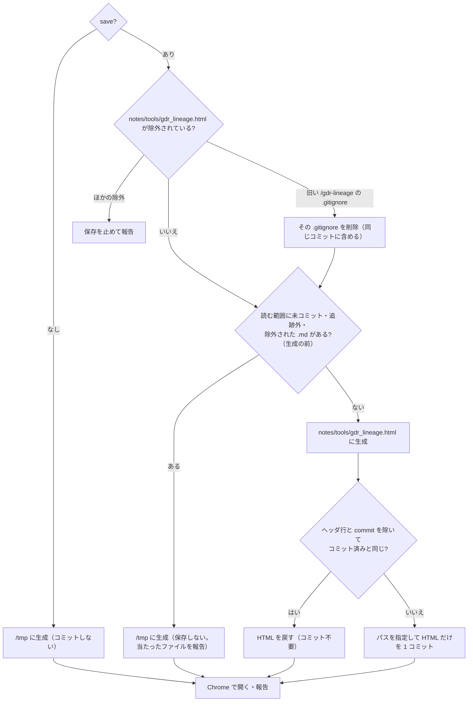

# 016. 系譜ビューアの生成物のコミット提案

## 目次

**GDR 一覧:**

| GDR ID | 決定の要約 | status |
|---|---|---|
| GDR-META-041 | `/gdr-lineage save` と明示したときは、3D の系譜ビューアの HTML を `notes/tools/gdr_lineage.html` に置いてコミットする（共有のため）。GDR-META-040 の「導入先では生成した HTML をコミットしない」と「リポジトリの外（または `.gitignore` した場所）で実行する」を改める。`save` なしは従来どおりリポジトリの外に出してコミットしない。コミットは HTML だけで、読む範囲に未コミット・追跡外・除外された Markdown があるときと、文書が変わっていないときはコミットしない | Proposed |

---

## 1. GDR（General Decision Record）

**GDR-META-041: `/gdr-lineage save` と明示したときは、3D の系譜ビューアの HTML を `notes/tools/gdr_lineage.html` に置いてコミットする（共有のため）。GDR-META-040 の「導入先では生成した HTML をコミットしない」と「リポジトリの外（または `.gitignore` した場所）で実行する」を改める。`save` なしは従来どおりリポジトリの外に出してコミットしない。コミットは HTML だけで、読む範囲に未コミット・追跡外・除外された Markdown があるときと、文書が変わっていないときはコミットしない**

- **status:** Proposed
- **scope:** meta, pol
- **決定:**
  - **`save` なし（既定）:** 出力はリポジトリの外（`/tmp/gdr_lineage_<リポジトリ名>.html`）で、コミットしない。GDR-META-040 のときと同じ（直前の変更 65b8be9 で `.gitignore` した `notes/tools/` に出すようにしたのは戻す）
  - **`save` あり:** 次の順で行う（`/gdr-lineage` の手順に入れる）
    1. **除外の確認:** `git check-ignore -q notes/tools/gdr_lineage.html` で除外されていれば、原因が旧い `/gdr-lineage` の作った `notes/tools/.gitignore`（1 行目が既定のコメント）なら削除して、HTML と同じコミットに含める。それ以外（プロジェクトの `.gitignore` が `*.html` を除外している等）は `-f` を使わず、保存を止めて報告する
    2. **読む範囲の確認（生成の前）:** `git status --porcelain --ignored --untracked-files=all -- ':(glob)<読む範囲>/**/*.md'` が空でなければ、保存せず `save` なしと同じく `/tmp` に出して開き、当たったファイルを報告する。HTML は本文を埋め込むので、コミットされていない下書きや `.gitignore` した文書（ローカル対応表など）の中身が履歴に入るのを防ぎ、コミットした HTML がその時点のコミット済みの文書と一致するようにする。追跡中の `notes/tools/gdr_lineage.html` は書き換えない（後の `git add -A` で漏れる経路を作らない）
    3. **生成:** `notes/tools/gdr_lineage.html` に出す
    4. **文書が変わっていないかの比較:** ヘッダ行と、データの中の対応するコミット（`"commit": "…"`）を除いてコミット済みの HTML と同じなら、作業ツリーの HTML をコミット済みのものに戻し、コミットしない（HTML には生成時刻と HEAD のハッシュが入るので、そのまま比べると毎回差分になる）。ツールのひな形の更新だけの差分はコミットしてよい
    5. **コミット:** HTML（と 1 で削除した `.gitignore`）だけをパスを指定してコミットする（`git commit -- <パス>`。ステージ済みの他の変更を巻き込まない。push しない）。git リポジトリでない場所では保存を止めて報告する
  - **置き場:** `notes/tools/gdr_lineage.html` の 1 つ（読む範囲が既定のとき）。上流リポジトリ自身も同じ（読む範囲は改善提案のディレクトリ。Docsify の公開範囲 `docs/` の外）。読む範囲を引数のディレクトリで変えたときは、既定の範囲の写しと混ざらないよう `save` を付けても保存しない
    - GDR-META-026 の保存先 `notes/91_gdr/map/` は使わない。`/gdr-map` が日付つきで残す Mermaid の置き場で、`/gdr-map` と AI が走査する `notes/91_gdr/` の下に数百 KB の HTML を置かないため。`notes/tools/` は文書の置き場ではないので、標準構成（03 §2.2）には加えない
  - **ツールを直接使う場合:** スクリプトの `-o` の既定・使い方は変えない。どこに出し、コミットするかは使う人が決める
  - **GDR-META-040 との関係:** 040 を置換せず、本 GDR が `refines` する。040 の決定のうち次の 2 つの文を本 GDR が上書きし、040 のほかの決定（系譜の定義・不変条件・`uid`・ツールの版の扱いのそのほか・上流の見本）は有効なまま:
    - 「版の扱い」の「リポジトリの外（または `.gitignore` した場所）で実行する」→ `save` のときは `notes/tools/` に出す
    - 「生成物」の「導入先では生成した HTML をコミットしない」→ `save` のときはコミットする
    - 040 の 2 か所には「GDR-META-041 で改めた」と 1 文の注記を、本 GDR の合意時（`Accepted`）に足す（040 は `Implemented` なので、足す前にユーザーに確かめる）。本 GDR が撤回されたら注記を外す。部分的に改める一般の規則はここでは定めない
  - **GDR-META-026 との関係:** 026 の原則「生成物の永続化は明示指定時のみ」（06 §1-2）に従う形で、026 の例外にはしない。既定の可視化（AI が都度 Mermaid を生成）は変えない
  - **適用:** user-level config は全プロジェクト共通なので、解釈版によらず適用する
- **理由:**
  - 起点はユーザーの指示「生成したHTMLもコミットするに修正」。**目的は共有**（ユーザー「コミットしたい理由は共有のため」）。生成した HTML は手元にしか残らず、系譜を他の人に見せるには、相手がスクリプトを取得して生成しなおす必要があった。コミットすれば、リポジトリを持つ人が Python やスクリプトの取得なしに、同じ系譜を Chrome で開ける
  - **明示したときだけ保存する**のはユーザーの選択（レビュー A-4）。026 の原則と `/gdr-map save` にそろい、026 の例外を増やさない。見るだけでコミットが増えることもない。共有したい時点で意図して残す形になる
  - 040 の「生成物をコミットしない」は、040 の「理由の出所」で AI の起案と記録されている。AI の起案だった文を、ユーザーの指示で改める
  - **026 が永続化を避けた理由への答え:** 026 は「画像をコミット」を「diff レビュー不能・陳腐化の検知も不能」で却下した。本案の HTML も diff は読めない（データは 1 行）が、ヘッダとデータに生成時刻と対応するコミットがあり、古さは `git log <ヘッダのコミット>..HEAD -- <読む範囲>` で検知できる。改善提案 15 のふりかえりは「見本の生成物は 7 分で古くなった」と記録しており、古くなることは知ったうえで、共有の時点で明示して残す形にして抑える
  - 費用と対処:
    - **古くなる** — HTML はソース文書のキャッシュで、文書を直しても再保存しなければずれる。正は常に文書側。古さはヘッダのコミットで判別できる
    - **大きい** — 見本で約 45KB、このリポジトリで約 620KB（データの 1 行が約 59 万字）。文書が変わるたびに全体が差分になる。文書が変わっていない保存はコミットしないことで、意味のない差分を抑える。上流では再検討条件の 1MB に近いうちに当たる見込み
    - **写しが検索に当たる** — コミットした HTML は読む範囲の GDR の本文をもう 1 部持つので、`git grep` / `grep -r` に巨大な 1 行ごと当たり、文書を直しても再保存まで旧い本文が残る。AI は HTML を GDR の根拠として読まない（正は文書）
    - **埋め込みによる漏れ** — スクリプトは読む範囲の Markdown を git の追跡と関係なく読む。読む範囲の確認を生成の前に行うことで防ぐ
  - **代替案 A:** 現状維持（コミットしない） → 共有の目的に合わない。却下
  - **代替案 B:** `/gdr-lineage` を実行するたびに既定でコミットする → 見るたびに写しが新しくなるが、見るだけでコミットが増え、026 の例外が 2 つになる。ユーザーが明示保存を選んだ。却下
  - **代替案 C:** `/gdr-docs`（完了処理）のたびに再生成してコミットする → 古くなりにくいが、任意ツールへの依存を完了処理に持ち込む。保留（再検討条件）
  - **代替案 D:** CI で生成して公開する → 導入先に CI を求めることになり、過剰。却下
  - **代替案 E:** 040 を置換する新 GDR を発行する → 040 の本体（系譜の定義・`uid`）は変わらないのに、全体を写し直し、波及チェックまで回すことになる。2 つの文の変更は `refines` と注記で足りる。却下
- **影響:**
  - **user-level config:** `commands/gdr-lineage.md`（引数に `save`、手順 2 以降: 出力先を `/tmp` に戻す・`save` の 5 段・報告。`notes/tools/.gitignore` を作る行と「除外されていなければ停止」の確認は削る）、説明文（「生成物はコミットしない」→「`save` で `notes/tools/` に保存してコミット」）。`CLAUDE.md` のコマンド表の説明文
  - **上流の文書:** 05 の `gdr-lineage.md` の行（引数・手順の要約。「`.gitignore` した置き場。無ければ作る」を削る）、06 §4（「生成した HTML はコミットしない」と出力先の文）、スクリプト冒頭の `-o` の説明（「リポジトリの中に出すなら .gitignore に入れる」の指示を、使う人が決める形に直す）、改善提案 15 の 2 か所への注記、CHANGELOG。06 §1-2 と 03 §2.2 は変えない
  - **このリポジトリ:** `notes/tools/.gitignore`（65b8be9 で追加）を削除し、`/gdr-lineage save` で HTML をコミットする
  - **既存の導入先:** 旧い `/gdr-lineage` が作った `notes/tools/.gitignore` は、`save` の初回に削除される（手元の環境では上流の 1 つだけ）
  - 波及チェック（GDR-META-038）: 040 を置換しないので対象外。040 を前提にする GDR は変わらない
  - 版: MINOR（v2.8）。必須の移行はない。**user-level config を更新すると、`/gdr-lineage save` が HTML をコミットするようになる**（解釈版によらず適用）
- **再検討条件:**
  - 共有に使われない（発行後 6 か月、`save` した HTML を開いた・渡したという例がない。ふりかえりでユーザーに聞く）→ `save` をやめ、040 の既定（コミットしない）に戻す
  - `save` を忘れて、コミットした HTML が文書より古いまま共有される例が繰り返し見つかる → 代替案 B（既定でコミット）か C（完了処理で再生成）を検討する
  - HTML の差分がリポジトリの肥大化・レビューの妨げとして問題になる（例: 1 ファイルが 1MB を超える。上流では近いうちに当たる見込み）→ コミットをやめるか、生成物を別のブランチ・リリースの添付に移す
  - 未コミット・追跡外・除外された文書を理由に保存できない場面が多い → スクリプトに「git が追跡する文書だけを読む」選択肢を足すかを検討する
  - `refines` と注記で既存の GDR の文を覆す形が 2 回目以降も出る → 02 §5.2 に部分的な改めの規則を足すかを GDR-META で検討する
  - GDR-META-040 の 3D の系譜ビューアを `tools/` から外す → 外す判断をする GDR-META で、本 GDR も置換する
- **日時:** 2026-11-26T15:48:27+09:00
- **関連:** refines GDR-META-040, relates-to GDR-META-026
- **理由の出所:** ai（起点と目的はユーザー: 「生成したHTMLもコミットするに修正」「コミットしたい理由は共有のため」。新しい GDR-META で規則を変えること、明示したとき（`save`）だけ保存すること、保存できないときは `/tmp` に出すこと、`refines` と注記で改めること、MINOR にすることはユーザーが選択した。保存の手順・置き場の理由・026 への答え・費用と対処・代替案の評価は AI の起案）
- **uid:** 01a2169c-d84a-7b56-b766-d418e04aeba4

---

## 2. 現状

1. **規則:** GDR-META-040（改善提案 15）の決定の「生成物」で「導入先では生成した HTML をコミットしない」、「版の扱い」で「リポジトリの外（または `.gitignore` した場所）で実行する」と定めた。GDR-META-026 の「永続化しない」の例外は上流の見本（架空の GDR）1 つだけ。05・06 §4・スクリプト冒頭・`commands/gdr-lineage.md` が同じことを書いている。040 の「生成物をコミットしない」は AI の起案だった
2. **置き場:** `/gdr-lineage` の出力は当初 `/tmp`。直前の変更（65b8be9）で、`.gitignore` した `notes/tools/` に置くように変えた（06 §4 の「`.gitignore` した場所」の範囲内）
3. **埋め込み:** スクリプトは読む範囲の `*.md` を（`_archive` / `_reference` / `review` / `*_reviewed.md` を除いて）git の追跡と関係なく読み、GDR のある文書の全文を HTML に埋め込む。ヘッダ行とデータに生成時刻と HEAD のハッシュ（`"commit"`）が入るので、文書が同じでも再生成すると差分が出る。大きさは見本で約 45KB、このリポジトリの改善提案（GDR 40 件）で約 620KB（レビュー時の実測）
4. **先例:** `/gdr-map` は `save` を付けたときだけ `notes/91_gdr/map/` に生成物ヘッダ付きで保存し、1 コミットする（GDR-META-026）

---

## 3. 改善案

`/gdr-lineage save` のときだけ、`notes/tools/gdr_lineage.html` に保存してコミットする（§1 の決定）。手順の流れ:

---

## 4. 詳細セクション

### 4.1. `commands/gdr-lineage.md` の手順の文案

> 2. **生成（プロジェクトの直下で）:** 読む範囲は、上流リポジトリ `general-decision-record` 自身なら `docs/ja/91_demo_buildup_documents.md/kaizen`、それ以外は `notes`（無ければ `notes/91_gdr`）。ディレクトリの指定があればそのディレクトリ。出力は `/tmp/gdr_lineage_<リポジトリ名>.html`（コミットしない）
> 3. **保存（`save` のときだけ。GDR-META-041）:** 読む範囲が既定のときに限る（ディレクトリを指定したときは保存せず、その旨を報告）
>    1. `git check-ignore -q notes/tools/gdr_lineage.html` で除外されていれば、旧い `/gdr-lineage` の作った `notes/tools/.gitignore`（1 行目が既定のコメント）なら削除する。それ以外の除外は `-f` を使わず保存を止めて報告する
>    2. `git status --porcelain --ignored --untracked-files=all -- ':(glob)<読む範囲>/**/*.md'` が空でなければ保存しない（手順 2 の `/tmp` の HTML を使い、当たったファイルを報告。恒久的に除外した文書があると保存できないことも添える）
>    3. `notes/tools/gdr_lineage.html` に生成する
>    4. 文書が変わっていなければ戻す: `norm() { sed -e 1d -e 's/"commit": "[0-9a-f]*"/"commit": ""/g'; }` で、`git show HEAD:notes/tools/gdr_lineage.html | norm` と `norm < notes/tools/gdr_lineage.html` が同じなら `git checkout -- notes/tools/gdr_lineage.html`（コミット済みの HTML が無い初回は比べない）
>    5. `git add notes/tools/gdr_lineage.html`（1 で削除した `.gitignore` も）して、`git commit -m "…" -- <そのパス>` で 1 コミット。メッセージはプロジェクトのコミット規約に合わせ、規約が無ければ `docs(tools): save the GDR lineage viewer`。push しない。競合したら手で直さず、再生成して解決する
> 4. **開く:** 保存したときは `notes/tools/gdr_lineage.html`、それ以外は `/tmp` の HTML を開く
> 5. **報告:** 実行時の出力に加え、保存した・保存しなかった（理由）・文書が変わっておらずコミットしなかった、を書く。AI は HTML を GDR の根拠として読まない（正は文書）

（以上のコマンドは、レビューで使い捨てのリポジトリに再現して確かめた形）

### 4.2. 06 §4・05・スクリプト冒頭の差し替え

- 06 §4: 「出力は `.gitignore` した場所（`/gdr-lineage` は `notes/tools/`）かリポジトリの外に置く」→「出力はリポジトリの外に置く。共有するときは `/gdr-lineage save` で `notes/tools/gdr_lineage.html` に保存してコミットする（GDR-META-041。読む範囲に未コミット・追跡外・除外された文書があるとき、文書が変わっていないときは保存・コミットしない）」。「生成した HTML はコミットしない」は「`save` のとき以外、生成した HTML はコミットしない」に改める
- 05: `gdr-lineage.md` の行の説明（「生成物はコミットしない」→「生成物は `save` のときだけ `notes/tools/` に保存してコミット」）、引数に `save`、手順の要約（出力先を `/tmp` に戻し、「`.gitignore` した置き場。無ければ作る」を削る）
- スクリプト冒頭の `-o`: 「生成物は既定ではコミットしない（GDR-META-026。リポジトリの中に出すなら .gitignore に入れる）」→「どこに出し、コミットするかは使う人が決める（`/gdr-lineage` は `save` のときだけ `notes/tools/` に保存してコミットする。GDR-META-041）」

---

## 5. 検討課題

1. **040 の改め方** — 決定: `refines` と注記（ユーザーの選択。レビュー A-5）。改めるのは 040 の 2 つの文で、注記は合意時に足す。置換（代替案 E）と注記なしは採らない
2. **再生成の契機** — `save` を付けて実行したときだけ。完了処理での再生成（代替案 C）は、任意ツールへの依存を完了処理に持ち込むので採らず、再検討条件に置いた
3. **コミットしたい動機** — 共有のため（ユーザー）。共有の相手がリポジトリを持たない場合（リンクだけ渡したい等）はコミットでは届かない。その要望が出たら別の手段（公開の置き場）を検討する
4. **版** — 決定: MINOR（v2.8）（ユーザーの選択。レビュー A-6）。06 §4 の定めを改めるので版に出す。v2.5〜v2.7 と同じ日の 4 つ目の版になる。スクリプトの `SPEC_VERSION`（v2.6）は読む書式が変わらないので据え置く
5. **既定でコミットするか（レビュー A-4）** — 決定: `save` を付けたときだけ（ユーザーの選択）。既定でコミットする案は代替案 B として却下
6. **保存できないときの出力先（レビュー A-3）** — 決定: `/tmp` に出す（ユーザーの選択）。追跡中の HTML に下書きの本文を書き込まない

---

## 6. 実行計画

### 6.1. タスク一覧

| # | タスク | 対象 GDR | 依存 | 状態 |
|---|---|---|---|---|
| 0.1 | レビュー（別モデル）→ 反映 | GDR-META-041 | — | 完了（A-3〜A-6 はユーザーの選択） |
| 0.2 | 合意 | GDR-META-041 | 0.1 | 未着手 |
| 1.1 | `commands/gdr-lineage.md`・`CLAUDE.md` のコマンド表（リポジトリ外配備） | GDR-META-041 | 0.2 | 未着手 |
| 1.2 | 05・06 §4・スクリプト冒頭の説明・改善提案 15 の 2 か所への注記（ユーザーに確かめてから） | GDR-META-041 | 0.2 | 未着手 |
| 1.3 | このリポジトリの `notes/tools/.gitignore` を外し、`save` で HTML を保存・コミット。スクリプトは手元の `docs/ja/01_GDR/tools/gdr_lineage_3d.py` を使う（`origin/main` より手元が新しいため。push 後なら取得したもので可） | GDR-META-041 | 1.1 | 未着手 |
| 1.4 | 確かめる: (1) 読む範囲が清浄 → コミットされる / (2) 直後に再実行 → コミットが増えず作業ツリーも清浄 / (3) `.md` を変更・追加 → 保存されず `/tmp` に出る / (4) 除外された `.md` がある → 保存されない / (5) 旧い `notes/tools/.gitignore` がある → 外してコミット / (6) ほかにステージ済みの変更がある → 巻き込まない / (7) 読む範囲が `notes` の導入先の形でも (1)(2) が成り立つ / (8) `save` なし → `/tmp` に出てコミットしない | GDR-META-041 | 1.1 | 未着手 |
| 2.1 | 版（MINOR v2.8）と CHANGELOG（「config を更新すると `/gdr-lineage save` がコミットするようになる」「解釈版によらず適用」「任意: 旧い `notes/tools/.gitignore` は `save` の初回に外れる」）、`~/.claude/CLAUDE.md` §6 の現行版、タグ | GDR-META-041 | 1.1〜1.4 | 未着手 |

### 6.2. フェーズ詳細

#### フェーズ 0: 合意・準備

- [x] 0.1 レビュー → 反映
- [ ] 0.2 合意

#### フェーズ 1: 組み込み

- [ ] 1.1 user-level config
- [ ] 1.2 上流の文書
- [ ] 1.3 このリポジトリでの適用
- [ ] 1.4 確かめる

#### フェーズ 2: 発行

- [ ] 2.1 版・CHANGELOG・タグ

### 6.3. 進捗サマリー

| フェーズ | 状態 |
|---|---|
| 0 | 0.1 完了・合意待ち |
| 1 | 未着手 |
| 2 | 未着手 |

---

## 7. ふりかえり

（完了処理で記入）
