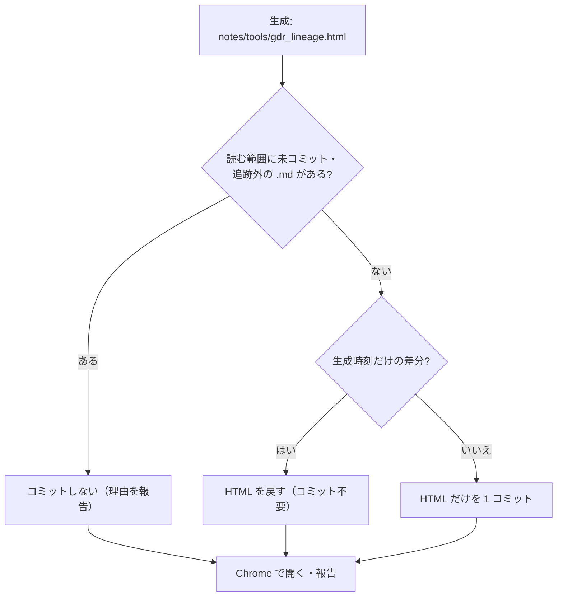

# 016. 系譜ビューアの生成物のコミット提案

## 目次

**GDR 一覧:**

| GDR ID | 決定の要約 | status |
|---|---|---|
| GDR-META-041 | `/gdr-lineage` が生成する 3D の系譜ビューアの HTML を、導入先の `notes/tools/gdr_lineage.html` に置いてコミットする。GDR-META-040 の「生成物: 導入先では生成した HTML をコミットしない」を改め、GDR-META-026 の「永続化しない」の例外に加える。コミットは HTML だけの 1 コミットで、読む範囲に未コミットの変更・追跡外の Markdown があるとき、生成時刻だけの差分のときはコミットしない | Proposed |

---

## 1. GDR（General Decision Record）

**GDR-META-041: `/gdr-lineage` が生成する 3D の系譜ビューアの HTML を、導入先の `notes/tools/gdr_lineage.html` に置いてコミットする。GDR-META-040 の「生成物: 導入先では生成した HTML をコミットしない」を改め、GDR-META-026 の「永続化しない」の例外に加える。コミットは HTML だけの 1 コミットで、読む範囲に未コミットの変更・追跡外の Markdown があるとき、生成時刻だけの差分のときはコミットしない**

- **status:** Proposed
- **scope:** meta, pol
- **決定:**
  - **置き場:** 導入先の `notes/tools/`。ファイル名は `gdr_lineage.html` の 1 つ（読む範囲が既定のとき）。`.gitignore` で除外しない
    - 上流リポジトリ自身も同じ（読む範囲は改善提案のディレクトリ。`notes/tools/gdr_lineage.html` に置く。Docsify の公開範囲 `docs/` の外）
    - 読む範囲を引数のディレクトリで変えたときは、既定の範囲の写しと混ざらないよう、リポジトリの外（`/tmp/gdr_lineage_<リポジトリ名>.html`）に出してコミットしない
  - **コミットの仕方（`/gdr-lineage` の手順に入れる）:** 生成したら、HTML だけを `git add` して 1 コミットする（他の変更を巻き込まない。push はしない）。次のときはコミットせず、理由を報告する（HTML は置いたまま）:
    - **読む範囲に未コミットの変更・追跡外の Markdown がある**（`git status --porcelain -- <読む範囲>` が空でない）— HTML は本文を埋め込むので、コミットされていない下書きや、`.gitignore` した文書（ローカル対応表など）の中身が履歴に入るのを防ぐ。また、コミットした HTML がその時点のコミット済みの文書と一致するようにする
    - **生成時刻だけの差分**（先頭のヘッダ行の生成時刻を除くと、コミット済みの HTML と同じ）— 作業ツリーの HTML をコミット済みのものに戻す
  - **コミットしない場合（ツールを直接使う場合）:** スクリプトの `-o` の既定・使い方は変えない。コミットするかは使う人が決める
  - **GDR-META-040 との関係:** 040 の決定のうち「生成物」の 1 項目だけを改める（系譜の定義・`uid`・ツールの版の扱い・上流の見本は変えない）。040 は置換せず、本 GDR が `refines` する。040 の「生成物」の項目には「GDR-META-041 で改めた」と 1 文の注記を添える（本文の判断は書き換えない。040 にある「発行後の軽微な訂正」の注記と同じ書き方）
  - **GDR-META-026 との関係:** 既定の可視化（AI が都度 Mermaid を生成し、生成物を永続化しない）は変えない。`/gdr-lineage` の HTML を、上流の見本に続く 2 つ目の例外として扱う
- **理由:**
  - 起点はユーザーの指示「生成したHTMLもコミットするに修正」。**コミットしたい動機は確認できていない（不明）**。以下は AI が挙げた利点と費用で、動機の確認とあわせて合意で確かめる
  - 利点（AI の推定）: clone した人が Python やスクリプトの取得なしに、その時点の系譜を Chrome で開ける。系譜の移り変わりを git の履歴で追える
  - 費用と対処:
    - **古くなる** — HTML はソース文書のキャッシュで、文書を直しても再生成しなければずれる（GDR-META-026 が永続化しない理由）。ヘッダと画面に生成時刻と対応する版が出るので、古さは読み手が判別できる。再生成の契機を決めるかは §5-2
    - **差分が大きい** — 1 回の生成で約 40KB 以上（見本で 40KB。本文を埋め込むので文書が増えるほど大きくなる）。生成時刻だけの差分はコミットしないことで、意味のない差分を抑える
    - **埋め込みによる漏れ** — スクリプトは読む範囲の Markdown を git の追跡と関係なく読む。未コミット・追跡外の文書があればコミットしないことで防ぐ
  - **代替案:**
    - **A: 現状維持（コミットしない。`notes/tools/` を `.gitignore`）** → ユーザーの指示に合わない。却下
    - **B: コミットする（本案）**
    - **C: `/gdr-docs`（完了処理）のたびに再生成してコミットする** → 古くなりにくいが、可視化が任意ツールなのに完了処理へ依存を持ち込む。§5-2 で検討（本案では採らない）
    - **D: CI で生成して公開する** → 導入先に CI を求めることになり、過剰。却下
    - **E: 040 を置換する新 GDR を発行する** → 040 の本体（系譜の定義・`uid`）は変わらないのに、全体を写し直すことになる。1 項目の変更は `refines` と注記で足りる。§5-1
- **影響:**
  - **user-level config:** `commands/gdr-lineage.md` の手順 2〜4（出力先・コミットの条件・報告）と説明文（「生成物はコミットしない」→「生成物は `notes/tools/` にコミットする」）。`CLAUDE.md` のコマンド表の説明文
  - **上流の文書:** 05 の `gdr-lineage.md` の行、06 §4 の「生成した HTML はコミットしない」、スクリプト冒頭の `-o` の説明（「既定ではコミットしない」は直接使う場合の説明として残し、`/gdr-lineage` は `notes/tools/` にコミットすると添える）、改善提案 15 の「生成物」の項目への注記、CHANGELOG
  - **このリポジトリ:** `notes/tools/.gitignore`（65b8be9 で追加）を削除し、`notes/tools/gdr_lineage.html` をコミットする
  - **既存の導入先:** `notes/tools/.gitignore` を置いた導入先があれば外す（今回の変更の直前に追加したもので、他の導入先には配っていない見込み）
  - 波及チェック（GDR-META-038）: 040 を置換しないので対象外。040 を前提にする GDR は変わらない
  - 版: MINOR（v2.8）。導入先の必須の移行はない（任意のコマンドの挙動の変更）
- **再検討条件:**
  - コミットした HTML が文書より古いまま放置される例が繰り返し見つかる（例: 合意・完了処理の後に再生成されていない）→ 案 C（完了処理で再生成）を検討する
  - HTML の差分がリポジトリの肥大化・レビューの妨げとして問題になる（例: 1 ファイルが 1MB を超える、差分の確認に支障が出る）→ コミットをやめるか、生成物を別のブランチ・リリースの添付に移す
  - 未コミット・追跡外の文書を理由にコミットしない場面が多く、運用の手間になる → スクリプトに「git が追跡する文書だけを読む」選択肢を足すかを検討する
  - GDR-META-040 の 3D の系譜ビューアが `tools/` から外れる → 本 GDR も失効させる
- **日時:** 2026-11-26T15:48:27+09:00
- **関連:** refines GDR-META-040, relates-to GDR-META-026
- **理由の出所:** human（「生成したHTMLもコミットするに修正」。新しい GDR-META で規則を変えることはユーザーが選択した）。動機は不明。置き場・コミットの条件・`refines` で改める構成・利点と費用・代替案は AI の起案
- **uid:** 01a2169c-d84a-7b56-b766-d418e04aeba4

---

## 2. 現状

1. **規則:** GDR-META-040（改善提案 15）の決定の「生成物」で「導入先では生成した HTML をコミットしない」と定め、GDR-META-026 の「永続化しない」の例外は上流の見本（架空の GDR）1 つだけとした。05・06 §4・スクリプト冒頭・`commands/gdr-lineage.md` が同じことを書いている
2. **置き場:** `/gdr-lineage` の出力は当初 `/tmp`。直前の変更（65b8be9）で、`.gitignore` した `notes/tools/` に置くように変えた（06 §4 の「`.gitignore` した場所」の範囲内）
3. **埋め込み:** スクリプトは読む範囲の `*.md` を（`_archive` / `_reference` / `review` / `*_reviewed.md` を除いて）git の追跡と関係なく読み、GDR のある文書の全文を HTML に埋め込む。先頭のヘッダ行に生成時刻が入るので、文書が同じでも再生成すると差分が出る

---

## 3. 改善案

`/gdr-lineage` の出力を `notes/tools/gdr_lineage.html` にコミットする（§1 の決定）。手順の流れ:

---

## 4. 詳細セクション

### 4.1. `commands/gdr-lineage.md` の手順 2 の文案

> 2. **生成（プロジェクトの直下で）:** 読む範囲は、上流リポジトリ `general-decision-record` 自身なら `docs/ja/91_demo_buildup_documents.md/kaizen`、それ以外は `notes`（無ければ `notes/91_gdr`）。出力は `notes/tools/gdr_lineage.html`（コミットする。GDR-META-041）。引数でディレクトリを指定したときは `/tmp/gdr_lineage_<リポジトリ名>.html` に出してコミットしない
> 3. **コミット:** 次のどちらにも当たらなければ、`git add notes/tools/gdr_lineage.html` だけで 1 コミットする（メッセージは `docs(tools): regenerate the GDR lineage viewer`。push しない）
>    - `git status --porcelain -- <読む範囲>` が空でない → コミットせず、未コミット・追跡外のファイルを報告する
>    - 生成時刻を除くとコミット済みの HTML と同じ → `git checkout -- notes/tools/gdr_lineage.html` で戻す

（判定の具体的なコマンドは実装時に決める。ヘッダ行の生成時刻の書式は `YYYY-MM-DDTHH:MM:SS±HH:MM`）

### 4.2. 06 §4・05 の差し替え

- 06 §4: 「出力は `.gitignore` した場所（`/gdr-lineage` は `notes/tools/`）かリポジトリの外に置く」→「`/gdr-lineage` は `notes/tools/gdr_lineage.html` に置いてコミットする（GDR-META-041。読む範囲に未コミットの変更があるとき・生成時刻だけの差分のときはコミットしない）。直接使うときはリポジトリの外か `.gitignore` した場所に置くか、コミットするかを使う人が決める」。「生成した HTML はコミットしない」の一文は削る
- 05: `gdr-lineage.md` の行の説明（「生成物はコミットしない」→「生成物を `notes/tools/` にコミット」）と手順の要約

---

## 5. 検討課題

1. **040 を置換するか、`refines` で改めるか** — 不可侵ルールは「判断の本質が変わる更新は新 GDR を発行して旧を `Superseded` にする」。本案は新 GDR を発行するが、040 の本体（系譜の定義・`uid`）は有効なまま残したいので置換しない。040 には 1 文の注記だけを足す。040 全体を置換する（案 E）か、注記も足さず 041 の側だけに書くかは合意で決める
2. **再生成の契機** — 本案は `/gdr-lineage` を実行したときだけ再生成する。古くなりにくくするなら、`/gdr-docs`（完了処理）で再生成する（案 C）。任意ツールへの依存を完了処理に持ち込むかの判断になるため、本案では採らず再検討条件に置いた
3. **コミットしたい動機の確認** — 理由の出所は「不明」のまま。動機（共有・履歴・閲覧の手軽さなど）が分かれば理由に書き、再検討条件を動機に合わせて直す
4. **版** — 05・06 と user-level config が変わり、導入先の必須の移行はないので MINOR（v2.8）とした。任意ツールの使い方の変更として版を上げない（v2.7 のように追補扱い）という見方もある

---

## 6. 実行計画

### 6.1. タスク一覧

| # | タスク | 対象 GDR | 依存 | 状態 |
|---|---|---|---|---|
| 0.1 | レビュー（別モデル）→ 反映 | GDR-META-041 | — | 未着手 |
| 0.2 | 合意（§5-1〜4 の判断を含む） | GDR-META-041 | 0.1 | 未着手 |
| 1.1 | `commands/gdr-lineage.md`・`CLAUDE.md` のコマンド表（リポジトリ外配備） | GDR-META-041 | 0.2 | 未着手 |
| 1.2 | 05・06 §4・スクリプト冒頭の説明・改善提案 15 への注記 | GDR-META-041 | 0.2 | 未着手 |
| 1.3 | このリポジトリの `notes/tools/.gitignore` を外し、`/gdr-lineage` で HTML を生成・コミット | GDR-META-041 | 1.1 | 未着手 |
| 2.1 | 版の判定と CHANGELOG、`~/.claude/CLAUDE.md` §6 の現行版、タグ | GDR-META-041 | 1.1〜1.3 | 未着手 |

### 6.2. フェーズ詳細

#### フェーズ 0: 合意・準備

- [ ] 0.1 レビュー → 反映
- [ ] 0.2 合意

#### フェーズ 1: 組み込み

- [ ] 1.1 user-level config
- [ ] 1.2 上流の文書
- [ ] 1.3 このリポジトリでの適用

#### フェーズ 2: 発行

- [ ] 2.1 版・CHANGELOG・タグ

### 6.3. 進捗サマリー

| フェーズ | 状態 |
|---|---|
| 0 | 未着手 |
| 1 | 未着手 |
| 2 | 未着手 |

---

## 7. ふりかえり

（完了処理で記入）
