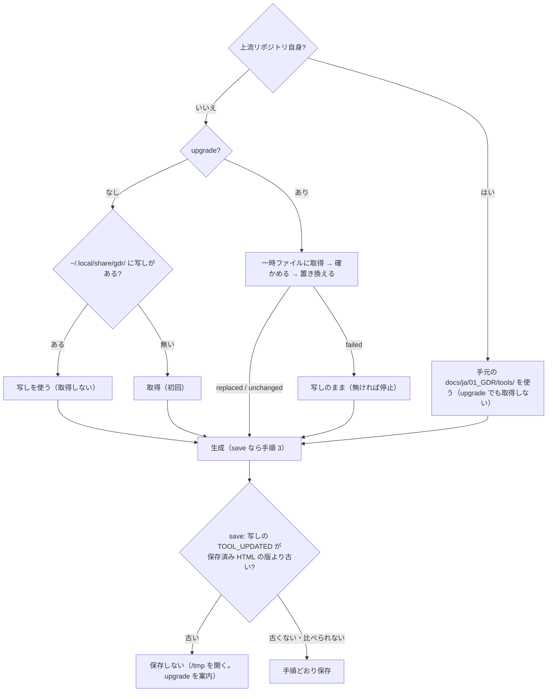

# 017. 系譜ビューアの取得を upgrade に限る提案

## 目次

**GDR 一覧:**

| GDR ID | 決定の要約 | status |
|---|---|---|
| GDR-META-042 | `/gdr-lineage` はツール（`gdr_lineage_3d.py`）を毎回取りに行かず、手元の写しを使う。main の最新を取り直すのは引数 `upgrade` を付けたときと、手元に写しが無いときだけ。`upgrade save` で取り直してから保存する。保存の前に、写しの版がコミット済みの HTML の版より古くないかを比べる。効いていない `curl -z` の説明を直す | Accepted |

---

## 1. GDR（General Decision Record）

**GDR-META-042: `/gdr-lineage` はツール（`gdr_lineage_3d.py`）を毎回取りに行かず、手元の写しを使う。main の最新を取り直すのは引数 `upgrade` を付けたときと、手元に写しが無いときだけ。`upgrade save` で取り直してから保存する。保存の前に、写しの版がコミット済みの HTML の版より古くないかを比べる。効いていない `curl -z` の説明を直す**

- **status:** Accepted
- **scope:** meta, pol
- **決定:**
  - **既定（`upgrade` なし。`save` を含む）:** `~/.local/share/gdr/gdr_lineage_3d.py`（以下「写し」）があればそれを使い、ネットに取りに行かない。無いときだけ取得する（初回）。使った写しの `SPEC_VERSION` と `TOOL_UPDATED` を報告に書き、取得せずに写しを使ったときは「`upgrade` で main の最新を取り直せる」と添える
  - **`upgrade`:** main の最新を一時ファイルに取得し、確かめてから（`SPEC_VERSION` の行がある・構文が通る。構文は `compile()` で確かめ、`.pyc` を書かない）写しを置き換える。結果は `TOOL_FETCH=replaced|unchanged|failed` の 1 行で読む（`replaced` = 置き換えた / `unchanged` = main と同じで変えていない / `failed` = 写しは変えていない。その行が出なければ失敗として扱う）。変わったかどうかと、前後の `TOOL_UPDATED` を報告する（`TOOL_UPDATED` は日付だけなので、同じ日の更新は `replaced` / `unchanged` で見分ける）。失敗したら写しは変えず、その旨を報告して手元の写しで続け、`save` も手順どおり行う（ユーザーの選択。下の版の比較で、古い写しによる保存は止まる）。写しも無ければ停止する。`upgrade` は他の引数と組み合わせられ、予約語として先に読む（`upgrade save` は取り直してから手順どおり保存する。`upgrade` だけなら取り直して `/tmp` に生成して開く）。GDR 仕様の版を上げる `/gdr-upgrade` とは別
  - **保存の前の版の比較（`save` のとき。ユーザーの選択）:** コミット済みの `notes/tools/gdr_lineage.html` があれば、その 1 行目（ヘッダ）の `…（GDR 仕様 vX.Y 向け、YYYY-MM-DD 版）` の日付と、写しの `TOOL_UPDATED` を比べる。写しのほうが古ければ保存せず、理由（「写しが保存済みの HTML より古い。`upgrade` で取り直せる」）を報告して `/tmp` の HTML を開く。同じ日付・新しい・ヘッダが読めない・コミット済みの HTML が無いときは比べず、手順どおり進む。`TOOL_UPDATED` が日付だけなので、同じ日の版の新旧は見分けられない（限界として残す）。手順 3 の「保存しない」条件の 1 つとして、読む範囲の確認の次に置く
  - **上流リポジトリ自身:** 従来どおり取得せず手元の `docs/ja/01_GDR/tools/gdr_lineage_3d.py` を使う。`upgrade` を付けても取得しない（その旨を報告する）
  - **`curl -z` をやめる:** raw.githubusercontent.com は `Last-Modified` を返さないので、`-z`（手元より新しいときだけ取得）は効かず、毎回 200 で取り直している（2026-11-26 に確かめた）。`upgrade` は無条件に取得する
  - **`/gdr-map … 3D`:** `upgrade` も `/gdr-lineage` に渡す
  - **ツール直接の利用・06 §4 の取得の例（`curl … -o ~/.local/share/gdr/gdr_lineage_3d.py`）:** 変えない。「main の最新を取得し、冒頭の版と更新日で確かめる」（GDR-META-040）は、取得するときの規則として有効なまま。本 GDR は `/gdr-lineage` が**いつ**取得するかだけを決める
  - **適用:** user-level config は全プロジェクト共通なので、解釈版によらず適用する
- **理由:**
  - 起点はユーザーの指示「`/gdr-lineage upgrade save` がほしい」「save に最新チェックはいらない」。取得の契機を、ユーザーが明示したときに限る（ユーザーの選択: 「取得は upgrade のときだけ」）
  - **ツールの更新を取り込むかを使う人が決める:** 今は `save` のたびにツールを取り直すので、文書が変わっていなくても、上流でツールが変わっていればひな形の差分だけのコミットが、意図せずに出る。取り直しを `upgrade` に分けると、取り込む時点を使う人が決められる（1 台で使う限り、保存の差分は文書の変化か、明示した `upgrade` によるものだけになる）
  - **古いひな形に戻すコミットを防ぐ:** 写しの版が機器ごとに「最後に `upgrade` した時点」で止まるので、複数の機器・人が `save` すると、古い写しの機器が、文書が同じでもひな形を古い版に戻すコミットを出しうる（`save` の目的は共有なので、複数の機器・人は想定の内）。保存の前に版を比べて、古い写しでは保存しない（ユーザーの選択。レビュー A-5）。`upgrade` に失敗して写しで続けた場合も、同じ比較で古い写しによる保存は止まる（レビュー A-4 の選択と組み合わせた形）
  - **ネットに依存しない:** 写しがあれば、オフラインや GitHub の障害時にも生成できる。既定ではネットに行かないので、毎回の取得（約 55KB）も、CDN のキャッシュ（最大 5 分古い版を受け取る）も当たらない。`upgrade` では push の直後 5 分ほど古い版を受け取ることがあり、報告の `unchanged` で気づける
  - **取得したコードを実行する機会が減る:** main から取ったスクリプトをそのまま実行するのは、明示したときと初回だけになる（レビューでの指摘）
  - **説明と事実のずれを直す:** コマンドと 05 は「`-z` で更新だけ取り直す」と書いているが、実際は毎回取得している。決定の前提が事実と違うまま残らないようにする
  - 費用:
    - 写しが古いまま使われ続けうる。報告に毎回 `TOOL_UPDATED` と `upgrade` の案内を出して抑える。ネットに取りに行かないので「新しい版がある」とは判定しない
    - 写しが壊れても、既定では取り直さないので自然には直らない（今までは次の実行で取り直されていた）。生成がスクリプトのエラーで落ちたら「`upgrade` で取り直す」と案内する
    - 版の比較は日付の粒度なので、同じ日の新旧の行き来は防げない。保存の手順が 1 段増える
  - **代替案 A:** 現状維持（毎回取得） → ユーザーが不要とした。上の差分の問題も残る。却下
  - **代替案 B:** `-z` を ETag（`If-None-Match`）での条件付き取得に替え、毎回確かめる → 更新の有無は正しく分かるが、毎回ネットに行き、保存にひな形の差分が混ざる問題は残る。却下
  - **代替案 C:** 一定期間（例: 7 日）を過ぎたら自動で取り直す → 契機が見えにくく、保存の差分がいつ混ざるか予測しにくい。却下
  - **代替案 D:** `upgrade` で、手元にある上流リポジトリ（push 前の版）から写す → リポジトリの場所が環境ごとに違い、ローカル対応表が要る。共有の仕組みとしては重い。push で足りる。却下
- **影響:**
  - **user-level config:** `commands/gdr-lineage.md`（`argument-hint` と引数の表に `upgrade`、手順 1 の取得の条件・`-z` を外す・確かめてから置き換える・`TOOL_FETCH` の読み方、`python3` の確認を取得の前に移す、手順 3 に版の比較、報告）、`commands/gdr-map.md`（`3D` 以外の引数はすでにそのまま渡すので、括弧書きの `save` の横に `upgrade` を並べるだけ）、`~/.claude/CLAUDE.md`（§3 のコマンド表の `[save]` の横に `[upgrade]`、§6 の現行版）
  - **上流の文書:** 05 の `gdr-lineage.md` の行（「引数」の列に `[upgrade]`、「処理」の列の取得の要約と版の比較）、06 §4（「main の最新を取得し」は残し、`/gdr-lineage` は `upgrade` のときに取り直すと 1 文足す。表記 `/gdr-lineage [<scope / PREFIX / GDR-ID>] [save]` に `[upgrade]`）、CHANGELOG。スクリプト本体は変えない。変えなくてよいことを確かめたもの: 05 の配置表と `gdr-map.md` の行、スクリプトの冒頭、00・README・`_sidebar.md`
  - **既存の導入先:** config を更新すると、次からは写しを使い続ける。上流の更新を取り込むには `upgrade` を付ける。**未 push の更新は、push するまで `upgrade` でも入らない**（取得先は `origin/main`。push はユーザーの指示のときだけ。2026-11-26 時点で `main` は `origin/main` より先で、今日のツールの改善は未 push）。05・CHANGELOG・タグの公開も同じく push 待ち
  - **GDR-META-040 との関係:** 040 の文は上書きしない（「main の最新を取得し、冒頭の版と更新日で確かめる」は取得するときの規則のまま）。改めるのは v2.7 の追補（新しい GDR なし）でコマンドに入った「毎回取り直す」動き。040 への注記は要らない
  - 波及チェック（GDR-META-038）: 040 を置換しないので対象外
  - 版: MINOR（v2.9）。必須の移行はない
- **再検討条件:**
  - 写しが古いまま使われ、上流で直した不具合が導入先で繰り返し問題になる → 代替案 B（条件付きの確認）か C（期間で取り直す）を検討する
  - raw.githubusercontent.com が `Last-Modified` を返すようになる、または ETag での確認が安く書ける → 代替案 B を見直す
  - ツールの配布先が変わる（リリースの添付・パッケージ等） → 取得の手順ごと見直す
  - 同じ日の版の新旧が行き来するコミット（版の比較で防げない分）が実際に出る → `TOOL_UPDATED` に時刻を足す（スクリプトの変更。版の対象外）か、ひな形の中身で比べるかを検討する
  - GDR-META-041 の `save` が廃止される → `upgrade save` と版の比較の記述を外す
- **日時:** 2026-11-26T19:52:22+09:00
- **関連:** refines GDR-META-040, relates-to GDR-META-041
- **理由の出所:** ai-reviewed（起点と方針はユーザー: 「/gdr-lineage upgrade save がほしい」「save に最新チェックはいらない」、取得は upgrade のときだけ・upgrade は必ず取り直す、upgrade が失敗しても写しで保存まで進む（レビュー A-4）、保存の前に版を比べる（レビュー A-5）はユーザーの選択。`-z` が効かないことの確認・取得のコマンド・理由の整理・代替案は AI の起案。取得のコマンドはレビューで使い捨ての場所で試して直した。合意: ユーザー「合意」（2026-11-26）。合意の前にレビュー 1 回を受けて直した）
- **uid:** 01a2177c-2850-774b-a408-6e6b15dc8c86

---

## 2. 現状

1. **取得の規則:** GDR-META-040 は「要る導入先が main の最新を取得し、冒頭の `SPEC_VERSION` と `TOOL_UPDATED` で確かめる」と定めた。いつ取得するかは決めていない
2. **コマンド:** `commands/gdr-lineage.md` の手順 1 は、毎回 `curl -fsSL -z <写し> <main の URL> -o <写し>` を実行する。説明は「`-z` で手元より新しいときだけ取り直す」。05 の行も「あれば `curl -z` で main の更新だけ取り直す」
3. **実際の動き（2026-11-26 に確かめた）:** raw.githubusercontent.com の応答に `Last-Modified` は無く（`ETag` と `cache-control: max-age=300` はある）、`-z` を付けても 200 が返り、毎回取り直している
4. **保存:** `save` は、文書が変わっていなくても、ひな形の差分があればコミットする（GDR-META-041 の「ツールのひな形の更新だけの差分はコミットしてよい」）。毎回取り直すので、上流でツールが変わると、次の `save` で差分が出る

---

## 3. 改善案



---

## 4. 詳細セクション

### 4.1. `commands/gdr-lineage.md` の手順 1 の文案

> 1. **取得（`upgrade` のときと、写しが無いときだけ。GDR-META-042）:** 先に `python3`（3.7 以上）があるかを確かめる（無ければ停止して案内）。上流リポジトリ `general-decision-record` 自身では取得せず、手元の `docs/ja/01_GDR/tools/gdr_lineage_3d.py` を使う（`upgrade` を付けても取得しない）。それ以外は `~/.local/share/gdr/gdr_lineage_3d.py`（以下「写し」）を使い、`upgrade` が無く写しがあればネットに取りに行かない。`upgrade` のとき、または写しが無いときは:
>    ```bash
>    dir=~/.local/share/gdr; dest="$dir/gdr_lineage_3d.py"
>    mkdir -p "$dir"
>    tmp=$(mktemp "$dir/.gdr_lineage_3d.XXXXXX")
>    if curl -fsSL https://raw.githubusercontent.com/yoshinag/general-decision-record/main/docs/ja/01_GDR/tools/gdr_lineage_3d.py -o "$tmp" \
>       && grep -q '^SPEC_VERSION = ' "$tmp" \
>       && python3 -c 'import sys; compile(open(sys.argv[1], encoding="utf-8").read(), sys.argv[1], "exec")' "$tmp"; then
>      if [ -f "$dest" ] && cmp -s "$tmp" "$dest"; then rm -f "$tmp"; echo "TOOL_FETCH=unchanged"
>      else chmod 644 "$tmp" && mv "$tmp" "$dest" && echo "TOOL_FETCH=replaced"; fi
>    else
>      rm -f "$tmp"; echo "TOOL_FETCH=failed"
>    fi
>    ```
>    `TOOL_FETCH=` の行で結果を読む（`replaced` = 置き換えた / `unchanged` = main と同じで変えていない / `failed` = 写しは変えていない。その行が出なければ失敗として扱う）。失敗したら写しで続け（`save` も手順どおり）、その旨を報告する。写しも無ければ停止して案内する。使った写しの `SPEC_VERSION` と `TOOL_UPDATED`（`upgrade` のときは結果と前後の値）を報告し、プロジェクトの解釈版と違えば一言添える。取得せずに写しを使ったときは「`upgrade` で main の最新を取り直せる」と添える。生成がスクリプトのエラーで落ちたら「`upgrade` で取り直す」と案内する

（上のコマンドは、レビューで使い捨ての場所で `file://` の URL に替え、置き換え・変わらず・HTML・構文エラー・取得失敗を試した形）

### 4.1.1. 手順 3 に足す段（版の比較）

> 読む範囲の確認の次に: コミット済みの `notes/tools/gdr_lineage.html` があれば、`git show HEAD:notes/tools/gdr_lineage.html | head -1` の `、YYYY-MM-DD 版）` の日付と、写しの `TOOL_UPDATED` を比べる。写しのほうが古ければ保存しない（「写しが保存済みの HTML より古い。`upgrade` で取り直せる」と報告し、`/tmp` の HTML を開く）。日付が読めなければ比べずに進む

### 4.2. 引数の表に足す行

> | `upgrade` | ツールの写しを main の最新に取り直してから実行する（`upgrade` を付けなければ手元の写しを使い、取りに行かない。写しが無いときだけ取得）。`save` と組み合わせられる。GDR 仕様の版を上げる `/gdr-upgrade` とは別 |

---

## 5. 検討課題

1. **`upgrade` の確かめ方** — 空・HTML のエラーページ・壊れたファイルで写しを上書きしないよう、`SPEC_VERSION` の行と構文（`compile()`。`.pyc` を書かない）で確かめてから置き換え、結果を `TOOL_FETCH=` の 1 行で出す（レビュー A-1〜A-3）。`curl -f` で HTTP のエラーは止まるが、念のため 2 つを重ねる
5. **`upgrade` が失敗したとき（レビュー A-4）** — 決定: 写しで続け、`save` も行う（ユーザーの選択）。古い写しによる保存は版の比較で止まる
6. **複数の機器・人での保存（レビュー A-5）** — 決定: 保存の前に版を比べる（ユーザーの選択）。日付の粒度の限界は再検討条件に置いた
2. **版** — MINOR（v2.9）を提案する。05 のコマンド定義が変わるので版に出す（v2.8 と同じ考え方）
3. **`/gdr-map … 3D` の扱い** — `upgrade` も渡す。`/gdr-map` 自身の引数には足さず、`3D` のときだけ `/gdr-lineage` の引数として通す

---

## 6. 実行計画

### 6.1. タスク一覧

| # | タスク | 対象 GDR | 依存 | 状態 |
|---|---|---|---|---|
| 0.1 | レビュー（別モデル）→ 反映 | GDR-META-042 | — | 完了（A-4・A-5 はユーザーの選択） |
| 0.2 | 合意 | GDR-META-042 | 0.1 | 完了（2026-11-26） |
| 1.1 | `commands/gdr-lineage.md`・`commands/gdr-map.md`・`CLAUDE.md` のコマンド表（リポジトリ外配備） | GDR-META-042 | 0.2 | 未着手 |
| 1.2 | 05・06 §4 | GDR-META-042 | 0.2 | 未着手 |
| 1.3 | 確かめる（置き場と URL を変数にして使い捨ての場所で。導入先は使い捨ての git リポジトリ）: (1) 写しあり・`upgrade` なし → 取得しない / (2) 写しなし → 取得する / (3) 旧い版（例: `git show v2.7:docs/ja/01_GDR/tools/gdr_lineage_3d.py`）を置いて `upgrade` → `replaced` と前後の版 / (4) 取得失敗（URL を変えて再現）→ `failed` で写しが変わらない / (5) `upgrade save` → 取り直してから保存 / (6) 上流リポジトリ自身で `upgrade` → 取得しない / (7) 写しの `TOOL_UPDATED` を保存済み HTML より古くして `save` → 保存されず `/tmp` に出る / (8) `upgrade` 失敗 + 古い写しで `save` → 保存されない | GDR-META-042 | 1.1 | 未着手 |
| 2.1 | 版（MINOR v2.9）と CHANGELOG（互換性: **config を更新すると、`/gdr-lineage` は上流のツールの更新を自動では取り込まなくなる**（`upgrade` のときだけ）・保存の前に版を比べる・解釈版によらず適用。要約: `curl -z` は効いておらず毎回取得していた（v2.7 の「main の更新だけ取り直す」の訂正）。任意の移行: 更新後に 1 回 `upgrade`。スクリプトの `SPEC_VERSION`（v2.6）は据え置き）、`~/.claude/CLAUDE.md` §6 の現行版、タグ。完了の報告に「公開（push）すると、ほかのプロジェクトで `upgrade` で取り込める」と書く | GDR-META-042 | 1.1〜1.3 | 未着手 |

### 6.2. 進捗サマリー

| フェーズ | 状態 |
|---|---|
| 0 | 完了 |
| 1 | 未着手 |
| 2 | 未着手 |
