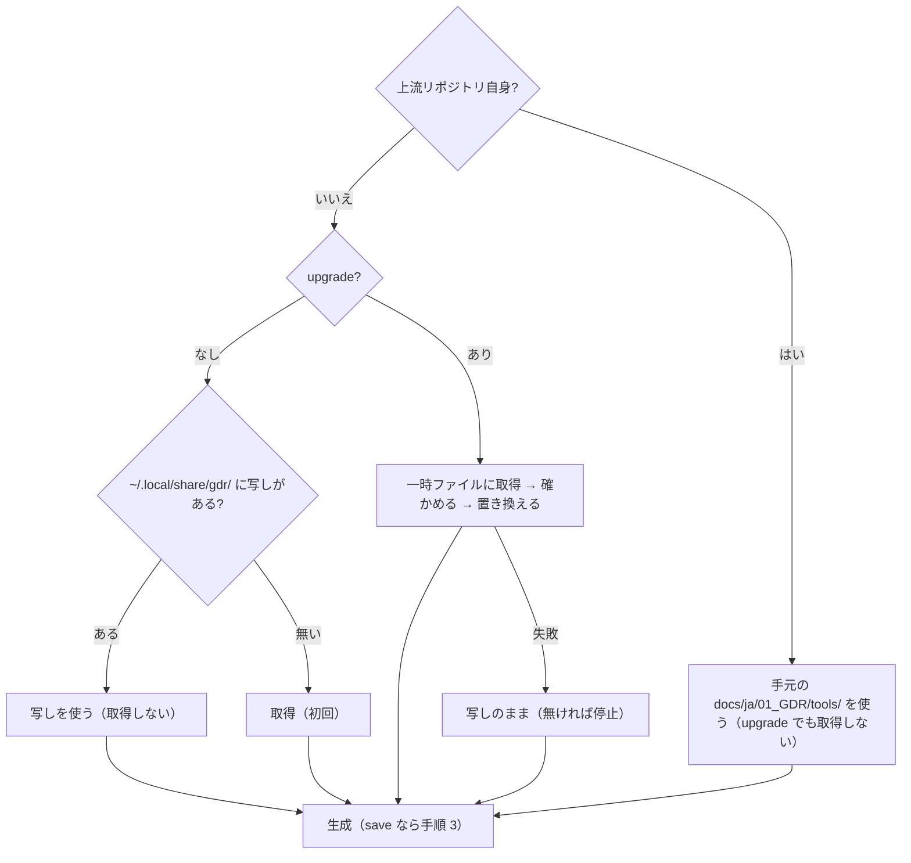

# 017. 系譜ビューアの取得を upgrade に限る提案

## 目次

**GDR 一覧:**

| GDR ID | 決定の要約 | status |
|---|---|---|
| GDR-META-042 | `/gdr-lineage` はツール（`gdr_lineage_3d.py`）を毎回取りに行かず、手元の写しを使う。main の最新を取り直すのは引数 `upgrade` を付けたときと、手元に写しが無いときだけ。`upgrade save` で取り直してから保存する。効いていない `curl -z` の説明を直す | Proposed |

---

## 1. GDR（General Decision Record）

**GDR-META-042: `/gdr-lineage` はツール（`gdr_lineage_3d.py`）を毎回取りに行かず、手元の写しを使う。main の最新を取り直すのは引数 `upgrade` を付けたときと、手元に写しが無いときだけ。`upgrade save` で取り直してから保存する。効いていない `curl -z` の説明を直す**

- **status:** Proposed
- **scope:** meta, pol
- **決定:**
  - **既定（`upgrade` なし。`save` を含む）:** `~/.local/share/gdr/gdr_lineage_3d.py` があればそれを使い、ネットに取りに行かない。無いときだけ取得する（初回）。使った写しの `SPEC_VERSION` と `TOOL_UPDATED` を報告に書き、「`upgrade` で main の最新を取り直せる」と添える
  - **`upgrade`:** main の最新を一時ファイルに取得し、中身を確かめてから（空でない・`SPEC_VERSION` の行がある・`python3 -m py_compile` が通る）写しを置き換える。失敗したら写しは変えず、その旨を報告して手元の写しで続ける（写しも無ければ停止）。取り直す前後の `TOOL_UPDATED` を報告する。`upgrade` は他の引数と組み合わせられる（`upgrade save` は取り直してから手順どおり保存する。`upgrade` だけなら取り直して `/tmp` に生成して開く）
  - **上流リポジトリ自身:** 従来どおり取得せず手元の `docs/ja/01_GDR/tools/gdr_lineage_3d.py` を使う。`upgrade` を付けても取得しない（その旨を報告する）
  - **`curl -z` をやめる:** raw.githubusercontent.com は `Last-Modified` を返さないので、`-z`（手元より新しいときだけ取得）は効かず、毎回 200 で取り直している（2026-11-26 に確かめた）。`upgrade` は無条件に取得する
  - **`/gdr-map … 3D`:** `upgrade` も `/gdr-lineage` に渡す
  - **ツール直接の利用・06 §4 の取得の例（`curl … -o ~/.local/share/gdr/gdr_lineage_3d.py`）:** 変えない。「main の最新を取得し、冒頭の版と更新日で確かめる」（GDR-META-040）は、取得するときの規則として有効なまま。本 GDR は `/gdr-lineage` が**いつ**取得するかだけを決める
  - **適用:** user-level config は全プロジェクト共通なので、解釈版によらず適用する
- **理由:**
  - 起点はユーザーの指示「`/gdr-lineage upgrade save` がほしい」「save に最新チェックはいらない」。取得の契機を、ユーザーが明示したときに限る（ユーザーの選択: 「取得は upgrade のときだけ」）
  - **保存の差分が文書の変化だけになる:** 今は `save` のたびにツールを取り直すので、文書が変わっていなくても、上流でツールが変わっていればひな形の差分だけのコミットが、意図せずに出る。取り直しを `upgrade` に分けると、ツールの更新を取り込むかどうかを使う人が決められる
  - **ネットに依存しない:** 写しがあれば、オフラインや GitHub の障害時にも生成できる。毎回の取得（約 55KB）と CDN のキャッシュ（最大 5 分古い版を受け取る）の不確かさもなくなる
  - **説明と事実のずれを直す:** コマンドと 05 は「`-z` で更新だけ取り直す」と書いているが、実際は毎回取得している。決定の前提が事実と違うまま残らないようにする
  - 費用: 写しが古いまま使われ続けうる。報告に毎回 `TOOL_UPDATED` と `upgrade` の案内を出して抑える。ネットに取りに行かないので「新しい版がある」とは判定しない
  - **代替案 A:** 現状維持（毎回取得） → ユーザーが不要とした。上の差分の問題も残る。却下
  - **代替案 B:** `-z` を ETag（`If-None-Match`）での条件付き取得に替え、毎回確かめる → 更新の有無は正しく分かるが、毎回ネットに行き、保存にひな形の差分が混ざる問題は残る。却下
  - **代替案 C:** 一定期間（例: 7 日）を過ぎたら自動で取り直す → 契機が見えにくく、保存の差分がいつ混ざるか予測しにくい。却下
  - **代替案 D:** `upgrade` で、手元にある上流リポジトリ（push 前の版）から写す → リポジトリの場所が環境ごとに違い、ローカル対応表が要る。共有の仕組みとしては重い。push で足りる。却下
- **影響:**
  - **user-level config:** `commands/gdr-lineage.md`（引数に `upgrade`、手順 1 の取得の条件・`-z` を外す・確かめてから置き換える、報告）、`commands/gdr-map.md`（「3D」で `upgrade` も渡す）、`CLAUDE.md` のコマンド表の引数
  - **上流の文書:** 05 の `gdr-lineage.md` の行（引数・取得の要約）、06 §4（「main の最新を取得し」は残し、`/gdr-lineage` は `upgrade` のときに取り直すと 1 文足す）、CHANGELOG。スクリプト本体は変えない
  - **既存の導入先:** config を更新すると、次からは写しを使い続ける。今日までの上流の更新（push 済みのもの）を取り込むには 1 回 `upgrade` を付ける
  - 波及チェック（GDR-META-038）: 040 を置換しないので対象外
  - 版: MINOR（v2.9）。必須の移行はない
- **再検討条件:**
  - 写しが古いまま使われ、上流で直した不具合が導入先で繰り返し問題になる → 代替案 B（条件付きの確認）か C（期間で取り直す）を検討する
  - raw.githubusercontent.com が `Last-Modified` を返すようになる、または ETag での確認が安く書ける → 代替案 B を見直す
  - ツールの配布先が変わる（リリースの添付・パッケージ等） → 取得の手順ごと見直す
- **日時:** 2026-11-26T19:52:22+09:00
- **関連:** refines GDR-META-040, relates-to GDR-META-041
- **理由の出所:** ai（起点と方針はユーザー: 「/gdr-lineage upgrade save がほしい」「save に最新チェックはいらない」、取得は upgrade のときだけ・upgrade は必ず取り直す、はユーザーの選択。`-z` が効かないことの確認・理由の整理・代替案は AI の起案）
- **uid:** 01a2177c-2850-774b-a408-6e6b15dc8c86

---

## 2. 現状

1. **取得の規則:** GDR-META-040 は「要る導入先が main の最新を取得し、冒頭の `SPEC_VERSION` と `TOOL_UPDATED` で確かめる」と定めた。いつ取得するかは決めていない
2. **コマンド:** `commands/gdr-lineage.md` の手順 1 は、毎回 `curl -fsSL -z <写し> <main の URL> -o <写し>` を実行する。説明は「`-z` で手元より新しいときだけ取り直す」。05 の行も「あれば `curl -z` で main の更新だけ取り直す」
3. **実際の動き（2026-11-26 に確かめた）:** raw.githubusercontent.com の応答に `Last-Modified` は無く（`ETag` と `cache-control: max-age=300` はある）、`-z` を付けても 200 が返り、毎回取り直している
4. **保存:** `save` は、文書が変わっていなくても、ひな形の差分があればコミットする（GDR-META-041 の「ツールのひな形の更新だけの差分はコミットしてよい」）。毎回取り直すので、上流でツールが変わると、次の `save` で差分が出る

---

## 3. 改善案



---

## 4. 詳細セクション

### 4.1. `commands/gdr-lineage.md` の手順 1 の文案

> 1. **取得（`upgrade` のときと、写しが無いときだけ。GDR-META-042）:** 上流リポジトリ `general-decision-record` 自身では取得せず、手元の `docs/ja/01_GDR/tools/gdr_lineage_3d.py` を使う（`upgrade` を付けても取得しない）。それ以外は `~/.local/share/gdr/gdr_lineage_3d.py`（以下「写し」）を使い、`upgrade` が無く写しがあればネットに取りに行かない。`upgrade` のとき、または写しが無いときは:
>    ```bash
>    mkdir -p ~/.local/share/gdr
>    tmp=$(mktemp ~/.local/share/gdr/.gdr_lineage_3d.XXXXXX)
>    curl -fsSL https://raw.githubusercontent.com/yoshinag/general-decision-record/main/docs/ja/01_GDR/tools/gdr_lineage_3d.py -o "$tmp" \
>      && grep -q '^SPEC_VERSION = ' "$tmp" && python3 -m py_compile "$tmp" \
>      && mv "$tmp" ~/.local/share/gdr/gdr_lineage_3d.py || rm -f "$tmp"
>    ```
>    失敗したら写しは変わらない。写しがあればそれで続け、その旨を報告する。写しも無ければ停止して案内する。使った写しの `SPEC_VERSION` と `TOOL_UPDATED`（`upgrade` のときは取り直す前後）を報告し、プロジェクトの解釈版と違えば一言添える。`upgrade` なしのときは「`upgrade` で main の最新を取り直せる」と添える

### 4.2. 引数の表に足す行

> | `upgrade` | ツールの写しを main の最新に取り直してから実行する（無ければ写しを使い、取りに行かない）。`save` と組み合わせられる |

---

## 5. 検討課題

1. **`upgrade` の確かめ方** — 空・HTML のエラーページ・壊れたファイルで写しを上書きしないよう、`SPEC_VERSION` の行と `py_compile` で確かめてから置き換える。`curl -f` で HTTP のエラーは止まるが、念のため 2 つを重ねる
2. **版** — MINOR（v2.9）を提案する。05 のコマンド定義が変わるので版に出す（v2.8 と同じ考え方）
3. **`/gdr-map … 3D` の扱い** — `upgrade` も渡す。`/gdr-map` 自身の引数には足さず、`3D` のときだけ `/gdr-lineage` の引数として通す

---

## 6. 実行計画

### 6.1. タスク一覧

| # | タスク | 対象 GDR | 依存 | 状態 |
|---|---|---|---|---|
| 0.1 | レビュー（別モデル）→ 反映 | GDR-META-042 | — | 未着手 |
| 0.2 | 合意 | GDR-META-042 | 0.1 | 未着手 |
| 1.1 | `commands/gdr-lineage.md`・`commands/gdr-map.md`・`CLAUDE.md` のコマンド表（リポジトリ外配備） | GDR-META-042 | 0.2 | 未着手 |
| 1.2 | 05・06 §4 | GDR-META-042 | 0.2 | 未着手 |
| 1.3 | 確かめる: (1) 写しあり・`upgrade` なし → 取得しない / (2) 写しなし → 取得する / (3) `upgrade` → 取り直して前後の版を報告 / (4) 取得失敗（URL を変えて再現）→ 写しが変わらない / (5) `upgrade save` → 取り直してから保存 / (6) 上流リポジトリ自身で `upgrade` → 取得しない | GDR-META-042 | 1.1 | 未着手 |
| 2.1 | 版（MINOR v2.9）と CHANGELOG、`~/.claude/CLAUDE.md` §6 の現行版、タグ | GDR-META-042 | 1.1〜1.3 | 未着手 |

### 6.2. 進捗サマリー

| フェーズ | 状態 |
|---|---|
| 0 | 未着手 |
| 1 | 未着手 |
| 2 | 未着手 |
