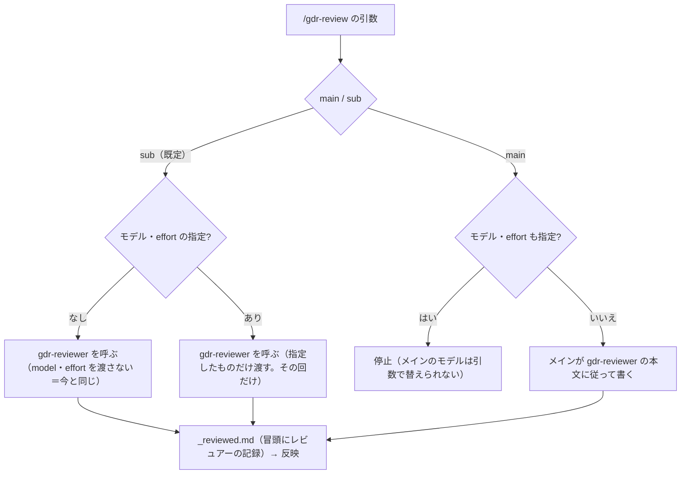

# 018. レビューの実行者とモデルの引数指定提案

## 目次

**GDR 一覧:**

| GDR ID | 決定の要約 | status |
|---|---|---|
| GDR-META-043 | `/gdr-review`・`レビュー：` に、レビューの実行者（`main` / `sub`）・レビュアーのモデル（`fable` / `opus` / `sonnet` / `haiku`）・effort（`low`〜`max`）を引数で指定できるようにする。指定しなければ今と同じ（`gdr-reviewer` の frontmatter で決まる）。「呼び出し時に `model` も `effort` も指定しない」を「引数で明示したときだけ指定する」に改める | Proposed |

---

## 1. GDR（General Decision Record）

**GDR-META-043: `/gdr-review`・`レビュー：` に、レビューの実行者（`main` / `sub`）・レビュアーのモデル（`fable` / `opus` / `sonnet` / `haiku`）・effort（`low`〜`max`）を引数で指定できるようにする。指定しなければ今と同じ（`gdr-reviewer` の frontmatter で決まる）。「呼び出し時に `model` も `effort` も指定しない」を「引数で明示したときだけ指定する」に改める**

- **status:** Proposed
- **scope:** meta, pol
- **決定:**
  - **引数（どれも省略可。順不同。ファイル名と「レビューのみ」は従来どおり）:**
    - 実行者: `sub`（既定。サブエージェント `gdr-reviewer` に委ねる）/ `main`（メインセッションが自分でレビューする）
    - モデル: `fable` / `opus` / `sonnet` / `haiku`（`sub` のときだけ。その回の Agent 呼び出しの `model` に渡す）
    - effort: `low` / `medium` / `high` / `xhigh` / `max`（`sub` のときだけ。その回の Agent 呼び出しの `effort` に渡す）
    - 読み方: 空白で区切った語が上の語のどれかと（大文字小文字を区別せず）一致し、かつ既存のファイルのパスでないときだけ引数として読み、ファイル名から除く。残りがファイル名（空ならモード B）
  - **既定（引数なし）:** 今と同じ。`sub` で、`model` も `effort` も渡さない（frontmatter の 1 か所で決まる）
  - **`sub` + モデル / effort:** 指定したものだけを渡し、指定しないものは frontmatter に任せる。その回だけで、frontmatter は変えない
  - **`main`:** サブエージェントを起動せず、メインセッションが `gdr-reviewer` の本文（観点・出力構造）に従って `_reviewed.md` を書き、続けて反映まで行う（ワンセット）。`gdr-reviewer` を使えないときの代替（反映に進まず止める）とは別扱い。`main` とモデル / effort を同時に指定したら、メインのモデルと effort は引数では替えられない（`/model` 等で切り替える）と伝えて停止する
  - **記録:** `_reviewed.md` の冒頭に、実行者・モデル・effort と、それが既定か引数での指定かを 1 行書く（例: `レビュアー: sub（opus・effort high。引数で指定）`）。`sub` のときは呼び出し側がプロンプトで伝え、レビュアーが書く
  - **`haiku`:** 使えるが、レビューの質が下がる見込みなので、指定されたら 1 行添える（止めない）
  - **規則の改め:** 05 §3「レビューの委任」と `~/.claude/CLAUDE.md` の「`gdr-reviewer` は呼び出し時に `model` も `effort` も指定しない」を、「既定では指定しない。引数で明示したときだけ、その回に限って指定する」に改める。モデルの**既定**は frontmatter の 1 か所で決める原則は変えない
  - **`/gdr-flow` のセルフレビュー段:** 既定（引数なし）で委ねる。`/gdr-flow` の引数に同じ語が含まれていても、作業指示の一部として読み、レビューの引数にはしない（指示の文と混ざるため）
  - **適用:** user-level config は全プロジェクト共通なので、解釈版によらず適用する
- **理由:**
  - 起点はユーザーの指示「review 系にも引数がほしいかも。デフォルトは今の状態で main|sub fable|opus|haiku とか」「引数で変更できる仕組みに修正」「effort も引数でほしいね」
  - **場面でレビューの重さを変えたい:** 既定のレビュアー（上位モデル・effort high）は単価が高く、1 回が長い。小さな文書や確認だけのレビューは軽いモデル・低い effort で足り、重要な判断は effort を上げたい。今は frontmatter を書き換えるか、プロジェクトに定義を置くしかなく、1 回だけ変えるには重い
  - **既定は変えない:** 指定しなければ今と同じなので、既存の使い方・GDR-META-039 の「上位モデルの独立した目で見る」は保たれる。引数はその回だけの明示的な例外
  - **`main` を明示の選択肢にする:** サブエージェントに委ねるのは、書いた本人の文脈から離れた目で見るため（039）。`main` はその利点を手放すが、会話の文脈を踏まえて素早く見たい場面がある。明示したときだけにし、記録に残す
  - **記録を残す:** 軽いレビューで済ませた文書と、既定のレビューを経た文書を後から区別できるようにする（理由の出所 `ai-reviewed` の重みが変わるため）
  - **代替案 A:** 現状維持（frontmatter かプロジェクトの定義で変える） → 1 回だけ変えるには重い。却下
  - **代替案 B:** モデルごとに別のサブエージェント（`gdr-reviewer-opus` 等）を定義する → 定義の本文を写す数が増え、観点の更新が漏れる。却下
  - **代替案 C:** `/gdr-flow` の引数でもレビューの指定を受け付ける → 作業指示の自然文と語が衝突する（例: 「main ブランチの…」）。今回は採らない（再検討条件）
- **影響:**
  - **user-level config:** `commands/gdr-review.md`（引数・読み方・委任の節・`main` の流れ・記録）、`agents/gdr-reviewer.md`（冒頭の記録の 1 行を書く。呼び出し側から実行者・モデル・effort を受け取る）、`CLAUDE.md`（モデルの役割分担の「呼び出し時に指定しない」、§3 の `レビュー：` の行、コマンド表の引数）、`commands/gdr-flow.md`（セルフレビューは既定で委ねる、と 1 文）
  - **上流の文書:** 05 §3「レビューの委任」の 2 つ目の項目、`gdr-review.md` の行（引数）、`gdr-reviewer.md` の仕様の節（記録の 1 行）、CHANGELOG。04 にレビューのプロンプトの記述があれば合わせる
  - **GDR-META-039 との関係:** 039 を置換せず `refines` する。039 のうち「呼び出し時に指定しない」の 1 文を本 GDR が改め、委任・ワンセット・frontmatter で既定を決める原則は有効なまま。039 の該当箇所に「GDR-META-043 で改めた」と 1 文の注記を、合意時に足す（039 は `Implemented` なので足す前にユーザーに確かめる）
  - 波及チェック（GDR-META-038）: 039 を置換しないので対象外
  - 版: MINOR。必須の移行はない（GDR-META-042 と同時に発行するなら同じ版にまとめる）
- **再検討条件:**
  - 引数の指定がほとんど使われない（発行後 3 か月、ふりかえりでユーザーに聞く） → 引数を外し、frontmatter だけに戻す
  - `haiku` や低い effort のレビューで見落としが繰り返し起きる → 下限（例: `haiku` は使えない）を設ける
  - `/gdr-flow` でもレビューの重さを変えたい要望が出る → 代替案 C を、語の衝突を避ける書き方（例: `review=opus`）で検討する
  - Agent ツールの `model` / `effort` の指定の仕様が変わる → 渡し方を見直す
- **日時:** 2026-11-26T19:55:03+09:00
- **関連:** refines GDR-META-039
- **理由の出所:** ai（起点と方針はユーザー: 「デフォルトは今の状態で main|sub fable|opus|haiku」「引数で変更できる仕組みに修正」「effort も引数でほしい」「現在の設定はデフォルトで、引数がある場合のみそれを適用」。`sonnet` の追加・`main` とモデルの同時指定の扱い・記録・`/gdr-flow` を対象外にすること・代替案は AI の起案）
- **uid:** 01a2177e-9cca-7445-8d41-24be16856da2

---

## 2. 現状

1. **委任:** `/gdr-review`・`レビュー：`（`/gdr-flow` のセルフレビュー段を含む）は、対象の特定をメインセッションが行い、レビュー本体を `gdr-reviewer` に委ねる（GDR-META-039）
2. **モデルと effort:** `gdr-reviewer` の frontmatter（`model: fable`、`effort: high`）の 1 か所で決める。呼び出し時に `model` も `effort` も指定しない（05 §3、`~/.claude/CLAUDE.md`、`commands/gdr-review.md`）。変えるには frontmatter を書き換えるか、プロジェクトの `.claude/agents/gdr-reviewer.md` を置く
3. **引数:** `/gdr-review` の引数はファイル名と「レビューのみ」（`--no-apply`）だけ
4. **Agent ツール:** 呼び出し時に `model`（`fable` / `opus` / `sonnet` / `haiku`）と `effort`（`low`〜`max`）を指定でき、frontmatter より優先される。`effort` はユーザーが明示したときだけ指定する決まり（引数での明示はこれに当たる）

---

## 3. 改善案

---

## 4. 詳細セクション

### 4.1. 引数の例

| 入力 | 動き |
|---|---|
| `/gdr-review foo.md` | 今と同じ（sub・frontmatter のモデルと effort） |
| `/gdr-review foo.md opus` | sub・opus・effort は frontmatter（high） |
| `/gdr-review foo.md sonnet low` | sub・sonnet・effort low |
| `/gdr-review foo.md max` | sub・モデルは frontmatter（fable）・effort max |
| `/gdr-review foo.md main` | メインセッションがレビューして反映 |
| `/gdr-review foo.md main opus` | 停止（メインのモデルは引数で替えられない） |
| `/gdr-review opus` | モード B（対象を自動特定）・sub・opus |
| `レビュー：foo.md haiku レビューのみ` | sub・haiku（質が下がる旨を添える）・反映せず止める |

### 4.2. `commands/gdr-review.md` の「引数の読み方」の文案

> **引数の読み方:** `$ARGUMENTS` を空白で区切り、次の語（大文字小文字を区別しない。既存のファイルのパスと一致するものは除く）を引数として取り出す。残りがファイル名で、空ならモード B。
> - `レビューのみ` / `--no-apply` → 反映せず止める
> - `main` / `sub` → レビューの実行者（既定 `sub`）
> - `fable` / `opus` / `sonnet` / `haiku` → レビュアーのモデル（`sub` のときだけ）
> - `low` / `medium` / `high` / `xhigh` / `max` → レビュアーの effort（`sub` のときだけ）
> 同じ種類の語が 2 つあれば停止して聞く。`main` とモデル / effort を同時に指定したら停止して伝える

---

## 5. 検討課題

1. **`sonnet` を含めるか** — ユーザーの例は `fable|opus|haiku`。Agent ツールが受け付ける 4 つをそろえて `sonnet` も含める案にした（要確認）
2. **`main` のときに反映まで行うか** — 明示の選択なのでワンセットどおり反映まで行う案にした。`gdr-reviewer` が使えないときの代替（止める）とは扱いを分けた
3. **`/gdr-flow` を対象にするか** — 今回は対象外（代替案 C）。必要なら `review=…` の形で別に検討する
4. **版** — MINOR。GDR-META-042（改善提案 017）と同時に合意するなら、同じ版にまとめて発行する

---

## 6. 実行計画

### 6.1. タスク一覧

| # | タスク | 対象 GDR | 依存 | 状態 |
|---|---|---|---|---|
| 0.1 | レビュー（別モデル）→ 反映 | GDR-META-043 | — | 未着手 |
| 0.2 | 合意（039 への注記の確認を含む） | GDR-META-043 | 0.1 | 未着手 |
| 1.1 | `commands/gdr-review.md`・`agents/gdr-reviewer.md`・`commands/gdr-flow.md`・`CLAUDE.md`（リポジトリ外配備） | GDR-META-043 | 0.2 | 未着手 |
| 1.2 | 05 §3・`gdr-review.md` の行・`gdr-reviewer.md` の仕様、改善提案 14 への注記 | GDR-META-043 | 0.2 | 未着手 |
| 1.3 | 確かめる: §4.1 の例のうち、既定・`opus`・`sonnet low`・`main`・`main opus`（停止）・モード B + `opus` を実際に動かし、`_reviewed.md` の冒頭の記録を見る | GDR-META-043 | 1.1 | 未着手 |
| 2.1 | 版（MINOR）と CHANGELOG、`~/.claude/CLAUDE.md` §6 の現行版、タグ | GDR-META-043 | 1.1〜1.3 | 未着手 |

### 6.2. 進捗サマリー

| フェーズ | 状態 |
|---|---|
| 0 | 未着手 |
| 1 | 未着手 |
| 2 | 未着手 |
