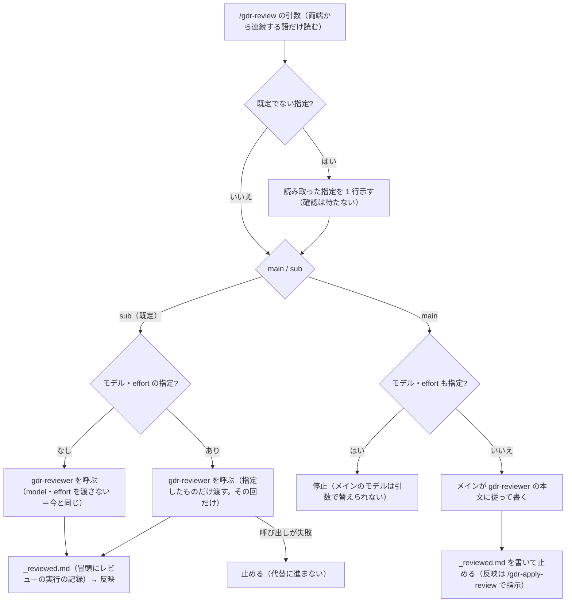

# 018. レビューの実行者とモデルの引数指定提案

## 目次

**GDR 一覧:**

| GDR ID | 決定の要約 | status |
|---|---|---|
| GDR-META-043 | `/gdr-review`・`レビュー：` に、レビューの実行者（`main` / `sub`）・レビュアーのモデル（Agent ツールのエイリアス）・effort の段階を引数で指定できるようにする。指定しなければ今と同じ（`gdr-reviewer` の frontmatter で決まる）。`main` はメインセッションが `_reviewed.md` を書いて止める。「呼び出し時に `model` も `effort` も指定しない」を「既定では指定しない。引数で明示したときだけ、その回に限って指定する」に改める | Implemented |

---

## 1. GDR（General Decision Record）

**GDR-META-043: `/gdr-review`・`レビュー：` に、レビューの実行者（`main` / `sub`）・レビュアーのモデル（Agent ツールのエイリアス）・effort の段階を引数で指定できるようにする。指定しなければ今と同じ（`gdr-reviewer` の frontmatter で決まる）。`main` はメインセッションが `_reviewed.md` を書いて止める。「呼び出し時に `model` も `effort` も指定しない」を「既定では指定しない。引数で明示したときだけ、その回に限って指定する」に改める**

- **status:** Implemented
- **scope:** meta, pol
- **決定:**
  - **引数（どれも省略可）:**
    - 実行者: `sub`（既定。サブエージェント `gdr-reviewer` に委ねる）/ `main`（メインセッションが自分でレビューする）
    - モデル: Agent ツールの `model` が受け付けるエイリアス（`sub` のときだけ。その回の呼び出しの `model` に渡す）。語の集合を列挙するのは user-level の `commands/gdr-review.md` の 1 か所だけにし、保守メモ（Agent ツールの受け付ける値が変わったらここを直す）を付ける。上流の文書・GDR・CHANGELOG は「レビュアーのモデル（エイリアス）」と書き、モデル名を列挙しない（GDR-META-039 の「上流の文書に特定のモデル名を書かない」に従う）
    - effort: Agent ツールの `effort` が受け付ける段階（`sub` のときだけ。その回の呼び出しの `effort` に渡す。列挙は同じく `commands/gdr-review.md` だけ）
  - **読み方（ユーザーの選択: 裸の語・位置を限る・適用前に示す）:**
    - 引数を空白で区切り、**両端から内側へ連続して並ぶ**引数の語だけを読む（大文字小文字を区別しない）。引数の語でないものに当たったら、そこから内側はすべてファイル名（空ならモード B）。途中にある語は読まない。「レビューのみ」（`--no-apply`）も同じ規則で読む（従来の「末尾」を両端に広げる）
    - 引数の語が既存のパス（作業ディレクトリからの相対のファイル・ディレクトリ）とも一致したとき、また取り出した後のファイル名が存在せず、語を含めた名前なら存在するとき（空白を含むファイル名）は、どちらの意味かを聞く。同じ種類の語が 2 つあれば（`main sub`、モデル 2 つ等）停止して聞く
    - 自然文の `レビュー：` では、実行者・モデル・effort の指定だと文として読めるときだけ引数として扱う（「レビューのみ」と同じ扱い）
    - 既定でない指定を読み取ったら、委任（または `main` のレビュー）の前に 1 行示す（例: 「レビューの実行: sub（モデル: opus〔引数〕・effort: 既定）」）。確認は待たない（モード B の「対象を 1 行示す」と同じ形）。既定のときは示さない
  - **既定（引数なし）:** 今と同じ。`sub` で、`model` も `effort` も渡さない（frontmatter の 1 か所で決まる）
  - **`sub` + モデル / effort:** 指定したものだけを渡し、指定しないものは frontmatter に任せる。その回だけで、frontmatter は変えない。指定した呼び出しが失敗したら（モデルが使えない・その effort に対応しない等）、代替（メインが書く）には進まず、失敗の内容を伝えて止める（指定を外してやり直すかはユーザーが決める）。組み合わせの可否はコマンド側で判定せず、Agent ツールに任せる
  - **`main`（ユーザーの選択: 書いて止める）:** サブエージェントを起動せず、メインセッションが `gdr-reviewer` の本文（観点・出力構造）に従って `_reviewed.md` を書き、**反映に進まず止める**（終わり方は「レビューのみ」と同じ。出力パスと A 区分の要点を伝える）。反映したいときはユーザーが `/gdr-apply-review` を指示する（単体の `/gdr-apply-review` は人の明示の指示なので、メインが書いた `_reviewed.md` も反映してよい、という既存の規則がそのまま使える）。`gdr-reviewer` を使えないときの代替と同じ「メインが書いて止める」に合流し、違いは冒頭の 1 行だけ。`main` とモデル / effort を同時に指定したら、メインのモデルと effort は引数では替えられない（`/model` 等で切り替える）と伝えて停止する
  - **記録:** `_reviewed.md` の冒頭に、レビューの実行の 1 行を書く。引数で指定した項目だけ値を書き、ほかは「既定」と書く（frontmatter の値は読みに行かない）。例: `レビューの実行: sub（既定）` / `レビューの実行: sub（モデル: opus〔引数〕・effort: 既定）` / `レビューの実行: main（引数）`。書式は代替の冒頭の文言（「代替（レビュー用サブエージェントを使えず、メインセッションが書いた）」）とそろえる。記録は「指定した値」で、実際に動いた値とは限らない（環境変数 `CLAUDE_CODE_EFFORT_LEVEL` は呼び出し時の指定より優先される）。`sub` のときは呼び出し側がプロンプトで文面ごと渡し、レビュアーはそのまま写す（プロジェクトに古い定義の写しがあっても書かれるように）
  - **届け先:** `_reviewed.md` は反映後に消えるので、既定でないレビューだったときは、反映の報告と、合意の前に示す「レビューで何が変わったか」（`/gdr-flow` のフェーズ 4）にも 1 句含める
  - **規則の改め:** 05 §3「レビューの委任」・`gdr-reviewer.md` の仕様・`~/.claude/CLAUDE.md` の「`gdr-reviewer` は呼び出し時に `model` も `effort` も指定しない」を「既定では指定しない。引数で明示したときだけ、その回に限って指定する」に、「メインのモデルが何であっても委ねる」を「`main` と明示したときを除き委ねる」に改める。モデルと effort の**既定**は frontmatter の 1 か所で決める原則は変えない。反映の規則（独立した文脈で書けなかったら反映しない。02 §5.2・039）は変えない
  - **`/gdr-flow` のセルフレビュー段:** 既定（引数なし）で委ねる。`/gdr-flow` の引数に同じ語が含まれていても、作業指示の一部として読み、レビューの引数にはしない（指示の文と混ざるため）
  - **適用:** user-level config は全プロジェクト共通なので、解釈版によらず適用する
- **理由:**
  - 起点はユーザーの指示「review 系にも引数がほしいかも。デフォルトは今の状態で main|sub fable|opus|haiku とか」「引数で変更できる仕組みに修正」「effort も引数でほしいね」「現在の設定はデフォルトで、引数がある場合のみそれを適用ね」
  - **場面でレビューの重さを変えたい:** 既定のレビュアー（上位モデル・高い effort）は単価が高く、1 回が長い。小さな文書や確認だけのレビューは軽いモデル・低い effort で足り、重要な判断は effort を上げたい。今は frontmatter を書き換えるか、プロジェクトに定義を置くしかなく、1 回だけ変えるには重い
  - **既定は変えない:** 既定では（引数なしのときは）今と同じなので、既存の使い方・GDR-META-039 の「上位モデルの独立した目で見る」は保たれる。引数はその回だけの明示的な例外
  - **`main` を明示の選択肢にし、書いて止める:** サブエージェントに委ねるのは、書いた本人の文脈から離れた目で見るため（039）。`main` はその利点を手放すが、会話の文脈を踏まえて素早く見たい場面がある。039 の代替案 D（メインがレビュアーと同じモデルなら委ねずに自分で書く）は、委任の目的を失い挙動がモデルで自動に分かれるとして退けられたが、`main` は人の明示で、挙動はモデルで分かれない。反映まで進めると、039 が人の確認を外す代わりに置いた歯止め（独立した目・全文の読み直し・事実誤認の除外・指摘の印）のうち 3 つが同じ文脈になって働かないので、書いて止める（反映は人が指示する）。02 §5.2・039 の反映の規則・04 を変えずに済む
  - **読み方を絞り、適用前に示す:** `main`・`low`・`high` などは普通の英単語で、どこにあっても読むと、自然文の `レビュー：`（「main ブランチに入れる前に」）や観点の添え書き（「high priority の項目を」）を誤読する。誤読すると独立したレビューを失う・黙って軽くなる。ユーザーの例の裸の語を保ったまま、誤読の起きる途中の語を外し、誤読しても委任の前に目に入るようにする
  - **記録を残す:** 軽いレビューで済ませた文書と、既定のレビューを経た文書を後から区別できるようにする（理由の出所 `ai-reviewed` の重みが変わるため）。`_reviewed.md` は消えるので、合意の前の提示にも出す
  - **モデル名を上流に書かない:** 039 の決定どおり。列挙を 1 か所にすると、モデルの顔ぶれが変わっても直すのは `commands/gdr-review.md` だけで済む。`sonnet` などを含めるかは「Agent ツールが受け付けるものは受け付ける」で決まる（ユーザーも `sonnet` を含めることを了承）
  - **代替案 A:** 現状維持（frontmatter かプロジェクトの定義で変える） → 1 回だけ変えるには重い。却下
  - **代替案 B:** モデルごとに別のサブエージェント（`gdr-reviewer-opus` 等）を定義する → 定義の本文を写す数が増え、観点の更新が漏れる。却下
  - **代替案 C:** `/gdr-flow` の引数でもレビューの指定を受け付ける → 作業指示の自然文と語が衝突する（例: 「main ブランチの…」）。今回は採らない（再検討条件）
  - **代替案 D:** `model=opus` `effort=high` の形にする → 誤読はほぼ無くなるが、ユーザーの例（裸の語）と変わり、打つ量が増える。誤読が実際に起きたら切り替える（再検討条件）
  - **代替案 E:** `main` でも反映まで行い、02 §5.2・05・04・`gdr-apply-review.md` に「人が明示して選んだときを除く」例外を足す → 039 の安全の組み立てを崩し、`/gdr-review main`（自動特定 + 独立でないレビュー + 確認なしの反映）が最も危うい組み合わせになる。却下（ユーザーの選択）
- **影響:**
  - **user-level config（同時に更新する）:**
    - `commands/gdr-review.md`: frontmatter の `description` と `argument-hint`、冒頭の「自分ではレビューを書かない」、引数の読み方（語の列挙と保守メモはここだけ）、適用前の 1 行表示、委任の節（`model` / `effort` を渡す条件・失敗したら止める・記録の 1 行を文面ごと渡す）、`main` の流れ（書いて止める）、代替の冒頭の文言と記録の書式をそろえる
    - `commands/gdr-apply-review.md`: §3 の止まる条件の言い回し（「代替で自分が書いた」→「メインセッションが書いた（代替・`main`）」）、§5-2 の報告（既定でないレビューだった旨）
    - `agents/gdr-reviewer.md`: 「入力」に記録の 1 行（呼び出し側から文面ごと受け取り、冒頭にそのまま書く）、保守メモ（「この frontmatter の 1 か所で決める」→「既定は」）
    - `commands/gdr-flow.md`: セルフレビューは既定で委ねる（指示文の語はレビューの引数にしない）と 1 文。フェーズ 4 の「レビューで何が変わったか」に、既定でないレビューだった旨を含める
    - `CLAUDE.md`: モデルの役割分担（レビュアーの行、「何であっても（…でも）委ねる」、「1 か所だけで決める」→「既定は」、「使えないとき」、「呼び出し時に指定しない」）、§3 の `レビュー：` の行、コマンド表の引数、§6 の現行版
  - **上流の文書:**
    - 05: 配置ファイルの表（`gdr-reviewer.md` の行「指定はここだけ」→「既定の指定」）、§3「レビューの委任」の 1〜3 項目目（`main` を除き委ねる・既定では指定しない・代替と `main` の関係）、コマンド表の `gdr-review.md` の行（description・引数・「指定しない」・「末尾の `レビューのみ`」→ 両端）、2 モードの表と関連の説明（モード B は「ファイル名の指定なし」。引数の語だけのときを含む）、`gdr-reviewer.md` の仕様の節（「ここだけに書く」「指定しない」の 2 文と記録の 1 行）、「レビュー反映の規則」の「止める」行（言い回し）と「報告」行（既定でないレビュー）
    - CHANGELOG。04・00・02 は変えない（確認済み。04 §3・§6 のレビューの記述は、ツールに依存しない原則の説明）
  - **GDR-META-039 との関係:** 039 を置換せず `refines` する。039 の決定のうち次を本 GDR が改め、委任・ワンセット・反映の規則・frontmatter で既定を決める原則は有効なまま:
    - 「Claude Code での実装」の「`gdr-reviewer` を呼ぶときは `model` も `effort` も指定しない」（同じ項目の「指定は frontmatter だけに書く」は「既定の指定」と読み替える）
    - 同「レビュー本体はレビュー用サブエージェントに委ねる」と、原則の「メインのモデルがレビュアーと同じでも、独立した文脈で書かせる」（`main` と明示したときを除く）
    - 039 の該当箇所に「GDR-META-043 で改めた」と 1 文の注記を、本 GDR の合意時（`Accepted`）に足す（039 は `Implemented` なので、足す前にユーザーに確かめる）。本 GDR が撤回されたら注記を外す
  - **GDR-META-041 の再検討条件に当たる:** 041 は「`refines` と注記で既存の GDR の文を覆す形が 2 回目以降も出る → 02 §5.2 に部分的な改めの規則を足すかを GDR-META で検討する」としている。本 GDR はその 2 回目（042 は 040 の文を覆していないので数えない）。部分的な改めの規則の検討は別の GDR-META の候補として申し送り、本 GDR では規則を定めない
  - 波及チェック（GDR-META-038）: 039 を置換しないので対象外
  - **CHANGELOG の移行項目:** プロジェクトに `.claude/agents/gdr-reviewer.md` を置いている導入先は写しを取り直す（丸ごと置き換わるため。取り直さなくても、記録の 1 行は呼び出し側が文面ごと渡すので書かれる）。引数の `model` / `effort` はプロジェクトの定義の frontmatter よりも優先される（その回は引数が勝つ）。`gdr-review.md`・`gdr-apply-review.md`・`agents/gdr-reviewer.md` は同時に更新する
  - 版: MINOR。必須の移行はない。GDR-META-042（改善提案 017）と同時に発行するなら v2.9、別なら次の版
- **再検討条件:**
  - 引数の指定がほとんど使われない（発行後 3 か月、ふりかえりでユーザーに聞く。`_reviewed.md` を追加したコミットの冒頭の行からも数えられる） → 引数を外し、frontmatter だけに戻す
  - 軽いモデルや低い effort のレビューで見落としが繰り返し起きる（合意の後に見つかった問題を、その文書が受けたレビューの種類と突き合わせる） → 下限を設ける
  - 引数でない語を引数と読んだ例が出る → 代替案 D（`model=` / `effort=` の形）に切り替える
  - `main` が「反映の指示が 1 回増える」ことで使われない → 全指摘を聞いてから反映する形を検討する
  - `/gdr-flow` でもレビューの重さを変えたい要望が出る → 代替案 C を、語の衝突を避ける書き方（例: `review=opus`）で検討する
  - Agent ツールの `model` / `effort` の指定の仕様が変わる → 渡し方と `commands/gdr-review.md` の列挙を見直す
- **日時:** 2026-11-26T19:55:03+09:00
- **関連:** refines GDR-META-039
- **理由の出所:** ai-reviewed（起点と方針はユーザー: 「デフォルトは今の状態で main|sub fable|opus|haiku」「引数で変更できる仕組みに修正」「effort も引数でほしい」「現在の設定はデフォルトで、引数がある場合のみそれを適用」。`sonnet` を含めること、`main` は書いて止めること（レビュー A-1）、裸の語・位置を限る・適用前に示す読み方（A-2）、`haiku` だけの注意を設けないこと（D-1）はユーザーの選択。読み方の細部（大文字小文字・既存パスとの衝突・同種の語の重複）、失敗したら止めること、記録の 1 行の書式と届け先、モデル名を 1 か所に列挙すること、`/gdr-flow` を対象外にすること、039 との関係（`refines` と注記）、版の判定、代替案は AI の起案。合意: ユーザー「合意（039 に注記も足す）」（2026-11-26）。合意の前にレビュー 1 回を受けて直した）
- **uid:** 01a2177e-9cca-7445-8d41-24be16856da2

---

## 2. 現状

1. **委任:** `/gdr-review`・`レビュー：`（`/gdr-flow` のセルフレビュー段を含む）は、対象の特定をメインセッションが行い、レビュー本体を `gdr-reviewer` に委ねる。メインのモデルが何であっても委ねる（GDR-META-039）
2. **モデルと effort:** `gdr-reviewer` の frontmatter の 1 か所で決める。呼び出し時に `model` も `effort` も指定しない（05 §3、`~/.claude/CLAUDE.md`、`commands/gdr-review.md`）。変えるには frontmatter を書き換えるか、プロジェクトの `.claude/agents/gdr-reviewer.md` を置く
3. **引数:** `/gdr-review` の引数はファイル名と、末尾の「レビューのみ」（`--no-apply`）だけ
4. **Agent ツール:** 呼び出し時に `model`（エイリアス）と `effort`（段階）を指定できる。`effort` の指定は frontmatter より優先されると公式に説明されている（039 §5-6）。`model` の指定が frontmatter より優先されることは、039 が理由に書いているが観察の記録が無かった。2026-11-26 に確かめた: frontmatter が `model: fable` の `gdr-reviewer` を `model: haiku` で呼ぶと claude-haiku-5-5、`model: sonnet`・`effort: low` で呼ぶと claude-sonnet-5-5 が動いた（モデル ID はサブエージェント自身の申告。effort は内側から見えないので、確かめたのは渡したことまで）。`effort` はユーザーが明示したときだけ指定する決まり（引数での明示はこれに当たる）
5. **反映の規則:** 独立した文脈で書けなかったレビュー（代替で自分が書いた）は、ワンセットの経路では反映せず止める（02 §5.2 (2)・039・05「レビュー反映の規則」・`gdr-apply-review.md` §3）

---

## 3. 改善案

---

## 4. 詳細セクション

### 4.1. 引数の例

（モデル名・段階は起票時点の Agent ツールの値による例）

| 入力 | 動き |
|---|---|
| `/gdr-review foo.md` | 今と同じ（sub・frontmatter のモデルと effort） |
| `/gdr-review foo.md opus` | sub・opus・effort は frontmatter の値 |
| `/gdr-review foo.md sonnet low` | sub・sonnet・effort low |
| `/gdr-review foo.md max` | sub・モデルは frontmatter の値・effort max |
| `/gdr-review opus foo.md` | sub・opus（先頭の連続する語も読む） |
| `/gdr-review foo.md main` | メインセッションがレビューして止める |
| `/gdr-review foo.md main opus` | 停止（メインのモデルは引数で替えられない） |
| `/gdr-review opus` | モード B（対象を自動特定）・sub・opus |
| `レビュー：foo.md haiku レビューのみ` | sub・haiku・反映せず止める |
| `レビュー：foo.md main ブランチに入れる前に` | 途中の `main` は読まない（既定のレビュー。観点の添え書きとして渡す） |
| `/gdr-review high level design.md`（ファイル名が `high level design.md`） | 先頭の `high` を取り出すと残りの `level design.md` が存在せず、語を含めた `high level design.md` が存在するので、どちらの意味かを聞く |

### 4.2. `commands/gdr-review.md` の「引数の読み方」の文案

> **引数の読み方:** `$ARGUMENTS` を空白で区切り、両端から内側へ、次の語（大文字小文字を区別しない）が連続するあいだだけ引数として取り出す。引数の語でないものに当たったら、そこから内側はすべてファイル名で、空ならモード B。途中にある語は読まない。
> - `レビューのみ` / `--no-apply` → 反映せず止める
> - `main` / `sub` → レビューの実行者（既定 `sub`）
> - `fable` / `opus` / `sonnet` / `haiku` → レビュアーのモデル（`sub` のときだけ。Agent ツールの `model` が受け付けるエイリアス。**保守メモ:** 受け付ける値が変わったらここを直す。ほかの文書にはモデル名を列挙しない）
> - `low` / `medium` / `high` / `xhigh` / `max` → レビュアーの effort（`sub` のときだけ。同じく Agent ツールの `effort` の段階）
>
> 引数の語が既存のパス（作業ディレクトリからの相対のファイル・ディレクトリ）とも一致したとき、また取り出した後のファイル名が存在せず、語を含めた名前なら存在するときは、どちらの意味かを聞く。同じ種類の語が 2 つあれば停止して聞く。`main` とモデル / effort を同時に指定したら停止して伝える。自然文の `レビュー：` では、実行者・モデル・effort の指定だと文として読めるときだけ引数として扱う。既定でない指定を読み取ったら、委任の前に 1 行示す（確認は待たない）

---

## 5. 検討課題

1. **`sonnet` を含めるか** — 決定: Agent ツールが受け付けるものは受け付ける（ユーザーも了承）。上流の文書には列挙しない（レビュー A-5）
2. **`main` のときに反映まで行うか** — 決定: 書いて止める（ユーザーの選択。レビュー A-1）。反映の規則は変えない
3. **引数の読み方** — 決定: 裸の語・両端から連続する語だけ・適用前に 1 行示す（ユーザーの選択。レビュー A-2）
4. **`haiku` だけの注意** — 決定: 設けない（ユーザーの選択。レビュー D-1）。記録の 1 行と適用前の表示で区別する
5. **`/gdr-flow` を対象にするか** — 今回は対象外（代替案 C）。必要なら `review=…` の形で別に検討する
6. **版** — MINOR。GDR-META-042（改善提案 017）と同時に発行するなら v2.9
7. **部分的な改めの規則（GDR-META-041 の再検討条件）** — 本 GDR が 2 回目に当たる。別の GDR-META の候補として申し送る（合意のときにユーザーに伝える）

---

## 6. 実行計画

### 6.1. タスク一覧

| # | タスク | 対象 GDR | 依存 | 状態 |
|---|---|---|---|---|
| 0.1 | レビュー（別モデル）→ 反映 | GDR-META-043 | — | 完了（A-1・A-2・D-1 はユーザーの選択） |
| 0.2 | 合意（039 への注記をユーザーに確かめてから足す。041 の再検討条件に当たることを伝える） | GDR-META-043 | 0.1 | 完了（2026-11-26。039 の 3 か所に注記） |
| 1.1 | `commands/gdr-review.md`・`commands/gdr-apply-review.md`・`agents/gdr-reviewer.md`・`commands/gdr-flow.md`・`CLAUDE.md`（リポジトリ外配備。同時に更新） | GDR-META-043 | 0.2 | 完了 |
| 1.2 | 05（配置表・§3・コマンド表・2 モードの表・`gdr-reviewer.md` の仕様・レビュー反映の規則） | GDR-META-043 | 0.2 | 完了 |
| 1.3 | 確かめる（**新しいセッションで**。途中で直した設定はそのセッションのサブエージェントに届かない）: §4.1 の例のうち、既定・`opus`・`sonnet low`・`main`（書いて止める）・`main opus`（停止）・モード B + `opus`・途中の `main` を読まない文。**モデルが実際に替わったこと**は記録の行では分からないので、目印とモデル ID を返させる検証用の定義で確かめ、結果を §2-4 に書く（effort は内側から見えないので「渡したこと」まで）。対応しない組み合わせを 1 つ渡し、失敗するか丸められるかを見る。引数の語と同名のパスがあるとき、同種の語が 2 つあるとき、「レビューのみ」との組み合わせ、自然文の `レビュー：`、`/gdr-flow` の指示文に同じ語があっても既定で委ねること、プロジェクトの定義がある状態で引数を付けたとき | GDR-META-043 | 1.1 | 一部完了（モデルの指定が効くことは確かめた〔§2-4〕。コマンドの流れの確認は新しいセッションで行う。下の 7.2） |
| 2.1 | 版（MINOR）と CHANGELOG（移行項目: プロジェクトの定義の写し直し・引数がプロジェクトの frontmatter より優先・3 ファイルの同時更新）、`~/.claude/CLAUDE.md` §6 の現行版、タグ | GDR-META-043 | 1.1〜1.3 | 完了 |

### 6.2. 進捗サマリー

| フェーズ | 状態 |
|---|---|
| 0 | 完了 |
| 1 | 完了 |
| 2 | 完了（v2.9） |

---

## 7. ふりかえり

### 7.1. 観察された傾向

- **レビューが決定の骨格を 2 か所変えた。** 起票は「`main` でも反映まで行う」「裸の語をどこでも読む」だったが、レビューが既存の反映の規則（独立した文脈で書けなかったら止める）との食い違いと、自ら `/gdr-flow` で退けた語の衝突を抱えていることを指摘し、ユーザーがどちらも推奨（書いて止める・両端の語だけ読む）を選んだ。結果として 02・04・反映の規則を変えずに済んだ
- **上流にモデル名を書かない決まり（039）を起票時に見落としていた。** 列挙を `commands/gdr-review.md` の 1 か所に寄せたので、モデルの顔ぶれが変わっても直す場所は 1 つになった
- **`refines` と注記で既存の GDR の文を改める形の 2 回目になった**（041 の再検討条件）。規則化は申し送り

### 7.2. 次回への申し送り

- **新しいセッションで確かめる（タスク 1.3 の残り）:** 既定・`opus`・`sonnet low`・`main`（書いて止める）・`main opus`（停止）・モード B + `opus`・途中の `main` を読まない文・同名のパス・同種の語が 2 つ・「レビューのみ」との組み合わせ・自然文の `レビュー：`・`/gdr-flow` の指示文の語・プロジェクトの定義がある状態。`_reviewed.md` の冒頭の「レビューの実行」の 1 行が書かれること（このセッションのサブエージェントには `gdr-reviewer.md` の変更が届いていない）
- 対応しない組み合わせ（モデルと effort）を渡したとき、失敗するか丸められるかは未確認
- GDR-META-041 の再検討条件（部分的な改めの規則を 02 §5.2 に足すか）を別の GDR-META で検討する
- 再検討条件の観察: 引数が使われたか（3 か月後）、誤読の例
